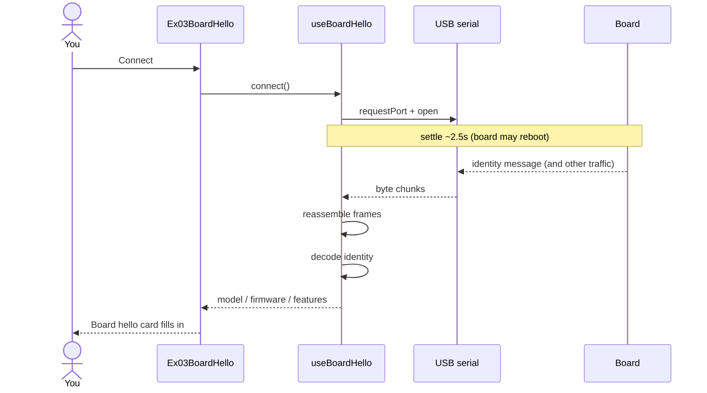
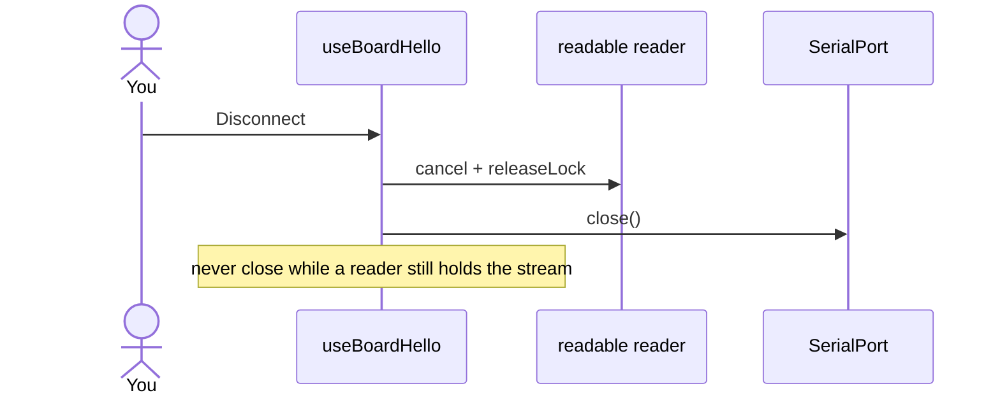

# ex03 — Board hello

**Goal:** after opening the USB port, **listen** until the board sends its
identity message, then show model, firmware, and features.

No commands are sent from the browser yet. The board publishes identity on
its own (boot / settle / about every 10 s).

Enable in [`src/App.tsx`](../../App.tsx): uncomment `Ex03BoardHello`
import + `<Route>`, comment the others.

---

## 1. Learning objectives

| Idea            | In this exercise                                                 |
| --------------- | ---------------------------------------------------------------- |
| Read stream     | Hold one `readable` reader while the port is open                |
| Settle time     | USB open can reset the board — wait ~2.5 s before expecting data |
| Framed messages | Bytes arrive in chunks; a decoder reassembles whole messages     |
| Identity        | Model, firmware string, feature flags come from the board        |
| Clean close     | Release the reader **before** closing the port                   |

**Success:** Connect → wait → “Board said hello” with the correct model
(`es3c28p` or `ws28p`).

---

## 2. Before you start

1. Flash the matching prebuilt image (same as ex02).
2. Quit other serial apps.
3. Chrome / Edge on `localhost`.
4. Prefer the board that matches `WORKSHOP_BOARD_ID` in
   [`src/lib/workshop.ts`](../../lib/workshop.ts).

---

## 3. What you should see

```
┌─────────────────────────────────────┐
│ ex03 · Board hello                  │
│ Hear the board introduce itself     │
├─────────────────────────────────────┤
│ Serial port           [ Connected ] │
│     [ Connect ]  [ Disconnect ]     │
├─────────────────────────────────────┤
│ Board hello                         │
│ Model      es3c28p                  │
│ Firmware   …                        │
│ Features   RGB LED · Microphone …   │
│ Id         ternion-esp32s3-…        │
└─────────────────────────────────────┘
```

---

## 4. Mental model

```
┌────────────┐  USB chunks   ┌──────────────┐  identity   ┌─────────────┐
│  Board     │ ────────────► │ FrameDecoder │ ──────────► │ BoardInfo   │
│  (ESP32)   │               │ lib/wire     │  msg 0x28   │ Card        │
└────────────┘               └──────────────┘             └─────────────┘
       ▲
       │ open / close
┌──────┴───────┐
│ useBoardHello│  ← wraps useSerialPort + listen loop
└──────────────┘
```

Student `index.tsx` only wires the hook to two cards.

---

## 5. Sequence — connect and hello



---

## 6. Sequence — disconnect (order matters)



---

## 7. Files

| File             | Role                          |
| ---------------- | ----------------------------- |
| `index.tsx`      | Student entry — compose cards |
| `Ex03Header.tsx` | Title + copy                  |
| `README.md`      | This guide                    |

| Shared path                     | Role                                              |
| ------------------------------- | ------------------------------------------------- |
| `hooks/useBoardHello.ts`        | Connect + listen for identity                     |
| `hooks/useSerialPort.ts`        | Picker / open / close (921600)                    |
| `lib/wire/*`                    | Frame split + identity decode + golden self-check |
| `components/SerialPortCard.tsx` | Connect UI                                        |
| `components/BoardInfoCard.tsx`  | Identity display                                  |

---

## 8. Checklist

- [ ] Decoder self-check shows **ok**
- [ ] Connect works (same as ex02)
- [ ] After a few seconds, model / firmware appear
- [ ] Features match the board (LED/mic vs motion/clock)
- [ ] Disconnect returns both cards to idle without errors

**Previous:** [ex02 — Web Serial picker](../ex02-web-serial-picker/)  
**Next:** [ex04 — RGB LED](../ex04-rgb-led/)
