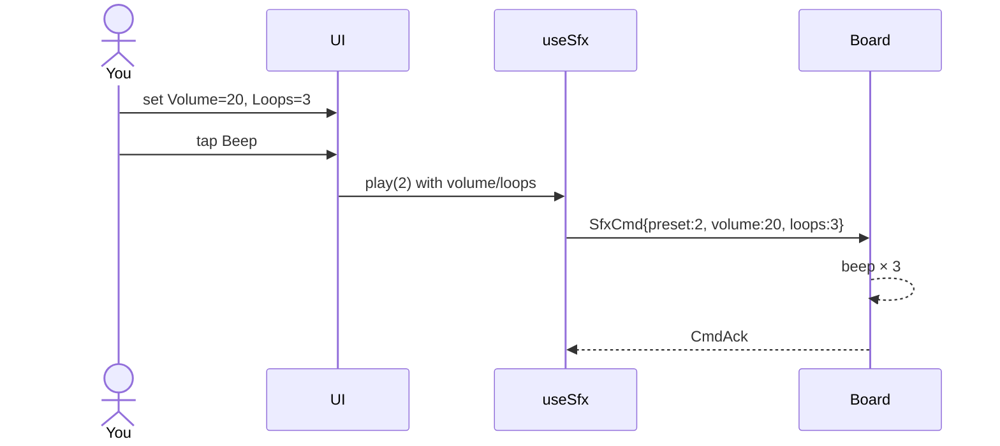

# ex07 — Volume and loops

**Goal:** same `SfxCmd` play path as ex06, but set **Volume** and
**Loops** on the command **before** each play.

Works on **both** board targets (speaker).

Enable in [`src/App.tsx`](../../App.tsx): uncomment `Ex07SfxVolume`
import + `<Route>`, comment the others.

---

## 1. Why this lab?

ex06 only triggered presets. Here you learn that one play message can
carry **parameters** (`volume`, `loops`), not just which sound.

**Success:** Change Volume, play Beep — loudness changes. Set Loops on
a one-shot (e.g. Beep) and hear it repeat that many times. Sirens still
need **Stop** when loops = board default (`0`).

---

## 2. Learning objectives

| Idea | In this exercise |
| ---- | ---------------- |
| `SfxCmd.volume` | 1–100; applied when that play starts (`0` = leave codec unchanged) |
| `SfxCmd.loops` | How many pattern cycles; `0` = preset default |
| Order | Sliders set local state → **Play** sends them together |
| vs live knobs | These are **not** live — they ride on the next play (ex08 is live) |

---

## 3. Before you start

1. Flash matching `firmware-prebuilt/<board>/`.
2. Finish [ex06](../ex06-sfx-play/) first.
3. Chrome/Edge on localhost; quit other serial apps.

---

## 4. What you do

1. Connect → wait for Ready.
2. Set **Volume** (start low, e.g. 10–20).
3. Set **Loops**:
   - `0` / `def` = firmware default (Alarm/sirens/machines keep looping).
   - `1`–`8` = play that many cycles then stop (best tested on Beep/Chime).
4. Tap a preset → hear the change.
5. **Stop** if something is still looping.

---

## 5. Mental model

```
Volume slider ─┐
Loops slider  ─┼─► play(preset, { volume, loops }) ─► SfxCmd 0x84
Preset button ─┘
```



---

## 6. Files

| File | Role |
| ---- | ---- |
| `index.tsx` | Mounts `SfxVolumeCard` |
| `components/sfx/SfxVolumeCard.tsx` | Volume/loops hero + short preset list |
| `Ex07Header.tsx` | Title + copy |
| `README.md` | This guide |

---

## 7. Checklist

- [ ] Quiet volume still audible; higher volume clearly louder
- [ ] Beep with Loops=3 repeats three times then stops
- [ ] Loops=`def` on Ambulance keeps going until Stop
- [ ] Status updates after each play

**Previous:** [ex06 — SFX play](../ex06-sfx-play/)  
**Next:** [ex08 — SFX params](../ex08-sfx-params/)
