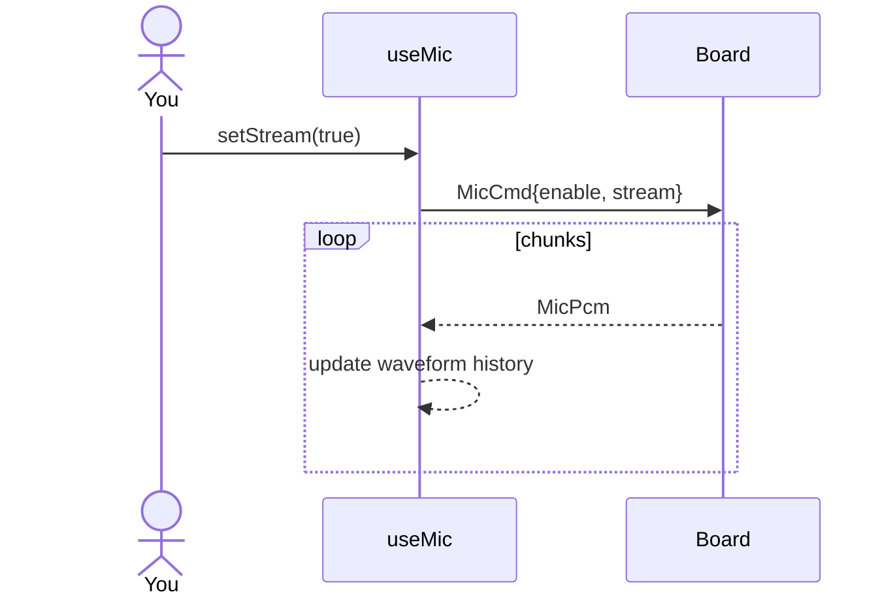

# ex14 — Mic waveform

**Goal:** turn on **PCM streaming** (`MicCmd.stream`) and draw a simple
scrolling **waveform** from `MicPcm` (`0x24`) chunks.

Needs **`es3c28p`**. Heavier USB traffic than level-only labs.

Enable in [`src/App.tsx`](../../App.tsx): uncomment `Ex14MicWave`
import + `<Route>`, comment the others.

---

## 1. Why this lab?

Levels are ~10 Hz summaries. PCM is the **actual samples** (16 kHz mono
int16 chunks). You learn opt-in high-rate uplink and how to keep a UI
responsive (downsample into a short history strip).

**Success:** **Stream PCM** on → green scope line moves with your voice.
Stream off → strip settles. VU can still run alongside.

---

## 2. Learning objectives

| Idea | In this exercise |
| ---- | ---------------- |
| `MicCmd.stream` | Opt-in; don’t leave it on forever in demos |
| `MicPcm` | `seq` + `samples[]` (sint32 carrying int16 range) |
| UI budget | Fold many samples into a fixed-length strip |
| Serial load | PCM is the reason mic stays on Web Serial (not BLE) |

---

## 3. Before you start

1. Flash `firmware-prebuilt/es3c28p/`.
2. Finish [ex13](../ex13-mic-gain/).
3. Prefer a solid USB cable; close other serial users.

---

## 4. What you do

1. Connect → Ready.
2. Tap **Stream PCM** (enables mic + stream).
3. Talk — waveform wiggles.
4. Tap again to turn stream off (or Mic off).

---

## 5. Mental model

```
Mic ──► DSP chain ──┬──► AudioLevel 0x23  (~10 Hz)
                    └──► MicPcm 0x24      (chunks, if stream)
                              │
                              ▼
                         WaveStrip (history)
```



---

## 6. Files

| File | Role |
| ---- | ---- |
| `index.tsx` | `features={{ vu: true, wave: true }}` |
| `useMic.ts` | PCM subscribe → `waveform` |
| `MicControlCard.tsx` | `WaveStrip` SVG |

---

## 7. Checklist

- [ ] Stream on → scope moves with sound
- [ ] Stream off → no new motion
- [ ] Page stays usable (no freeze)

**Previous:** [ex13 — Mic gain](../ex13-mic-gain/)  
**Next:** [ex15 — Mic studio](../ex15-mic-studio/)
