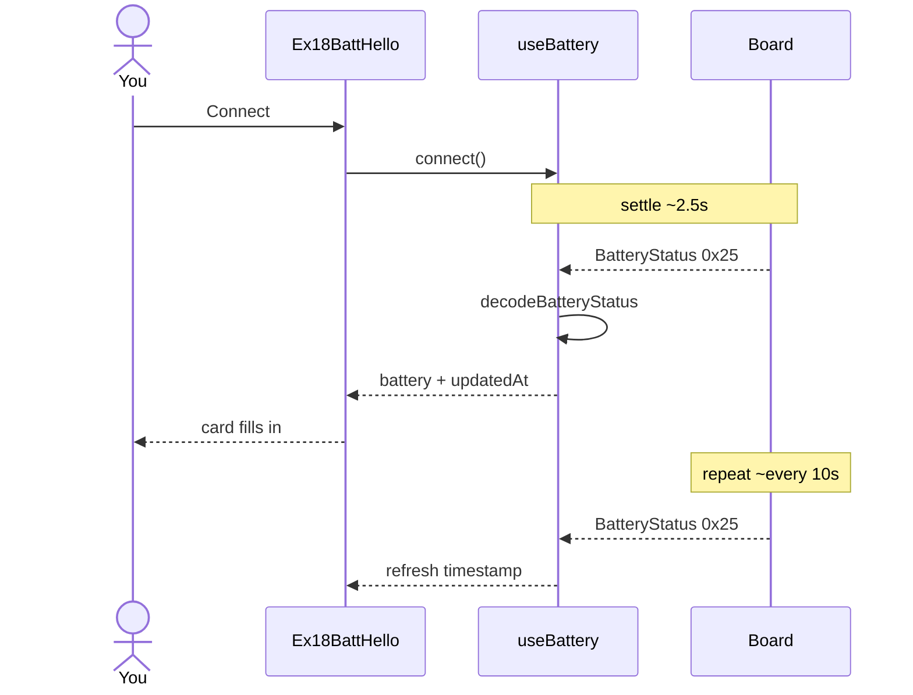

# ex18 — Battery hello

**Goal:** subscribe to **`BatteryStatus`** on `MSG_BATTERY` (`0x25`) and show
pack **millivolts** and **percent**. The board pushes updates on its own
(about every **10 seconds**) — no host poll command.

**Board:** **both** targets include `CAP.BATT` (`es3c28p` and `ws28p`).

Enable in [`src/App.tsx`](../../App.tsx): uncomment `Ex18BattHello` import +
`<Route>`, comment the others.

---

## 1. Learning outcomes

| Idea | In this exercise |
| ---- | ---------------- |
| Slow telemetry | Not every sensor is 50 Hz — battery is periodic |
| Passive listen | Same pattern as ex03 identity and ex16 keys |
| Protobuf fields | `mv`, `pct` on `BatteryStatus` |
| Staleness UI | `updatedAt` timestamp when the last frame arrived |
| Capability gate | `boardHas(CAP.BATT)` messaging when unsupported |

**Success:** After connect and settle, voltage and percent appear and refresh
roughly every ten seconds.

---

## 2. Theory

### BatteryStatus

Firmware samples the pack (or USB power path, depending on hardware) and
emits framed messages:

| Constant | Value | Payload |
| -------- | ----- | ------- |
| `MSG_BATTERY` | `0x25` | Protobuf `BatteryStatus`: `mv`, `pct` |

The host **never** requests a reading in this lab — `useBattery` only filters
`frame.msgType === MSG_BATTERY` in `subscribe`.

Percent is clamped to 0–100 in [`lib/wire/battery.ts`](../../lib/wire/battery.ts).

### Why ~10 s?

Aggressive battery polling over USB wastes power and bandwidth. Workshop
firmware uses a conservative interval so you can leave the page open during
other labs without spamming the decoder.

---

## 3. Before you start

1. Flash matching prebuilt:
   - `firmware-prebuilt/es3c28p/` or
   - `firmware-prebuilt/ws28p/`
2. Align `WORKSHOP_BOARD_ID` in [`src/lib/workshop.ts`](../../lib/workshop.ts).
3. USB power vs battery: readings still update; interpret `mv` in context of
   how the board is powered.

---

## 4. What you should see

```
┌─────────────────────────────────────┐
│ ex18 - Battery hello                │
│ Read battery status                 │
├─────────────────────────────────────┤
│ Serial port           [ Connected ] │
├─────────────────────────────────────┤
│ Battery                             │
│ Millivolts     3850 mV              │
│ Percent        72 %                 │
│ Updated        just now             │
│ Hint           updates ~every 10 s  │
└─────────────────────────────────────┘
```

Values depend on your hardware and charge state.

---

## 5. Mental model

```
┌────────────┐  BatteryStatus 0x25   ┌──────────────┐   ┌──────────────┐
│  Board ADC │ ────────────────────► │ useBattery   │ ─►│ BatteryCard  │
│  ~10 s     │                       │ subscribe    │   │ mv / pct     │
└────────────┘                       └──────────────┘   └──────────────┘
```

---

## 6. Sequence — wait for first status



---

## 7. Files

| File | Role |
| ---- | ---- |
| `index.tsx` | Serial + battery card |
| `Ex18Header.tsx` | Title and copy |
| `README.md` | This guide |

| Shared path | Role |
| ----------- | ---- |
| `hooks/useBattery.ts` | Subscribe `MSG_BATTERY` |
| `lib/wire/battery.ts` | `MSG_BATTERY`, decode |
| `components/BatteryCard.tsx` | Readout + hints |
| `components/SerialPortCard.tsx` | Connect UI |
| `lib/workshop.ts` | `CAP.BATT` |

---

## 8. Checklist

- [ ] Connect → Ready
- [ ] First `BatteryStatus` within ~10 s (often sooner after boot)
- [ ] `updatedAt` changes on later frames
- [ ] Percent between 0 and 100
- [ ] Clean disconnect

---

## 9. Common pitfalls

| Symptom | Likely cause |
| ------- | ------------ |
| “Waiting for first…” forever | Wrong firmware; or `CAP.BATT` mismatch in workshop.ts |
| Values frozen | Board stopped publishing — reconnect USB |
| Percent jumps oddly | Fuel gauge estimate on real pack; USB-only power may look “full” |
| Comparing to multimeter | Board reports pack node, not bench supply |

---

**Previous:** [ex17 — Key action](../ex17-key-action/)  
**Next:** [ex19 — Battery warn](../ex19-batt-warn/)
