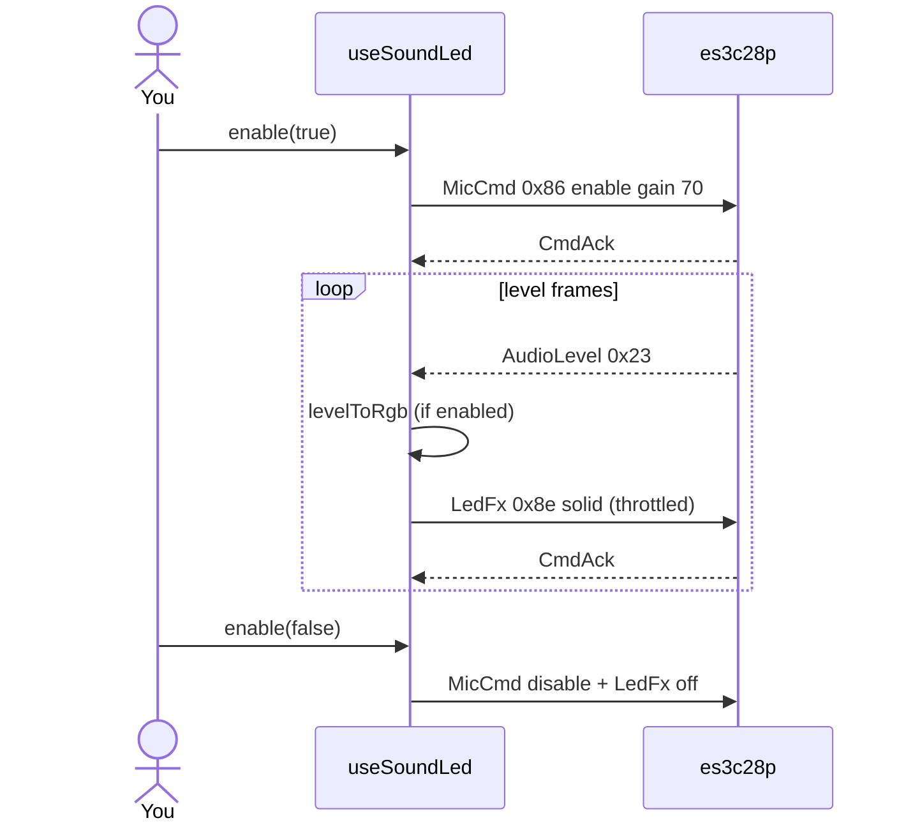

# ex23 — Sound-reactive LED

**Goal:** enable the MEMS mic with **`MicCmd`** (`0x86`), subscribe to
**`AudioLevel`** (`0x23`), map level to an RGB color, and drive the LED with
**`LedFx`** solid (`0x8e`) — throttled to ~**80 ms** between LED writes. One
session; mic in, LED out.

**Board:** **`es3c28p` only** — needs **`CAP.MIC`** and **`CAP.LED`**. Flash
**`firmware-prebuilt/es3c28p/`** and set `WORKSHOP_BOARD_ID` to **`es3c28p`**.

Enable in [`src/App.tsx`](../../App.tsx): uncomment `Ex23SoundLed` import +
`<Route>`, comment the others. `SerialPortCard` uses **`serialOnly`** (PCM
labs pattern; this lab uses level, not PCM stream).

---

## 1. Learning outcomes

| Idea | In this exercise |
| ---- | ---------------- |
| Sensor → actuator | AudioLevel drives LED without storing PCM |
| Mic enable path | `encodeMicCmd({ enable: true, gainPct: 70 })` |
| Rate limiting | Avoid flooding USB with LedFx every level frame |
| Color mapping | Quiet → blue-ish; loud → red (see `levelToRgb`) |
| Clean disable | Mic off → `LedFx` off |

**Success:** Enable mic → speak/clap → LED color and on-screen RGB swatch
track loudness.

---

## 2. Theory

### Message flow

| Constant | Value | Direction | Role |
| -------- | ----- | --------- | ---- |
| `MSG_MIC_CMD` | `0x86` | Host → board | Enable / disable mic |
| `MSG_AUDIO_LEVEL` | `0x23` | Board → host | `peak`, `rms` for VU |
| `MSG_LED_FX` | `0x8e` | Host → board | Solid RGB from level |
| `MSG_CMD_ACK` | `0x27` | Board → host | MicCmd and LedFx acks |

Level percent uses `levelToPercent(lv.peak || lv.rms)` from
[`lib/wire/mic.ts`](../../lib/wire/mic.ts).

### Why throttle LED writes?

AudioLevel can arrive faster than useful for RGB updates. `useSoundLed` skips
`LedFx` if the last send was **< 80 ms** ago — reduces USB load and flicker.

```
AudioLevel 0x23 ──► pct ──► levelToRgb ──► LedFx 0x8e (max ~12 Hz)
```

---

## 3. Before you start

1. Flash **`firmware-prebuilt/es3c28p/`**.
2. `WORKSHOP_BOARD_ID = "es3c28p"` in [`src/lib/workshop.ts`](../../lib/workshop.ts).
3. Review ex11–ex12 (mic enable + level) and ex04–ex05 (LED).

---

## 4. What you should see

```
┌─────────────────────────────────────┐
│ ex23 - Sound-reactive LED           │
│ Mic level drives RGB color          │
├─────────────────────────────────────┤
│ Serial port (USB)     [ Connected ] │
├─────────────────────────────────────┤
│ Sound → LED                         │
│ [ ] Enable mic                      │
│ Level bar / peak                    │
│ RGB preview    swatch               │
│ Physical LED   matches loudness     │
└─────────────────────────────────────┘
```

---

## 5. Mental model

```
┌────────────┐  AudioLevel 0x23      ┌──────────────┐   ┌──────────────┐
│    Mic     │ ────────────────────► │ useSoundLed  │ ─►│   RGB LED    │
└────────────┘                       └──────────────┘   └──────────────┘
     MicCmd 0x86 enable from host UI (toggle)
```

---

## 6. Sequence — enable and first level



---

## 7. Files

| File | Role |
| ---- | ---- |
| `index.tsx` | `serialOnly` on port card + `SoundLedCard` |
| `Ex23Header.tsx` | Title and copy |
| `README.md` | This guide |

| Shared path | Role |
| ----------- | ---- |
| `hooks/useSoundLed.ts` | Mic + level + LED map |
| `lib/wire/mic.ts` | `MSG_MIC_CMD`, `MSG_AUDIO_LEVEL` |
| `lib/wire/led.ts` | `MSG_LED_FX` |
| `components/SoundLedCard.tsx` | Enable toggle + level UI |
| `lib/workshop.ts` | `CAP.MIC`, `CAP.LED` |

---

## 8. Checklist

- [ ] Wrong target shows “Needs es3c28p”
- [ ] Enable mic → level meter moves
- [ ] LED color shifts when you speak
- [ ] Disable mic → LED off
- [ ] Disconnect with mic disabled first (good habit)

---

## 9. Common pitfalls

| Symptom | Likely cause |
| ------- | ------------ |
| Level works, LED dark | `ledSupported` false — ws28p has no RGB |
| LED stuck one color | Enable off without disconnect — toggle enable |
| Flickery LED | Normal at threshold; throttle limits but not eliminated |
| No level | Mic not enabled or gain zero — check MicCmd ack |
| ws28p user | Switch board — this lab is intentionally es3c28p |

---

**Previous:** [ex22 — RTC sync](../ex22-rtc-sync/)  
**Next:** [ex24 — Button appliance](../ex24-button-appliance/)
