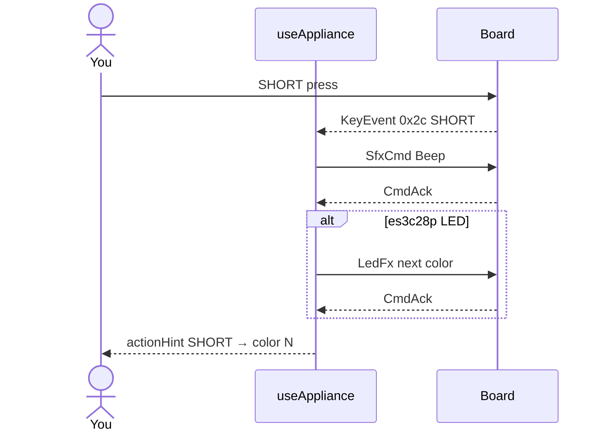

# ex24 — Button appliance

**Goal:** map **`KeyEvent`** gestures to a small **appliance** — one button,
multiple behaviors:

| Gesture | Action |
| ------- | ------ |
| **SHORT** | Next palette color on RGB LED + **Beep** |
| **DOUBLE** | **Chime** |
| **LONG** | **SfxStop** + LED off |

**Board:** **`CAP.BTN`** on both targets. **LED color cycle** when
`boardHas(CAP.LED)` (**es3c28p**). **ws28p** still gets SFX on SHORT/DOUBLE/LONG
without LED changes.

Enable in [`src/App.tsx`](../../App.tsx): uncomment `Ex24ButtonAppliance`
import + `<Route>`, comment the others.

---

## 1. Learning outcomes

| Idea | In this exercise |
| ---- | ---------------- |
| Gesture router | Single subscribe, branch on `KEY_EV` |
| State machine lite | `colorIndex` / `colorRef` for SHORT rotation |
| SFX variety | Beep, Chime, Stop presets on `MSG_SFX_CMD` (`0x84`) |
| Product UX | `actionHint` documents what fired |
| ex17 + ex16 compose | Keys + LED + SFX in one hook |

**Success:** SHORT cycles four colors (es3c28p) with Beep; DOUBLE plays Chime;
LONG stops sound and turns LED off.

---

## 2. Theory

### Appliance table (implementation)

From [`hooks/useAppliance.ts`](../../hooks/useAppliance.ts):

```
SHORT  → colorIndex = (colorIndex + 1) % 4
         SfxCmd Beep + LedFx solid COLORS[index]  (if LED)
DOUBLE → SfxCmd Chime
LONG   → SfxCmd Stop + LedFx off                 (if LED)
```

| Message | Value | Use |
| ------- | ----- | --- |
| `MSG_KEY_EVENT` | `0x2c` | Input |
| `MSG_SFX_CMD` | `0x84` | Beep / Chime / Stop |
| `MSG_LED_FX` | `0x8e` | Solid / off |
| `MSG_CMD_ACK` | `0x27` | Await each write |

Key labels: **BOOT** on es3c28p; **PWR** or **BOOT** on ws28p.

---

## 3. Before you start

1. Flash **`firmware-prebuilt/es3c28p/`** for the full appliance, or **ws28p**
   for audio-only mapping.
2. Match `WORKSHOP_BOARD_ID` in [`src/lib/workshop.ts`](../../lib/workshop.ts).
3. Finish ex16–ex17 so key gestures feel familiar.

---

## 4. What you should see

```
┌─────────────────────────────────────┐
│ ex24 - Button appliance             │
│ SHORT / DOUBLE / LONG mappings      │
├─────────────────────────────────────┤
│ Serial port           [ Connected ] │
├─────────────────────────────────────┤
│ Key events                          │
│ Hint   SHORT=color+Beep, etc.       │
│ Action BOOT DOUBLE → Chime          │
│        Color index 2/4              │
└─────────────────────────────────────┘
```

---

## 5. Mental model

```
┌────────────┐  KeyEvent 0x2c        ┌──────────────┐   ┌──────────────┐
│   Board    │ ────────────────────► │ useAppliance │ ─►│  SFX + LED   │
└────────────┘                       └──────────────┘   └──────────────┘
```

---

## 6. Sequence — SHORT cycles color



---

## 7. Files

| File | Role |
| ---- | ---- |
| `index.tsx` | Key card with `appMessage` + color hint |
| `Ex24Header.tsx` | Title and copy |
| `README.md` | This guide |

| Shared path | Role |
| ----------- | ---- |
| `hooks/useAppliance.ts` | Gesture → SFX + LED |
| `lib/wire/key.ts` | `KEY_EV`, decode |
| `lib/wire/sfx.ts` | Beep, Chime, Stop |
| `lib/wire/led.ts` | Solid palette, off |
| `components/KeyEventCard.tsx` | Log + hints |

---

## 8. Checklist

- [ ] SHORT → Beep every time
- [ ] On es3c28p, LED color advances (4 colors)
- [ ] DOUBLE → Chime (no color change required)
- [ ] LONG → audio stops, LED off on es3c28p
- [ ] Hint shows `Color index n/4` when LED supported

---

## 9. Common pitfalls

| Symptom | Likely cause |
| ------- | ------------ |
| SHORT only Beep, no color | ws28p or LED cap off — expected |
| DOUBLE triggers SHORT twice | Tap timing — board decides DOUBLE vs two SHORTs |
| LONG ignored | Release timing — hold longer |
| Stuck Chime | LONG not sent — use LONG for Stop |
| Overlapping commands | Async handler — disconnect resets state |

---

**Previous:** [ex23 — Sound-reactive LED](../ex23-sound-led/)  
**Next:** [ex25 — Caps gate](../ex25-caps-gate/)
