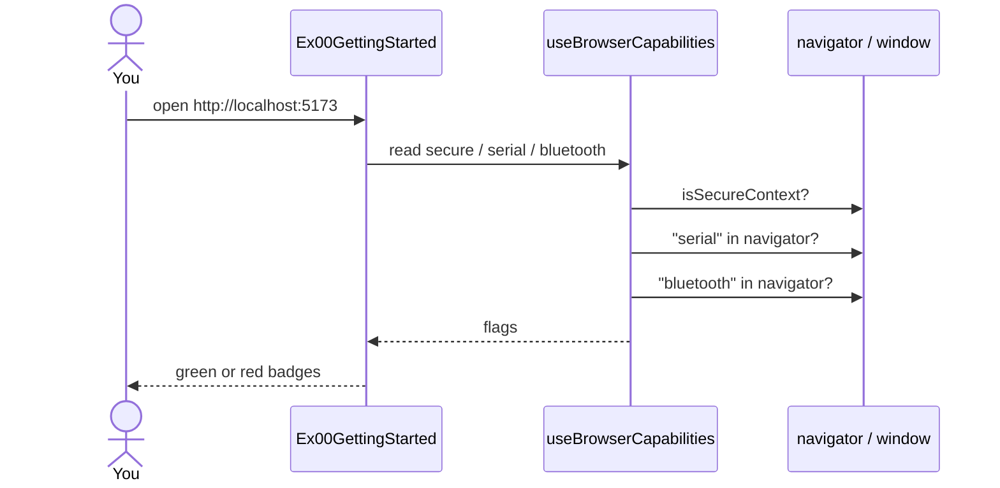

# ex00 — Getting started

<div class="ebook-run">

**Track:** `react` · **Project:** `demos` · **Port:** `5173`

```text
cd demos
vp install   # first time
vp dev
# enable ex00-getting-started in demos/src/App.tsx (import + <Route>)
# match WORKSHOP_BOARD_ID in demos/src/lib/workshop.ts
```

<p class="ebook-source"><strong>Source:</strong> <code>demos/src/pages/ex00-getting-started/README.md</code></p>

</div>


**Goal:** understand the workshop layout, pick a board target, and confirm
your browser can use **Web Serial** and **Web Bluetooth**.

This lab does **not** talk to the board yet. It is a readiness check before
you open a USB port (ex02) or send messages.

Enable in [`src/App.tsx`](../../../../demos/src/App.tsx): uncomment the `Ex00GettingStarted`
import + `<Route>`, comment the others.

---

## 1. Learning objectives

| Idea              | In this exercise                                                     |
| ----------------- | -------------------------------------------------------------------- |
| Workshop shape    | Thin `index.tsx` + local helpers + shared components/hooks           |
| Board targets     | `es3c28p` (LED + mic) vs `ws28p` (motion + clock; no LED/mic)        |
| Secure context    | Serial/Bluetooth need `localhost` or HTTPS                           |
| Capability badges | Green = API present; red = use Chrome/Edge or fix context            |
| Two pipes         | USB cable (Serial) and wireless (Bluetooth) — same board, later labs |

**Success:** all three badges you care about are green (secure context,
Web Serial, and ideally Web Bluetooth), and you know which board folder to
flash.

---

## 2. What you should see

```
┌─────────────────────────────────────────────────────────────┐
│ ex00 · Getting started                                      │
│ Drive es3c28p from the browser                              │
├─────────────────────────────────────────────────────────────┤
│ Board · es3c28p                                             │
│  [ RGB LED ]  [ Microphone ]  [ Speaker ]                   │
├─────────────────────────────────────────────────────────────┤
│ Browser capabilities                                        │
│  [✓ Secure context]  [✓ Web Serial]  [✓ Web Bluetooth]      │
├──────────────────────┬──────────────────────────────────────┤
│ Web Serial           │ Web Bluetooth                        │
│ USB cable to board   │ Wireless link to board               │
└──────────────────────┴──────────────────────────────────────┘
```

If a badge is red: switch to Chrome or Edge, open the app on
`http://localhost:…`, and retry.

---

## 3. Mental model — where this page sits

```
┌──────────────┐     switch in App.tsx      ┌──────────────────────┐
│   App.tsx    │ ─────────────────────────► │  active exNN page    │
│  one Route   │                            │  (this folder)       │
└──────────────┘                            └──────────┬───────────┘
                                                       │
                       ┌───────────────────────────────┼───────────────┐
                       ▼                               ▼               ▼
              ┌────────────────┐              ┌──────────────┐  ┌────────────┐
              │ shared comps   │              │ local Ex00*  │  │ lib/       │
              │ BoardSummary   │              │ Header       │  │ workshop   │
              │ BrowserCaps…   │              │ SwitchHint   │  │ board id   │
              └────────────────┘              └──────────────┘  └────────────┘
```

Student file `index.tsx` only **composes** pieces. Long copy lives in
`Ex00Header.tsx` / `Ex00SwitchHint.tsx` so you do not edit walls of JSX.

---

## 4. Sequence — page load (capability check)



No USB dialog appears in ex00. The picker comes in **ex02**.

---

## 5. Board targets

Switch in [`src/lib/workshop.ts`](../../../../demos/src/lib/workshop.ts)
(`WORKSHOP_BOARD_ID`) — same comment/uncomment style as `App.tsx`.

| Board               | Flash folder                 | Has                                    | Does not have       |
| ------------------- | ---------------------------- | -------------------------------------- | ------------------- |
| `es3c28p` (default) | `firmware-prebuilt/es3c28p/` | RGB LED, microphone, speaker           | motion sensor       |
| `ws28p`             | `firmware-prebuilt/ws28p/`   | motion sensor, clock, battery, speaker | RGB LED, microphone |

```
┌────────────────────┐         ┌────────────────────┐
│     es3c28p        │         │       ws28p        │
│  caps focus: LED   │         │  caps focus: IMU   │
│  + mic             │         │  + clock           │
│                    │         │                    │
│  later: LED labs   │         │  later: motion     │
│  + mic labs        │         │  labs              │
└────────────────────┘         └────────────────────┘
         ▲                              ▲
         │     same browser labs        │
         └──────────┬───────────────────┘
                    │
           gate UI with boardHas()
```

Flash notes: [`firmware-prebuilt/README.md`](../../../../firmware-prebuilt/README.md).

---

## 6. Files in this folder

| File                 | Role                                  |
| -------------------- | ------------------------------------- |
| `index.tsx`          | Student entry — compose sections only |
| `Ex00Header.tsx`     | Title + intro copy                    |
| `Ex00SwitchHint.tsx` | How to switch examples in `App.tsx`   |
| `README.md`          | This guide                            |

Shared pieces used here:

| Path                                 | Role                               |
| ------------------------------------ | ---------------------------------- |
| `components/BoardSummary.tsx`        | Features for the active board      |
| `components/BrowserCapabilities.tsx` | Secure / Serial / Bluetooth badges |
| `components/TransportCards.tsx`      | USB vs wireless intro              |
| `hooks/useBrowserCapabilities.ts`    | Reads capability flags             |
| `lib/workshop.ts`                    | Board id, features, `boardHas()`   |

---

## 7. How to run

```bash
cd hardware-interface-workshop/demos
npm install
npx vp dev
```

In `src/App.tsx`, enable only ex00. Open the URL Vite prints (use
Chrome or Edge).

---

## 8. Checklist

- [ ] App runs on `localhost` (or HTTPS)
- [ ] Secure context badge is green
- [ ] Web Serial badge is green
- [ ] You know which board you will flash (`es3c28p` or `ws28p`)
- [ ] You can find how to switch examples in `App.tsx`

**Next:** [ex01 — React component](../../generated/react/ex01-react-component/index.md)
