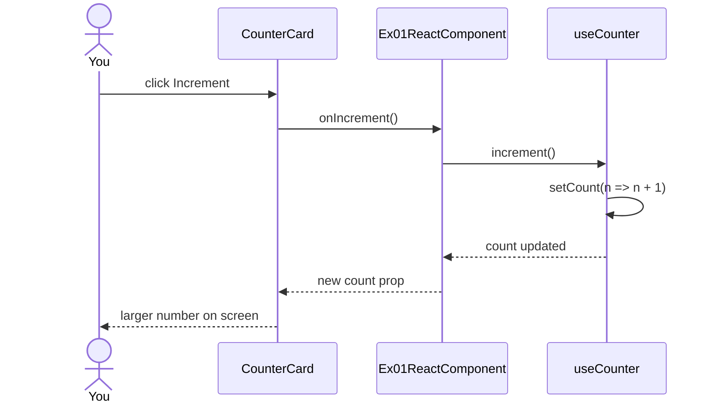

# ex01 — React component

<div class="ebook-run">

**Track:** `react` · **Project:** `demos` · **Port:** `5173`

```text
cd demos
vp install   # first time
vp dev
# enable ex01-react-component in demos/src/App.tsx (import + <Route>)
# match WORKSHOP_BOARD_ID in demos/src/lib/workshop.ts
```

<p class="ebook-source"><strong>Source:</strong> <code>demos/src/pages/ex01-react-component/README.md</code></p>

</div>


**Goal:** practice a tiny React page: a custom hook for state, a presentational
card, and props / callbacks — before any USB or Bluetooth.

Enable in [`src/App.tsx`](../../../../demos/src/App.tsx): uncomment `Ex01ReactComponent`
import + `<Route>`, comment the others.

---

## 1. Learning objectives

| Idea              | In this exercise                           |
| ----------------- | ------------------------------------------ |
| Compose a page    | `LabPage` + header + one interactive card  |
| Local state       | `useCounter` wraps `useState`              |
| Props down        | `count`, `title` into `CounterCard`        |
| Events up         | `onIncrement` / `onReset` callbacks        |
| Thin student file | Logic and styling live outside `index.tsx` |

**Success:** clicking **Increment** raises the number; **Reset** returns to 0.

---

## 2. What you should see

```
┌─────────────────────────────────────┐
│ ex01 · React component              │
│ Build a small UI brick              │
├─────────────────────────────────────┤
│ Click counter                       │
│                                     │
│                 8                   │
│                                     │
│     [ Increment ]  [ Reset ]        │
└─────────────────────────────────────┘
```

---

## 3. Mental model — data flow

```
┌──────────────────┐  count, callbacks   ┌────────────────┐
│  useCounter()    │ ──────────────────► │  CounterCard   │
│  count           │                     │  shows number  │
│  increment()     │ ◄── onIncrement ─── │  two buttons   │
│  reset()         │ ◄── onReset ─────── │                │
└──────────────────┘                     └────────────────┘
         ▲
         │ used by
┌────────┴─────────┐
│ Ex01ReactComponent│  ← you edit this file (keep it short)
│ index.tsx         │
└──────────────────┘
```

State lives in the hook. The card does not own the number — it only
displays and asks to change it.

---

## 4. Sequence — click Increment



Reset follows the same path with `reset()` → `setCount(0)`.

---

## 5. Files in this folder

| File             | Role                             |
| ---------------- | -------------------------------- |
| `index.tsx`      | Student entry — wire hook → card |
| `Ex01Header.tsx` | Title + short description        |
| `README.md`      | This guide                       |

Shared pieces:

| Path                           | Role                            |
| ------------------------------ | ------------------------------- |
| `hooks/useCounter.ts`          | `count` / `increment` / `reset` |
| `components/CounterCard.tsx`   | Display + buttons               |
| `components/lab/LabPage.tsx`   | Page width / padding shell      |
| `components/lab/LabHeader.tsx` | Standard title block            |

---

## 6. Try this (optional)

Edit only `index.tsx` or the hook — keep the card reusable:

1. Start the counter at `10` → `useCounter(10)`.
2. Add a second card on the same page with its **own** `useCounter()` — each
   card should count independently.
3. Change the title string passed to `CounterCard`.

---

## 7. How to run

```bash
cd hardware-interface-workshop/demos
npx vp dev
```

Enable only ex01 in `src/App.tsx`.

---

## 8. Checklist

- [ ] Increment updates the number
- [ ] Reset returns to the starting value
- [ ] You can point to where state lives (`useCounter`) vs UI (`CounterCard`)
- [ ] `index.tsx` stays a short composition

**Previous:** [ex00 — Getting started](../../generated/react/ex00-getting-started/index.md)  
**Next:** [ex02 — Web Serial picker](../../generated/react/ex02-web-serial-picker/index.md)
