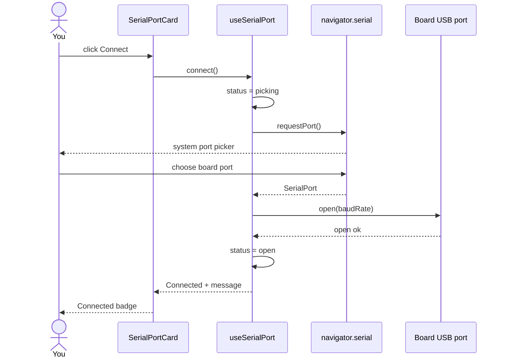
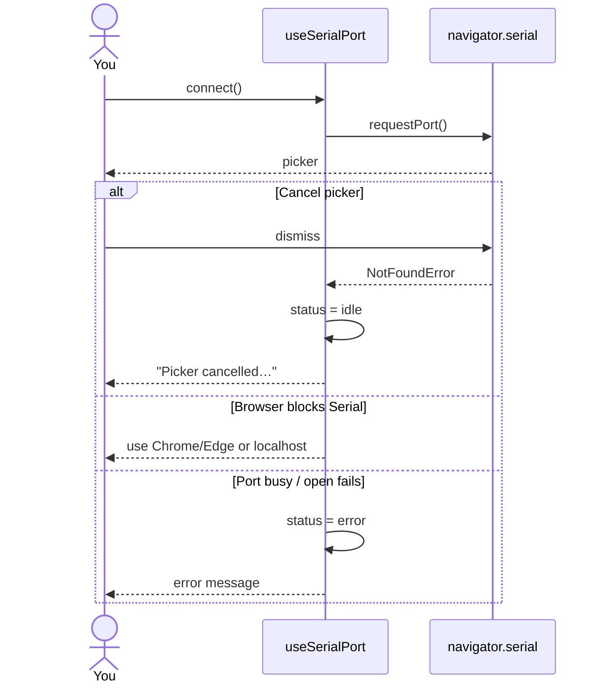
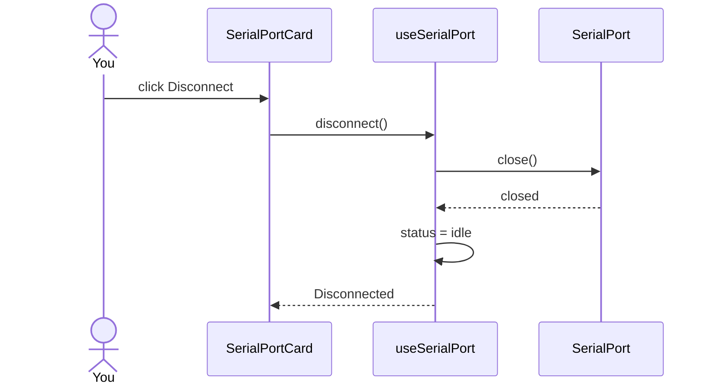

# ex02 — Web Serial picker

<div class="ebook-run">

**Track:** `react` · **Project:** `demos` · **Port:** `5173`

```text
cd demos
vp install   # first time
vp dev
# enable ex02-web-serial-picker in demos/src/App.tsx (import + <Route>)
# match WORKSHOP_BOARD_ID in demos/src/lib/workshop.ts
```

<p class="ebook-source"><strong>Source:</strong> <code>demos/src/pages/ex02-web-serial-picker/README.md</code></p>

</div>


**Goal:** use the browser’s **Web Serial** picker to claim the board’s USB
port, open it, then disconnect. No board messages yet — only connect /
disconnect.

Enable in [`src/App.tsx`](../../../../demos/src/App.tsx): uncomment `Ex02WebSerialPicker`
import + `<Route>`, comment the others.

---

## 1. Learning objectives

| Idea           | In this exercise                                  |
| -------------- | ------------------------------------------------- |
| User gesture   | `requestPort()` only works from a button click    |
| Secure context | Needs `localhost` or HTTPS + Chrome/Edge          |
| Open / close   | Browser opens the port; you must close when done  |
| Cancel         | Closing the picker is normal — not a hard failure |
| Thin page      | Hook owns status; card shows Connect / Disconnect |

**Success:** after flashing the board and quitting other serial apps, Connect
opens a picker, you choose the port, status shows connected, Disconnect
releases it.

---

## 2. Before you connect

1. Flash the matching prebuilt image (`es3c28p` or `ws28p`) — see
   [`firmware-prebuilt/README.md`](../../../../firmware-prebuilt/README.md).
2. Plug the USB cable (USB-Serial/JTAG).
3. Close any serial monitor, IDE monitor, or other app using that port.
4. Use **Chrome** or **Edge** on `http://localhost:…`.

```
┌─────────────┐     USB      ┌──────────────────┐
│   Browser   │ ◄──────────► │  Board (ESP32-S3)│
│  this lab   │   serial     │  prebuilt image  │
└─────────────┘              └──────────────────┘
       ▲
       │ must be free
┌──────┴──────┐
│ other apps  │  ← close these first
│ (monitor…)  │
└─────────────┘
```

---

## 3. What you should see

```
┌─────────────────────────────────────┐
│ ex02 · Web Serial picker            │
│ Claim the USB serial port           │
├─────────────────────────────────────┤
│ Serial port              [ Idle ]   │
│ Click Connect to open the picker.   │
│                                     │
│     [ Connect ]  [ Disconnect ]     │
└─────────────────────────────────────┘
```

After a successful Connect, the badge turns connected and Disconnect
becomes enabled.

---

## 4. Mental model — who owns the port

```
┌──────────────────┐   status, connect()   ┌─────────────────┐
│  useSerialPort() │ ────────────────────► │ SerialPortCard  │
│  status          │                       │ Connect button  │
│  connect()       │ ◄── click Connect ─── │ Disconnect btn  │
│  disconnect()    │ ◄── click Disconnect─ │ message line    │
└────────┬─────────┘                       └─────────────────┘
         │
         │ navigator.serial.requestPort()
         │ port.open({ baudRate })
         ▼
┌──────────────────┐
│  Browser Serial  │
│  API + OS driver │
└────────┬─────────┘
         │ USB
         ▼
┌──────────────────┐
│      Board       │
└──────────────────┘
```

---

## 5. Sequence — Connect (happy path)



---

## 6. Sequence — cancel or error



---

## 7. Sequence — Disconnect



Always disconnect before unplugging or opening another serial tool.

---

## 8. Files in this folder

| File             | Role                                               |
| ---------------- | -------------------------------------------------- |
| `index.tsx`      | Student entry — `useSerialPort` → `SerialPortCard` |
| `Ex02Header.tsx` | Title + short description                          |
| `README.md`      | This guide                                         |

Shared pieces:

| Path                            | Role                                         |
| ------------------------------- | -------------------------------------------- |
| `hooks/useSerialPort.ts`        | Picker, open, close, status, messages        |
| `components/SerialPortCard.tsx` | Connect / Disconnect UI                      |
| `lib/browser.ts`                | Secure context + Serial availability helpers |

---

## 9. Status cheat sheet

| Status    | Meaning                                     |
| --------- | ------------------------------------------- |
| `idle`    | Not connected (or picker cancelled)         |
| `picking` | System picker is open                       |
| `open`    | Port is open — use Disconnect when done     |
| `error`   | Unsupported browser/context, or open failed |

---

## 10. How to run

```bash
cd hardware-interface-workshop/demos
npx vp dev
```

Enable only ex02 in `src/App.tsx`.

---

## 11. Checklist

- [ ] Board flashed; other serial apps closed
- [ ] Chrome/Edge on localhost
- [ ] Connect shows the system picker
- [ ] Choosing a port shows Connected
- [ ] Canceling the picker shows a calm cancel message
- [ ] Disconnect returns to Idle

**Previous:** [ex01 — React component](../../generated/react/ex01-react-component/index.md)  
**Next:** [ex03 — Board hello](../../generated/react/ex03-board-hello/index.md)
