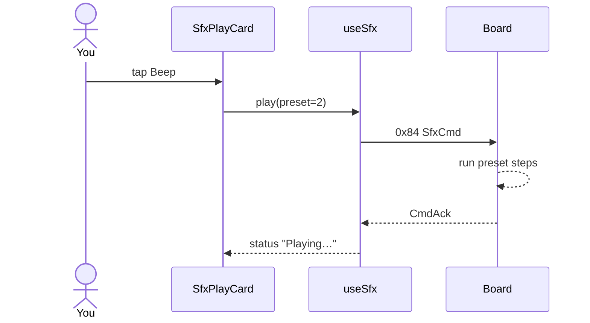

# ex06 — Play a board sound

<div class="ebook-run">

**Track:** `react` · **Project:** `demos` · **Port:** `5173`

```text
cd demos
vp install   # first time
vp dev
# enable ex06-sfx-play in demos/src/App.tsx (import + <Route>)
# match WORKSHOP_BOARD_ID in demos/src/lib/workshop.ts
```

<p class="ebook-source"><strong>Source:</strong> <code>demos/src/pages/ex06-sfx-play/README.md</code></p>

</div>


**Goal:** send the first **speaker** command over Web Serial — tap a
built-in pad (Chime, Alarm, Beep, chirps) and **Stop**. Sirens and the
full studio wait for later labs.

Works on **both** `es3c28p` and `ws28p` (speaker on both).

Enable in [`src/App.tsx`](../../../../demos/src/App.tsx): uncomment `Ex06SfxPlay`
import + `<Route>`, comment the others.

---

## 1. Why this lab?

Same idea as ex04 for the LED: the **host tells the board to actuate**.
Here the actuator is the speaker. You learn `SfxCmd` (`0x84`) before
volume knobs, live DSP, or custom melodies.

**Success:** Connect, wait until Ready, tap **Beep** (or Chime), hear
the board; **Stop** silences a looping **Alarm**.

Keep **Volume** low (desk-safe). Default starts quiet on purpose.

---

## 2. Learning objectives

| Idea | In this exercise |
| ---- | ---------------- |
| Host → board play | Framed `SfxCmd` with a `preset` id |
| CmdAck | Board confirms each command |
| Stop | `preset = 255` ends the sequencer |
| Shared session | One `useSerialSession` for read + write |

---

## 3. Before you start

1. Flash matching `firmware-prebuilt/<board>/` (`robotos_serial_bridge`).
2. Set `WORKSHOP_BOARD_ID` in [`workshop.ts`](../../../../demos/src/lib/workshop.ts).
3. Chrome/Edge on localhost; quit other serial apps.

---

## 4. What you should see

```
┌─────────────────────────────────────────┐
│ ex06 · Play a board sound               │
├─────────────────────────────────────────┤
│ Serial port              [ Connected ]  │
├─────────────────────────────────────────┤
│ Tap a sound                             │
│  [Chime] [Alarm] [Beep]                 │
│  Chirp pair: [Chirp ↑] [Chirp ↓]        │
│  Volume ════⬤════════                   │
│            [ Stop ]                     │
└─────────────────────────────────────────┘
```

---

## 5. Presets in this UI (wire ids)

| Id | Pad | Notes |
| -- | --- | ----- |
| 0 | Chime | Boot-style melody |
| 1 | Alarm | Two-tone; loops by default |
| 2 | Beep | One short tone |
| 4 / 5 | Chirp ↑ / ↓ | Same pitches, opposite order |
| 255 | Stop | Ends playback |

Sirens / machines / user slot appear in ex07–ex10 — not on this card.

---

## 6. Mental model

```
┌──────────────┐  SfxCmd 0x84   ┌──────────────┐
│ Preset button│ ─────────────► │ Board seq +  │
│ / Stop       │                │ codec/speaker│
└──────────────┘                └──────────────┘
         ▲ CmdAck 0x27
```



---

## 7. Files

| File | Role |
| ---- | ---- |
| `index.tsx` | Student entry |
| `Ex06Header.tsx` | Title + copy |
| `README.md` | This guide |

| Shared | Role |
| ------ | ---- |
| `hooks/useSfx.ts` | play / stop + ack |
| `lib/wire/sfx.ts` | encode + preset ids |
| `components/sfx/SfxPlayCard.tsx` | Pads + volume + Stop (play-only UI) |

---

## 8. Checklist

- [ ] Connected and settled; controls visible
- [ ] Beep / Chime audible at low volume
- [ ] Chirp ↑ and Chirp ↓ clearly different directions
- [ ] **Stop** ends a looping Alarm
- [ ] Disconnect works

**Previous:** [ex05 — LED studio](../../generated/react/ex05-led-studio/index.md)  
**Next:** [ex07 — SFX volume](../../generated/react/ex07-sfx-volume/index.md)
