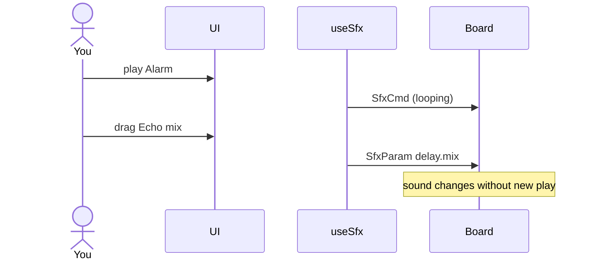

# ex08 — Live sound knobs

<div class="ebook-run">

**Track:** `react` · **Project:** `demos` · **Port:** `5173`

```text
cd demos
vp install   # first time
vp dev
# enable ex08-sfx-params in demos/src/App.tsx (import + <Route>)
# match WORKSHOP_BOARD_ID in demos/src/lib/workshop.ts
```

<p class="ebook-source"><strong>Source:</strong> <code>demos/src/pages/ex08-sfx-params/README.md</code></p>

</div>


**Goal:** change the **running** sound with `SfxParam` (`0x85`) —
Master volume, Echo mix, Release — **without** pressing play again.

Works on **both** board targets (speaker).

Enable in [`src/App.tsx`](../../../../demos/src/App.tsx): uncomment `Ex08SfxParams`
import + `<Route>`, comment the others.

---

## 1. Why this lab?

| Control | When it applies |
| ------- | --------------- |
| Volume (ex07) | On the **next** `SfxCmd` play |
| Master / Echo / Release | **Immediately** on the DSP / codec |

You learn a second message type: tweak the engine while a loop runs.

**Success:** Start **Alarm** or a **siren**, drag Echo mix and Release,
and hear the tone change live. Expand the info box below the card for
short definitions.

---

## 2. Learning objectives

| Idea | In this exercise |
| ---- | ---------------- |
| `SfxParam` | `stage` + `field` + `value` |
| Live path | No need to re-trigger the preset |
| DSP stages | Master = codec; Echo = delay mix; Release = ADSR tail |
| Info panel | Collapsed reference under the main UI |

---

## 3. Before you start

1. Flash matching `firmware-prebuilt/<board>/`.
2. Finish [ex07](../../generated/react/ex07-sfx-volume/index.md).
3. Chrome/Edge on localhost; quit other serial apps.

---

## 4. What you do

1. Connect → Ready.
2. Play a **looping** sound (Alarm / Ambulance / Police).
3. Drag **Master %** — loudness changes now.
4. Drag **Echo mix** — more “room” / repeats.
5. Drag **Release** — notes fade longer or shorter.
6. Open **What the controls do** (collapsed info box) if you need the
   wire names.
7. **Stop** when done.

---

## 5. Knob reference

| UI | Wire | Effect |
| -- | ---- | ------ |
| Master % | `stage=0xFF` | Codec/speaker level **now** |
| Echo mix | `stage=5 field=1` (`delay.mix`) | Wet/dry delay blend |
| Release | `stage=4 field=3` (`adsr.rel_ms`) | Fade-out after each note (ms) |
| Volume | `SfxCmd.volume` | Next play only (not live) |

---

## 6. Mental model

```
Running sequencer ──► VCO → filter → clip → ADSR → delay → codec
                                              ▲         ▲
                                         Release    Echo mix
                                                         ▲
                                                      Master %
```



---

## 7. Files

| File | Role |
| ---- | ---- |
| `index.tsx` | Mounts `SfxParamsCard` + info panel |
| `components/sfx/SfxParamsCard.tsx` | Start loop + live Master/Echo/Release |
| `Ex08Header.tsx` | Title + copy |
| `components/SfxParamsInfo.tsx` | Collapsed “what controls do” |
| `README.md` | This guide |

---

## 8. Checklist

- [ ] Looping sound running
- [ ] Master changes loudness without re-tapping the pad
- [ ] Echo mix audibly adds space
- [ ] Release changes note tails
- [ ] Info box opens/closes; main controls stay clean

**Previous:** [ex07 — SFX volume](../../generated/react/ex07-sfx-volume/index.md)  
**Next:** [ex09 — SFX melody](../../generated/react/ex09-sfx-melody/index.md)
