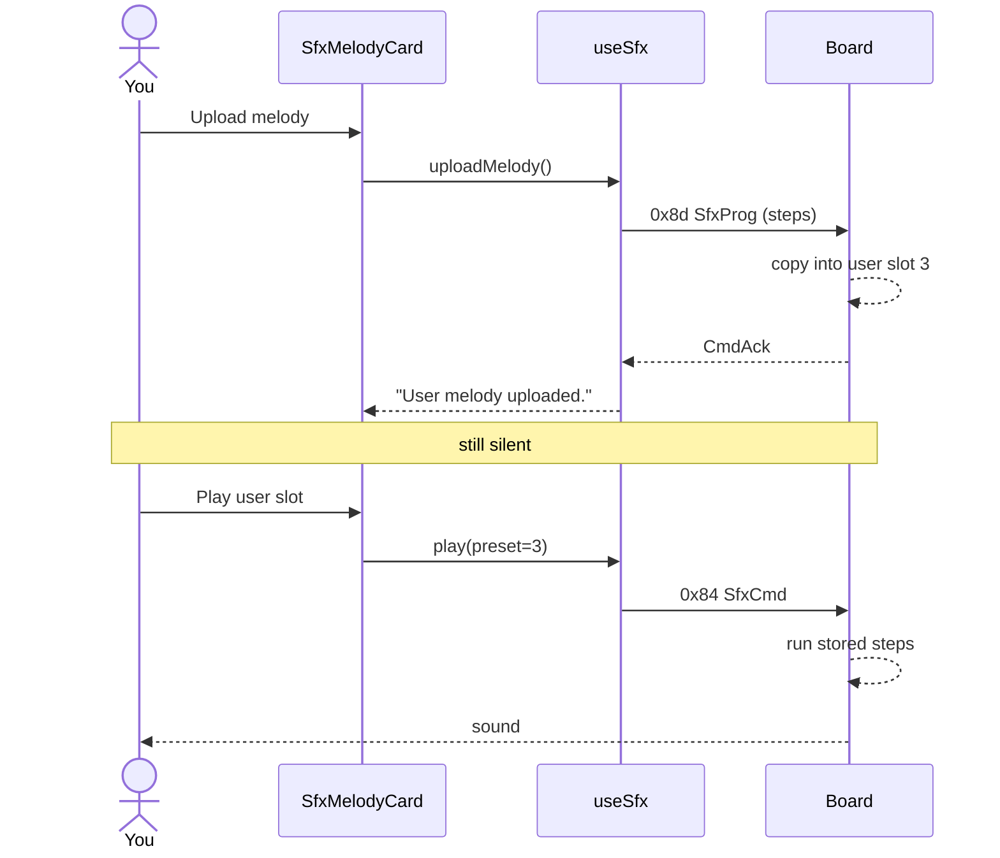

# ex09 — Upload a melody

<div class="ebook-run">

**Track:** `react` · **Project:** `demos` · **Port:** `5173`

```text
cd demos
vp install   # first time
vp dev
# enable ex09-sfx-melody in demos/src/App.tsx (import + <Route>)
# match WORKSHOP_BOARD_ID in demos/src/lib/workshop.ts
```

<p class="ebook-source"><strong>Source:</strong> <code>demos/src/pages/ex09-sfx-melody/README.md</code></p>

</div>


**Goal:** send a **custom note list** from the browser into the board’s
**user sound slot**, then play that slot. You are not picking a built-in
pad like Chime — you are **programming** a short tune over USB.

Works on **both** board targets (speaker).

Enable in [`src/App.tsx`](../../../../demos/src/App.tsx): uncomment `Ex09SfxMelody`
import + `<Route>`, comment the others.

---

## 1. Why this lab?

| Earlier labs (ex06–08) | This lab (ex09) |
| ---------------------- | --------------- |
| Play fixed presets already baked into firmware | Host **uploads** note steps, then plays them |
| Melody changes only if you reflash | Melody can change from the web app |

**Success:** After **Upload melody**, **Play user slot** sounds
**different from Chime**. Status shows `User melody uploaded.` then a
play ack.

---

## 2. Learning objectives

| Idea | In this exercise |
| ---- | ---------------- |
| Two-step control | **Store** program, then **trigger** play |
| `SfxProg` (0x8d) | Upload steps: frequency, wave shape, duration |
| User slot = preset **3** | Same play path as Chime, different content source |
| Not a WAV file | Only a small table of notes — no audio sample upload |

---

## 3. Before you start

1. Flash matching `firmware-prebuilt/<board>/` (`robotos_serial_bridge`).
2. Set `WORKSHOP_BOARD_ID` in [`workshop.ts`](../../../../demos/src/lib/workshop.ts).
3. Chrome/Edge on localhost; quit other serial apps.

---

## 4. What you do on the page

```
┌─────────────────────────────────────────┐
│ ex09 · Upload a melody                  │
├─────────────────────────────────────────┤
│ Serial port              [ Connected ]  │
├─────────────────────────────────────────┤
│ Speaker / SFX                           │
│   … other pads (ignore for this lab) …  │
│   Volume  ═══════⬤═══════               │
│   [ Upload melody ]  [ Play user slot ] │
│              [ Stop ]                   │
└─────────────────────────────────────────┘
```

**Focus on two buttons only:**

1. **Connect** → wait until controls appear.
2. Click **Upload melody**  
   - Does **not** play sound.  
   - Status → `User melody uploaded.`
3. Click **Play user slot** → hear the demo tune.
4. Optional: tap **Chime**, then **Play user slot** again — they must
   sound different.
5. **Stop** to silence.

---

## 5. What gets uploaded?

**Upload melody** sends a built-in demo (`SFX_DEMO_MELODY` in
[`lib/wire/sfx.ts`](../../lib/wire/sfx.ts)) as protobuf **`SfxProg`**:

| Step | Hz | Shape | ms | Notes |
| ---- | -- | ----- | -- | ----- |
| 1 | 330 | sine | 220 | Low bump |
| 2 | 0 | — | 80 | Rest |
| 3 | 880 | triangle | 180 | Ping |
| 4 | 1320 | triangle | 280 | Higher ping |
| 5 | 0 | — | 100 | Rest |
| 6 | 990 | sine | 400 | Soft end |

Wire message: **`msg_type 0x8d`**. Firmware copies the steps into RAM
slot **3**. Nothing is heard until play.

---

## 6. Mental model

```
┌────────────────┐   SfxProg 0x8d    ┌──────────────────┐
│ Upload melody  │ ────────────────► │ Board user slot 3│
│ (note table)   │                   │ (stored steps)   │
└────────────────┘                   └────────┬─────────┘
                                              │
┌────────────────┐   SfxCmd preset=3          │
│ Play user slot │ ───────────────────────────┘
│ (trigger only) │         ▼
└────────────────┘   sequencer → speaker
```



---

## 7. Files

| File | Role |
| ---- | ---- |
| `index.tsx` | Student entry (`features.prog`) |
| `Ex09Header.tsx` | Title + short how-to |
| `README.md` | This guide |

| Shared | Role |
| ------ | ---- |
| `hooks/useSfx.ts` | `uploadMelody` / `playUser` |
| `lib/wire/sfx.ts` | `encodeSfxProg`, `SFX_DEMO_MELODY` |
| `components/sfx/SfxMelodyCard.tsx` | Step 1 Upload / Step 2 Play user + Chime |

---

## 8. Checklist

- [ ] Connected and settled
- [ ] **Upload melody** → status `User melody uploaded.` (no sound yet)
- [ ] **Play user slot** → hear the demo tune
- [ ] Sound is **not** the same as **Chime**
- [ ] **Stop** works

**Previous:** [ex08 — SFX params](../../generated/react/ex08-sfx-params/index.md)  
**Next:** [ex10 — SFX studio](../../generated/react/ex10-sfx-studio/index.md)
