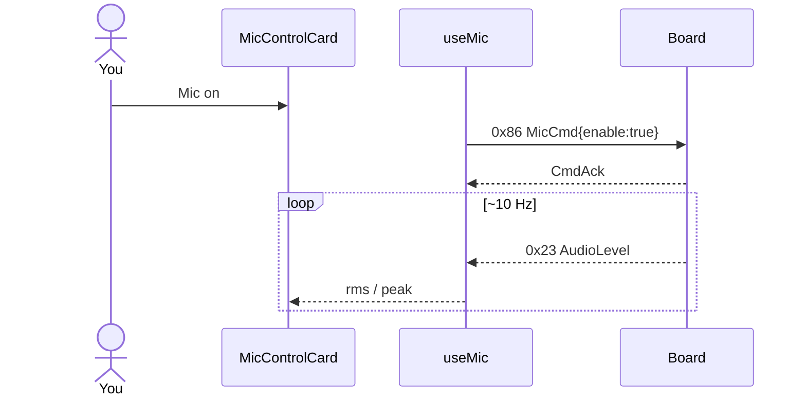

# ex11 — Turn on the mic

<div class="ebook-run">

**Track:** `react` · **Project:** `demos` · **Port:** `5173`

```text
cd demos
vp install   # first time
vp dev
# enable ex11-mic-hello in demos/src/App.tsx (import + <Route>)
# match WORKSHOP_BOARD_ID in demos/src/lib/workshop.ts
```

<p class="ebook-source"><strong>Source:</strong> <code>demos/src/pages/ex11-mic-hello/README.md</code></p>

</div>


**Goal:** enable the board microphone and watch live **AudioLevel**
numbers (rms / peak) arrive over USB.

Needs **`es3c28p`** (`boardHas(CAP.MIC)`). `ws28p` has no mic.

Enable in [`src/App.tsx`](../../../../demos/src/App.tsx): uncomment `Ex11MicHello`
import + `<Route>`, comment the others.

---

## 1. Why this lab?

SFX labs were mostly **host → board**. Mic labs flip the flow: after a
small command, the board **streams telemetry** to the host (~10 Hz
levels).

**Success:** Connect, tap **Mic on**, speak or clap near the board —
`rms` / `peak` numbers rise. **Mic off** stops the updates.

---

## 2. Learning objectives

| Idea | In this exercise |
| ---- | ---------------- |
| `MicCmd` (0x86) | `enable=true/false` |
| `AudioLevel` (0x23) | Board → host while capture is on |
| Capability gate | Hide UI when target has no mic |
| Continuous listen | Subscribe on the shared serial session |

---

## 3. Before you start

1. Flash `firmware-prebuilt/es3c28p/`.
2. Set `WORKSHOP_BOARD_ID` to `es3c28p`.
3. Quiet room helps; hold the board mic toward you.

---

## 4. What you do

1. Connect → Ready.
2. Click **Mic on** → status acknowledges.
3. Watch the line like `rms … · peak …` — clap or talk.
4. Click **Mic off** — numbers stop updating.

---

## 5. Mental model

```
┌────────────┐  MicCmd enable   ┌──────────┐
│ Mic on/off │ ───────────────► │ Board mic│
└────────────┘                  └────┬─────┘
                                     │ AudioLevel ~10 Hz
                                     ▼
                              ┌──────────────┐
                              │ Number readouts│
                              └──────────────┘
```



---

## 6. Files

| File | Role |
| ---- | ---- |
| `index.tsx` | Basic mic card (numbers only) |
| `Ex11Header.tsx` | Title + copy |
| `hooks/useMic.ts` | enable + level subscribe |
| `lib/wire/mic.ts` | encode/decode |

---

## 7. Checklist

- [ ] Target is es3c28p
- [ ] Mic on → levels move when you make sound
- [ ] Mic off → stream stops
- [ ] ws28p (if tried) shows “no mic” message

**Previous:** [ex10 — SFX studio](../../generated/react/ex10-sfx-studio/index.md)  
**Next:** [ex12 — Mic VU](../../generated/react/ex12-mic-vu/index.md)
