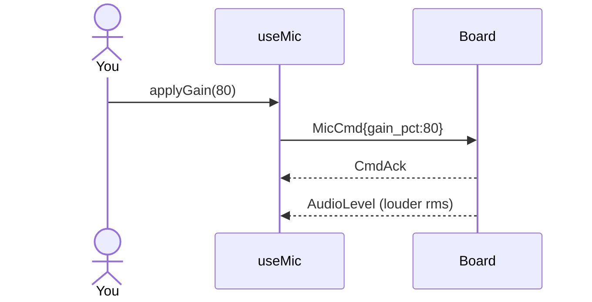

# ex13 — Gain and mute

<div class="ebook-run">

**Track:** `react` · **Project:** `demos` · **Port:** `5173`

```text
cd demos
vp install   # first time
vp dev
# enable ex13-mic-gain in demos/src/App.tsx (import + <Route>)
# match WORKSHOP_BOARD_ID in demos/src/lib/workshop.ts
```

<p class="ebook-source"><strong>Source:</strong> <code>demos/src/pages/ex13-mic-gain/README.md</code></p>

</div>


**Goal:** send `MicCmd` **gain_pct** and **mute** while watching the VU
react.

Needs **`es3c28p`**.

Enable in [`src/App.tsx`](../../../../demos/src/App.tsx): uncomment `Ex13MicGain`
import + `<Route>`, comment the others.

---

## 1. Why this lab?

ex11–12 only enabled capture. Here the host **configures** the mic:
gain (PGA / digital path) and mute — still optional fields on the same
`MicCmd` message.

**Success:** Mic on + speak. Raise **Gain** → VU climbs for the same
voice. **Mute** → level drops / stays quiet; **Unmute** restores.

---

## 2. Learning objectives

| Idea | In this exercise |
| ---- | ---------------- |
| Optional fields | Only send the params you change |
| `gain_pct` | 0–100 |
| `mute` | Soft silence without disabling capture |
| Apply on release | Slider commits gain on mouse/touch up (or % button) |

---

## 3. Before you start

1. Flash `firmware-prebuilt/es3c28p/`.
2. Finish [ex12](../../generated/react/ex12-mic-vu/index.md).

---

## 4. What you do

1. Connect → **Mic on**.
2. Speak at constant distance.
3. Drag **Gain**, release — apply; VU should change.
4. Tap **Mute** / **Unmute**.
5. **Mic off**.

---

## 5. Mental model

```
MicCmd{ gain_pct } ──► board PGA / gain
MicCmd{ mute }     ──► silence tap (capture may stay enabled)
AudioLevel         ──► VU still updates (muted ≈ low)
```



---

## 6. Files

| File | Role |
| ---- | ---- |
| `index.tsx` | `features={{ vu: true, gain: true }}` |
| `useMic.ts` | `applyGain` / `setMute` |

---

## 7. Checklist

- [ ] Higher gain → bigger VU for same speech
- [ ] Mute clearly quiets the meter
- [ ] Unmute restores response

**Previous:** [ex12 — Mic VU](../../generated/react/ex12-mic-vu/index.md)  
**Next:** [ex14 — Mic wave](../../generated/react/ex14-mic-wave/index.md)
