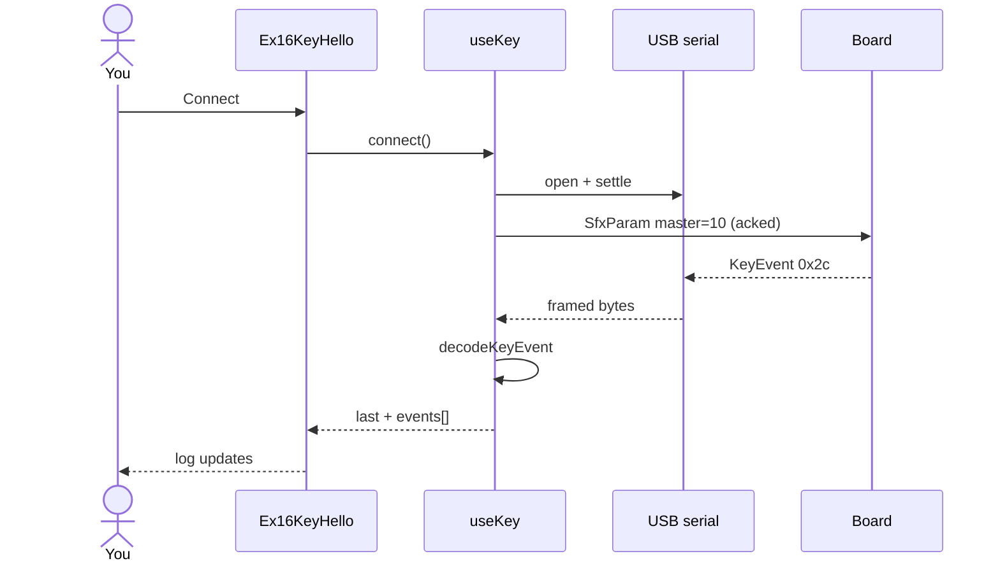

# ex16 — Key hello

<div class="ebook-run">

**Track:** `react` · **Project:** `demos` · **Port:** `5173`

```text
cd demos
vp install   # first time
vp dev
# enable ex16-key-hello in demos/src/App.tsx (import + <Route>)
# match WORKSHOP_BOARD_ID in demos/src/lib/workshop.ts
```

<p class="ebook-source"><strong>Source:</strong> <code>demos/src/pages/ex16-key-hello/README.md</code></p>

</div>


**Goal:** open one serial session and **listen** for board-originated button
events — no host “enable button” command. Decode `KeyEvent` on
`MSG_KEY_EVENT` (`0x2c`) and show SHORT, LONG, DOUBLE, UP, and DOWN in a
live log.

Works on **both** board targets (`CAP.BTN`). On **es3c28p** use **BOOT**;
on **ws28p** use **PWR** or **BOOT**.

Enable in [`src/App.tsx`](../../../../demos/src/App.tsx): uncomment `Ex16KeyHello` import +
`<Route>`, comment the others.

---

## 1. Learning outcomes

After this lab you should be able to:

| Idea | In this exercise |
| ---- | ---------------- |
| Push vs pull | The board publishes key edges; the host only subscribes |
| Event taxonomy | `KEY_EV`: UP, DOWN, SHORT, LONG, DOUBLE |
| Protobuf decode | `KeyEvent` fields: `timestamp_ms`, `key`, `event`, `hold_ms` |
| Capability gate | `boardHas(CAP.BTN)` before showing the key card |
| Desk safety | One `SfxParam` master-volume write after settle (quiet after loud labs) |

**Success:** Connect → Ready → press the board button → the log shows labeled
events (`BOOT SHORT`, etc.).

---

## 2. Theory

### KeyEvent on the wire

The firmware debounces physical buttons and emits **semantic** events, not raw
GPIO levels. The browser receives COBS-framed messages with `msgType = 0x2c`
and a protobuf `KeyEvent` payload (see [`lib/wire/key.ts`](../../lib/wire/key.ts)).

| `key` value | Label (this workshop) |
| ----------- | --------------------- |
| `0` | PWR (ws28p) |
| `1` | BOOT (both boards) |

| `event` (`KEY_EV`) | Meaning |
| ------------------ | ------- |
| `0` UP | Release |
| `1` DOWN | Press |
| `2` SHORT | Short tap |
| `3` LONG | Held past threshold |
| `4` DOUBLE | Double tap |

There is **no** host command to start key reporting — if `CAP.BTN` is set in
firmware, events appear once the session is `ready`.

### Quiet master after connect

Earlier SFX labs may leave the speaker loud. `useKey` sends one acked
`MSG_SFX_PARAM` (`0x85`) with stage `0xFF` (master volume) set to **10** so
boot chirps stay desk-safe. That is unrelated to key decoding but keeps the
room quiet while you focus on the log.

---

## 3. Before you start

1. Flash the prebuilt that matches `WORKSHOP_BOARD_ID` in
   [`src/lib/workshop.ts`](../../../../demos/src/lib/workshop.ts):
   - `firmware-prebuilt/es3c28p/` or
   - `firmware-prebuilt/ws28p/`
2. Close other serial monitors (only one reader on the port).
3. Chrome or Edge on `localhost`.
4. Finish ex15 if you want mic context; ex16 does not use the mic.

---

## 4. What you should see

```
┌─────────────────────────────────────┐
│ ex16 - Key hello                    │
│ Listen for button presses           │
├─────────────────────────────────────┤
│ Serial port           [ Connected ] │
│     [ Connect ]  [ Disconnect ]     │
├─────────────────────────────────────┤
│ Key events                          │
│ Last     BOOT - SHORT               │
│ History  SHORT, DOWN, UP, ...       │
│ Hint     Ready - press BOOT ...     │
└─────────────────────────────────────┘
```

On **ws28p**, the hint mentions PWR instead of BOOT only.

---

## 5. Mental model

```
┌────────────┐  KeyEvent 0x2c        ┌──────────────┐   ┌──────────────┐
│   Board    │ ────────────────────► │    useKey    │ ─►│ KeyEventCard │
└────────────┘                       └──────────────┘   └──────────────┘
```

Student `index.tsx` wires `useKey` to `SerialPortCard` + `KeyEventCard`.

---

## 6. Sequence — connect and first key event



---

## 7. Files

| File | Role |
| ---- | ---- |
| `index.tsx` | Compose header, serial card, key card |
| `Ex16Header.tsx` | Title and lab copy |
| `README.md` | This guide |

| Shared path | Role |
| ----------- | ---- |
| `hooks/useKey.ts` | Session + subscribe `MSG_KEY_EVENT` + quiet master |
| `hooks/useSerialSession.ts` | Connect, settle, `subscribe`, write |
| `hooks/useAckedWrite.ts` | Wait for `MSG_CMD_ACK` (`0x27`) on writes |
| `lib/wire/key.ts` | `MSG_KEY_EVENT`, `KEY_EV`, decode |
| `lib/wire/sfx.ts` | `MSG_SFX_PARAM`, `encodeSfxParam` |
| `components/KeyEventCard.tsx` | Last event + history + clear |
| `components/SerialPortCard.tsx` | Connect UI |
| `lib/workshop.ts` | `CAP.BTN`, `WORKSHOP_BOARD_ID` |

---

## 8. Checklist

- [ ] Decoder self-check (if shown elsewhere) is **ok**
- [ ] Connect reaches **Ready**
- [ ] SHORT, LONG, and DOUBLE appear when you use different press patterns
- [ ] **Clear** empties history without disconnecting
- [ ] Disconnect is clean (no stuck “open” state)

---

## 9. Common pitfalls

| Symptom | Likely cause |
| ------- | ------------ |
| No events | Wrong board flashed vs `WORKSHOP_BOARD_ID`; or pressing the wrong button (BOOT vs PWR) |
| “No buttons (CAP.BTN)” | Target caps in `workshop.ts` do not include BTN — rare if board id matches flash |
| Events stop after ex17-style lab | Another tab holds the port — close it |
| Double events in log | Normal: DOWN then SHORT; read `event` column, not only “last” |
| Loud boot sound | Master write failed or disconnect before settle — reconnect |

---

**Previous:** [ex15 — Mic studio](../../generated/react/ex15-mic-studio/index.md)  
**Next:** [ex17 — Key action](../../generated/react/ex17-key-action/index.md)
