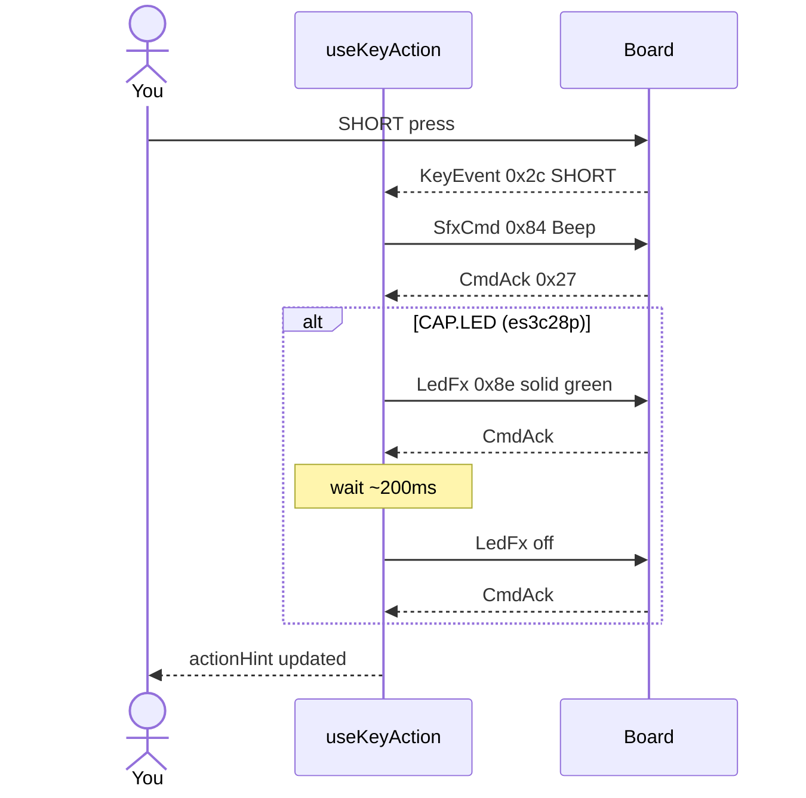

# ex17 — Key action

<div class="ebook-run">

**Track:** `react` · **Project:** `demos` · **Port:** `5173`

```text
cd demos
vp install   # first time
vp dev
# enable ex17-key-action in demos/src/App.tsx (import + <Route>)
# match WORKSHOP_BOARD_ID in demos/src/lib/workshop.ts
```

<p class="ebook-source"><strong>Source:</strong> <code>demos/src/pages/ex17-key-action/README.md</code></p>

</div>


**Goal:** turn a **SHORT** `KeyEvent` into **host → board** commands: play the
**Beep** preset via `SfxCmd` (`0x84`), and on **es3c28p** flash the RGB LED
green with `LedFx` (`0x8e`) then turn off. One serial session handles both
listen and write.

**Board:** both targets have `CAP.BTN`. **LED flash** runs only when
`boardHas(CAP.LED)` — **es3c28p** yes, **ws28p** sound only.

Enable in [`src/App.tsx`](../../../../demos/src/App.tsx): uncomment `Ex17KeyAction` import +
`<Route>`, comment the others.

---

## 1. Learning outcomes

| Idea | In this exercise |
| ---- | ---------------- |
| Input → output | Subscribe to `0x2c`, react in the handler, `writeAcked` actuators |
| Filter by gesture | Only `KEY_EV.SHORT` triggers action (ignore LONG/DOUBLE for now) |
| Acked writes | Commands wait for `MSG_CMD_ACK` (`0x27`) before the next step |
| Conditional UI | `actionHint` shows whether LED ran |
| Composition | Reuses key decode from ex16 + SFX/LED from earlier labs |

**Success:** SHORT press → hear Beep; on es3c28p see a brief green LED pulse;
hint line confirms the mapping.

---

## 2. Theory

### Closing the loop

ex16 was **observe only**. ex17 adds **control**: the same `subscribe` callback
that updates React state also schedules async I/O when `ev.event === KEY_EV.SHORT`.

```
┌──────────┐  KeyEvent 0x2c   ┌─────────────┐  SHORT    ┌──────────────┐
│  Board   │ ───────────────► │ useKeyAction│ ────────► │ SfxCmd Beep  │
│  button  │                  │ writeAcked  │           │ LedFx flash  │
└──────────┘                  └─────────────┘           └──────────────┘
                              MsgCmdAck 0x27 on each write
```

| Message | Direction | Role in this lab |
| ------- | --------- | ---------------- |
| `MSG_KEY_EVENT` `0x2c` | Board → host | Trigger |
| `MSG_SFX_CMD` `0x84` | Host → board | `encodeSfxPlay(SFX_PRESET.BEEP, { volume: 10 })` |
| `MSG_LED_FX` `0x8e` | Host → board | Solid green ~200 ms, then off |
| `MSG_CMD_ACK` `0x27` | Board → host | Confirms each write |

LONG and DOUBLE still appear in the log but **do not** trigger the action —
that pattern returns in ex24.

---

## 3. Before you start

1. Flash **`firmware-prebuilt/es3c28p/`** for the full LED + sound experience,
   or **`ws28p/`** for Beep-only on SHORT.
2. Match `WORKSHOP_BOARD_ID` in [`src/lib/workshop.ts`](../../../../demos/src/lib/workshop.ts).
3. Know ex16 (key events) and ex07–ex09 style SFX basics.

---

## 4. What you should see

```
┌─────────────────────────────────────┐
│ ex17 - Key action                   │
│ Button triggers a sound             │
├─────────────────────────────────────┤
│ Serial port           [ Connected ] │
├─────────────────────────────────────┤
│ Key events                          │
│ Hint   SHORT press → Beep + flash   │
│ Action BOOT SHORT -> Beep + LED ... │
└─────────────────────────────────────┘
```

On **ws28p**, hints omit “green flash”.

---

## 5. Mental model

```
┌──────────────┐   KeyEvent 0x2c   ┌──────────────┐   writes   ┌─────────────┐
│ lib/wire/key │ ◄──────────────── │ useKeyAction │ ─────────► │ wire sfx/led│
└──────────────┘                   └──────┬───────┘            └─────────────┘
                                          │
                                          ▼
                                   ┌──────────────┐
                                   │ KeyEventCard │
                                   └──────────────┘
```

---

## 6. Sequence — SHORT press to Beep + LED



---

## 7. Files

| File | Role |
| ---- | ---- |
| `index.tsx` | Serial + key card with `actionHint` |
| `Ex17Header.tsx` | Title and copy |
| `README.md` | This guide |

| Shared path | Role |
| ----------- | ---- |
| `hooks/useKeyAction.ts` | SHORT → SFX + optional LED |
| `hooks/useSerialSession.ts` | Shared transport |
| `hooks/useAckedWrite.ts` | Acked command pipeline |
| `lib/wire/key.ts` | `MSG_KEY_EVENT`, `KEY_EV.SHORT` |
| `lib/wire/sfx.ts` | `MSG_SFX_CMD`, `SFX_PRESET.BEEP` |
| `lib/wire/led.ts` | `MSG_LED_FX`, solid/off encoders |
| `components/KeyEventCard.tsx` | Log + hint lines |

---

## 8. Checklist

- [ ] Connect → Ready
- [ ] SHORT → Beep every time (not on LONG alone)
- [ ] On es3c28p, green LED pulse visible
- [ ] LONG / DOUBLE logged but no Beep from those alone
- [ ] Disconnect clears pending acks without console errors

---

## 9. Common pitfalls

| Symptom | Likely cause |
| ------- | ------------ |
| Key log works, no Beep | `writeAcked` failing silently — check disconnect mid-command |
| Beep but no LED on es3c28p | `WORKSHOP_BOARD_ID` still `ws28p` while physical board is es3c28p |
| LED stuck on | Disconnect before off command — reconnect and send off from ex04 |
| Every tap double-fires | Debounce is on the board; avoid hammering during LED sequence |
| “Replaced” in console | New command superseded old pending ack — usually harmless on disconnect |

---

**Previous:** [ex16 — Key hello](../../generated/react/ex16-key-hello/index.md)  
**Next:** [ex18 — Battery hello](../../generated/react/ex18-batt-hello/index.md)
