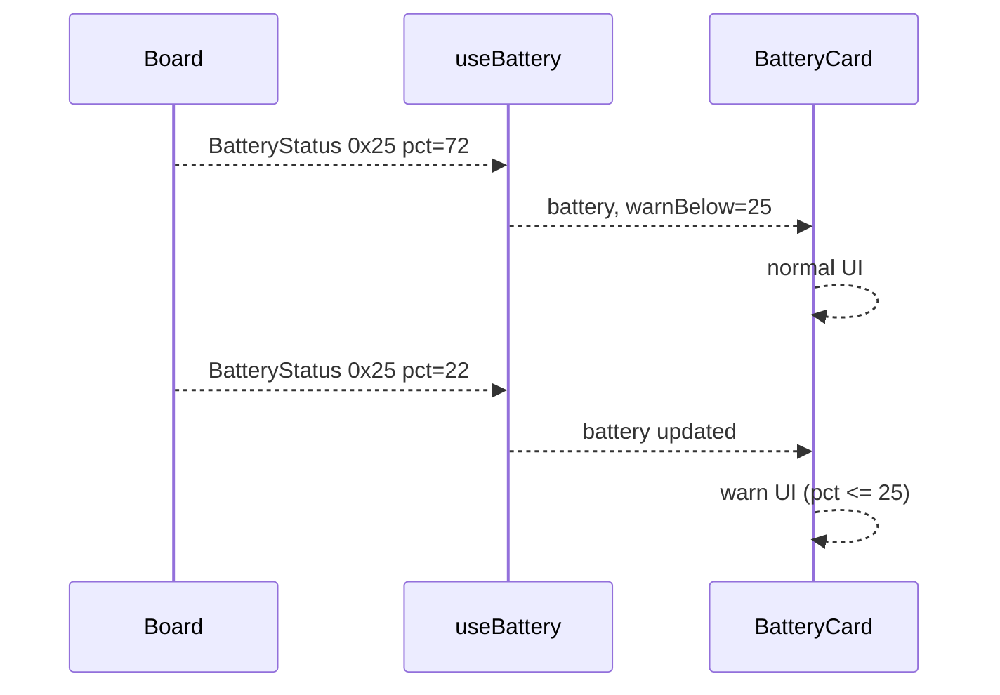

# ex19 — Battery warn

<div class="ebook-run">

**Track:** `react` · **Project:** `demos` · **Port:** `5173`

```text
cd demos
vp install   # first time
vp dev
# enable ex19-batt-warn in demos/src/App.tsx (import + <Route>)
# match WORKSHOP_BOARD_ID in demos/src/lib/workshop.ts
```

<p class="ebook-source"><strong>Source:</strong> <code>demos/src/pages/ex19-batt-warn/README.md</code></p>

</div>


**Goal:** use the **same** `BatteryStatus` stream as ex18, but add a
**host-side warn threshold** — highlight the card when percent is at or below
**25%** (`WARN_BELOW` in `index.tsx`). No new wire messages.

**Board:** **both** targets (`CAP.BATT`).

Enable in [`src/App.tsx`](../../../../demos/src/App.tsx): uncomment `Ex19BattWarn` import +
`<Route>`, comment the others.

---

## 1. Learning outcomes

| Idea | In this exercise |
| ---- | ---------------- |
| Policy on data | Threshold logic lives in the UI layer, not firmware |
| Reuse hook | `useBattery` unchanged from ex18 |
| Presentational props | `BatteryCard` accepts `warnBelow` |
| Product thinking | Warn early; do not wait for hard cutoff |

**Success:** Normal styling above 25%; warn styling at or below 25% when the
board reports low `pct`.

---

## 2. Theory

### Host-side threshold

ex18 proves you can **read** `pct`. ex19 asks: **what should the app do** with
that number?

```
┌─────────────────────┐      pct      ┌─────────────────────┐
│ BatteryStatus 0x25  │ ────────────► │ BatteryCard         │
│ same stream as ex18 │               │ warn if pct <= 25   │
└─────────────────────┘               └─────────────────────┘
```

Firmware does not send “low battery” as a separate message here — you derive
state from `pct` and `warnBelow` (default **25**).

To test without draining a pack, temporarily lower `WARN_BELOW` in
`index.tsx` (e.g. to 90) for a desk demo, then restore 25.

---

## 3. Before you start

1. Same flash + `WORKSHOP_BOARD_ID` as ex18.
2. Run ex18 once so you know typical `pct` on your setup.

---

## 4. What you should see

```
┌─────────────────────────────────────┐
│ ex19 - Battery warn                 │
│ Threshold on percent                │
├─────────────────────────────────────┤
│ Serial port           [ Connected ] │
├─────────────────────────────────────┤
│ Battery              [ warn band ]  │
│ Percent        22 %   ← at/below 25 │
│ Hint           same ~10 s stream    │
└─────────────────────────────────────┘
```

Exact warn chrome comes from `BatteryCard` styles.

---

## 5. Mental model

```
┌────────────┐  Battery 0x25  ┌────────────┐   pct    ┌─────────────┐
│   Board    │ ─────────────► │ useBattery │ ───────► │ BatteryCard │
└────────────┘                └────────────┘          │ warnBelow   │
                                                      └─────────────┘
```

---

## 6. Sequence — threshold evaluation



No extra host → board traffic.

---

## 7. Files

| File | Role |
| ---- | ---- |
| `index.tsx` | `WARN_BELOW = 25`, passes `warnBelow` to card |
| `Ex19Header.tsx` | Title and copy |
| `README.md` | This guide |

| Shared path | Role |
| ----------- | ---- |
| `hooks/useBattery.ts` | Same as ex18 |
| `components/BatteryCard.tsx` | Warn styling when `pct <= warnBelow` |
| `lib/wire/battery.ts` | `MSG_BATTERY` |

---

## 8. Checklist

- [ ] Connect → readings match ex18
- [ ] Above 25%: no warn emphasis
- [ ] At or below 25%: warn emphasis (or raise threshold to verify)
- [ ] Threshold change in `index.tsx` affects UI after reload

---

## 9. Common pitfalls

| Symptom | Likely cause |
| ------- | ------------ |
| Never warns | Your board always reports high `pct` on USB — tweak threshold to test |
| Warn flicker | Percent hovering near 25 — add hysteresis in a real product (not in this lab) |
| Different from ex18 values | Same hook — if they differ, you are on a different port/session |

---

**Previous:** [ex18 — Battery hello](../../generated/react/ex18-batt-hello/index.md)  
**Next:** [ex20 — IMU hello](../../generated/react/ex20-imu-hello/index.md)
