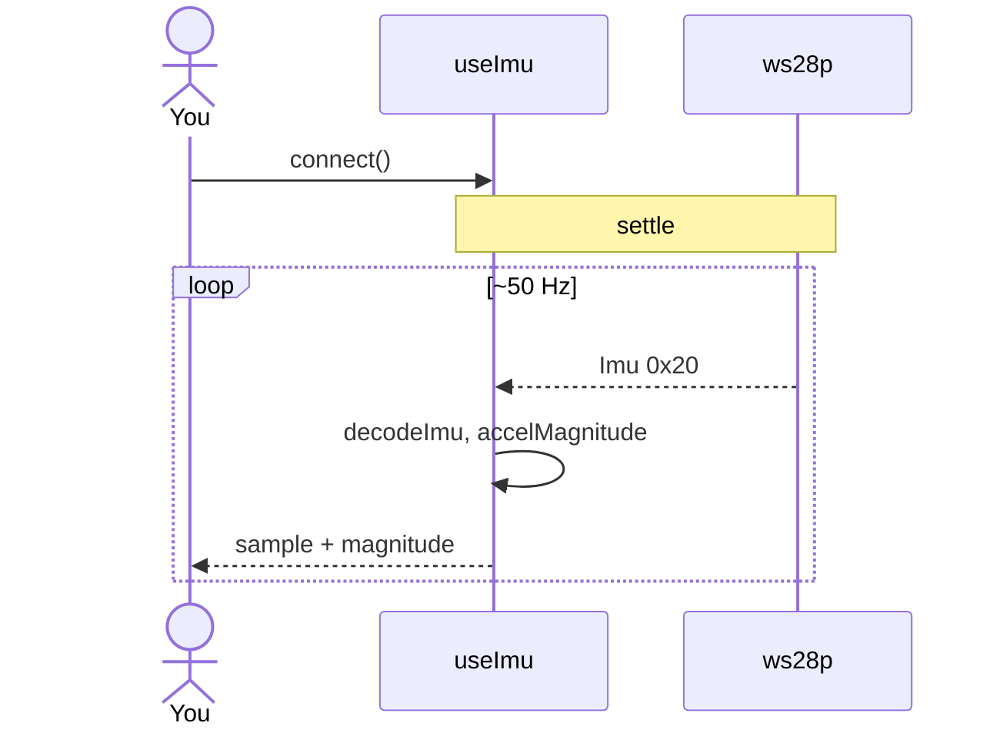

# ex20 — IMU hello

<div class="ebook-run">

**Track:** `react` · **Project:** `demos` · **Port:** `5173`

```text
cd demos
vp install   # first time
vp dev
# enable ex20-imu-hello in demos/src/App.tsx (import + <Route>)
# match WORKSHOP_BOARD_ID in demos/src/lib/workshop.ts
```

<p class="ebook-source"><strong>Source:</strong> <code>demos/src/pages/ex20-imu-hello/README.md</code></p>

</div>


**Goal:** decode high-rate **`Imu`** samples on `MSG_IMU` (`0x20`) — acceleration
and angular velocity — and show axis bars plus **|a|** magnitude. Tilt and
move the board; watch live values (~**50 Hz** on ws28p).

**Board:** needs **`CAP.IMU`** — set `WORKSHOP_BOARD_ID` to **`ws28p`** and
flash **`firmware-prebuilt/ws28p/`**. **es3c28p** has no IMU; the UI shows a
capability message.

Enable in [`src/App.tsx`](../../../../demos/src/App.tsx): uncomment `Ex20ImuHello` import +
`<Route>`, comment the others.

---

## 1. Learning outcomes

| Idea | In this exercise |
| ---- | ---------------- |
| High-rate stream | IMU vs 10 s battery — subscribe continuously |
| Schema name | Payload is `robotos.sensor.v1.Imu` (see wire comments) |
| Vectors | `accel` and `gyro` as 3-vectors |
| Magnitude | `accelMagnitude` for shake detection preview (ex21) |
| Capability | `boardHas(CAP.IMU)` gates the lab |

**Success:** On ws28p, connect → accel bars respond to tilt; magnitude stable
near ~9.8 m/s² when flat (axis convention depends on mount).

---

## 2. Theory

### Imu message

| Constant | Value | Payload |
| -------- | ----- | ------- |
| `MSG_IMU` | `0x20` | `robotos.sensor.v1.Imu`: `timestamp_ns`, `acceleration`, `angular_velocity` |

Decode path: [`lib/wire/imu.ts`](../../lib/wire/imu.ts).

`useImu` also tracks shake **count** internally (threshold default **18**)
for reuse by `ImuCard` sliders — ex20 focuses on **hello** display; ex21
adds SFX on shake.

### es3c28p vs ws28p

| Board | IMU |
| ----- | --- |
| es3c28p | Not in `BOARDS.es3c28p.caps` |
| ws28p | IMU \| RTC \| BATT \| BTN |

Switch both **flash image** and **`WORKSHOP_BOARD_ID`** together.

---

## 3. Before you start

1. Flash **`firmware-prebuilt/ws28p/`**.
2. In [`src/lib/workshop.ts`](../../../../demos/src/lib/workshop.ts):
   ```ts
   // export const WORKSHOP_BOARD_ID: WorkshopBoardId = "es3c28p";
   export const WORKSHOP_BOARD_ID: WorkshopBoardId = "ws28p";
   ```
3. Secure the board while USB is connected — cable strain affects readings.

---

## 4. What you should see

```
┌─────────────────────────────────────┐
│ ex20 - IMU hello                    │
│ Watch motion samples                │
├─────────────────────────────────────┤
│ Serial port           [ Connected ] │
├─────────────────────────────────────┤
│ IMU                                 │
│ Accel X/Y/Z   bars moving           │
│ |a|           ~9.x at rest          │
│ Gyro          small noise when still│
│ Hint          IMU streaming ~50 Hz  │
└─────────────────────────────────────┘
```

---

## 5. Mental model

```
┌────────────┐  Imu 0x20 ~50Hz   ┌──────────────┐   ┌──────────────┐
│  ws28p     │ ────────────────► │ useImu       │ ─►│ ImuCard      │
│  IMU chip  │                   │ decodeImu    │   │ bars + |a|   │
└────────────┘                   └──────────────┘   └──────────────┘
```

---

## 6. Sequence — first sample



---

## 7. Files

| File | Role |
| ---- | ---- |
| `index.tsx` | Serial + IMU card (hello mode) |
| `Ex20Header.tsx` | Title and copy |
| `README.md` | This guide |

| Shared path | Role |
| ----------- | ---- |
| `hooks/useImu.ts` | Subscribe `MSG_IMU` |
| `lib/wire/imu.ts` | `MSG_IMU`, `decodeImu`, `accelMagnitude` |
| `components/ImuCard.tsx` | Axis display |
| `lib/workshop.ts` | `CAP.IMU`, ws28p caps |

---

## 8. Checklist

- [ ] `WORKSHOP_BOARD_ID` is `ws28p` with ws28p firmware
- [ ] Connect → “IMU streaming” hint
- [ ] Tilt changes accel bars
- [ ] Magnitude increases when you shake (preview for ex21)
- [ ] es3c28p target shows “No IMU” without crashing

---

## 9. Common pitfalls

| Symptom | Likely cause |
| ------- | ------------ |
| No IMU message | Still on es3c28p in workshop.ts or wrong flash |
| Flat zeros | Settle not finished — wait for Ready |
| Noisy gyro at rest | Normal MEMS noise at desk scale |
| USB unplug during motion | Cable — not a protocol bug |

---

**Previous:** [ex19 — Battery warn](../../generated/react/ex19-batt-warn/index.md)  
**Next:** [ex21 — IMU shake](../../generated/react/ex21-imu-shake/index.md)
