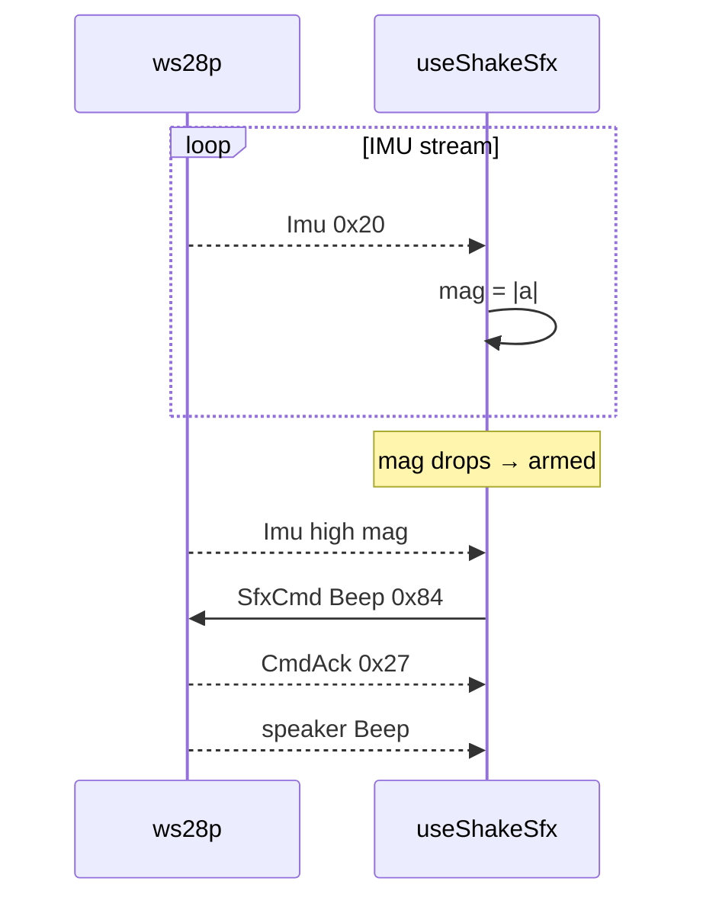

# ex21 — IMU shake

<div class="ebook-run">

**Track:** `react` · **Project:** `demos` · **Port:** `5173`

```text
cd demos
vp install   # first time
vp dev
# enable ex21-imu-shake in demos/src/App.tsx (import + <Route>)
# match WORKSHOP_BOARD_ID in demos/src/lib/workshop.ts
```

<p class="ebook-source"><strong>Source:</strong> <code>demos/src/pages/ex21-imu-shake/README.md</code></p>

</div>


**Goal:** when acceleration magnitude **|a|** crosses a **shake threshold**
(rising edge after dipping below 70% of threshold), send **`SfxCmd` Beep**
(`0x84`) to the board speaker. Same IMU stream as ex20; adds **event → sound**.

**Board:** **`ws28p`** (`CAP.IMU` + speaker path on this target). Set
`WORKSHOP_BOARD_ID` to **`ws28p`** and flash **`firmware-prebuilt/ws28p/`**.

Enable in [`src/App.tsx`](../../../../demos/src/App.tsx): uncomment `Ex21ImuShake` import +
`<Route>`, comment the others.

---

## 1. Learning outcomes

| Idea | In this exercise |
| ---- | ---------------- |
| Edge detection | Require `belowRef` then `mag >= threshold` — avoids retrigger spam |
| Hysteresis | Reset “armed” when `mag < threshold * 0.7` |
| Debounce SFX | `busyRef` blocks overlapping Beep commands |
| UI tuning | Slider adjusts `shakeThreshold` (default **18**) |
| Same msg type | Still only `MSG_IMU` (`0x20`) from board |

**Success:** Firm shake → Beep; `shakeCount` increments; slider changes
sensitivity.

---

## 2. Theory

### Shake detector (host-side)

Firmware streams raw IMU. **Policy** lives in `useShakeSfx`:

```
each Imu 0x20:
  mag = |accel|
  if mag < 0.7 * threshold → armed = true
  if armed and mag >= threshold and not busy:
      armed = false; shakeCount++; SfxCmd Beep
```

This is not a board-side “shake interrupt” — you implement product logic in
TypeScript, same idea as ex19’s battery warn threshold.

| Message | Direction | Role |
| ------- | --------- | ---- |
| `MSG_IMU` `0x20` | Board → host | Input |
| `MSG_SFX_CMD` `0x84` | Host → board | Beep on shake |
| `MSG_CMD_ACK` `0x27` | Board → host | Ack Beep |

---

## 3. Before you start

1. Complete ex20 on ws28p so IMU bars already work.
2. Flash **`firmware-prebuilt/ws28p/`**; `WORKSHOP_BOARD_ID = "ws28p"`.
3. Volume: prior labs may have changed master — shake Beep uses `volume: 10`.

---

## 4. What you should see

```
┌─────────────────────────────────────┐
│ ex21 - IMU shake                    │
│ Shake triggers Beep                 │
├─────────────────────────────────────┤
│ Serial port           [ Connected ] │
├─────────────────────────────────────┤
│ IMU                                 │
│ Accel mag        spikes on shake    │
│ Shake count      increments         │
│ Threshold        slider (def. 18)   │
│ Hint             Shake — Beep peak  │
└─────────────────────────────────────┘
```

---

## 5. Mental model

```
┌────────────┐  Imu 0x20             ┌──────────────┐   ┌──────────────┐
│   Board    │ ────────────────────► │ useShakeSfx  │ ─►│ SfxCmd Beep  │
└────────────┘                       └──────────────┘   └──────────────┘
```

---

## 6. Sequence — shake to Beep



---

## 7. Files

| File | Role |
| ---- | ---- |
| `index.tsx` | `useShakeSfx` + IMU card with shake controls |
| `Ex21Header.tsx` | Title and copy |
| `README.md` | This guide |

| Shared path | Role |
| ----------- | ---- |
| `hooks/useShakeSfx.ts` | Threshold edge + Beep |
| `hooks/useAckedWrite.ts` | Acked SfxCmd |
| `lib/wire/imu.ts` | `MSG_IMU`, magnitude |
| `lib/wire/sfx.ts` | `MSG_SFX_CMD`, `SFX_PRESET.BEEP` |
| `components/ImuCard.tsx` | Threshold slider, reset count |

---

## 8. Checklist

- [ ] Gentle tilt does **not** Beep every frame
- [ ] Sharp shake triggers Beep
- [ ] Lower threshold → easier triggers
- [ ] Reset shake count clears counter
- [ ] Disconnect mid-Beep does not hang UI

---

## 9. Common pitfalls

| Symptom | Likely cause |
| ------- | ------------ |
| Constant Beeps | Threshold too low or board vibrating on desk |
| Never Beep | Threshold too high — lower slider |
| Count rises, no sound | ws28p speaker path / volume; check SFX labs on same board |
| ex20 works, ex21 silent | `busyRef` stuck — disconnect and reconnect |

---

**Previous:** [ex20 — IMU hello](../../generated/react/ex20-imu-hello/index.md)  
**Next:** [ex22 — RTC sync](../../generated/react/ex22-rtc-sync/index.md)
