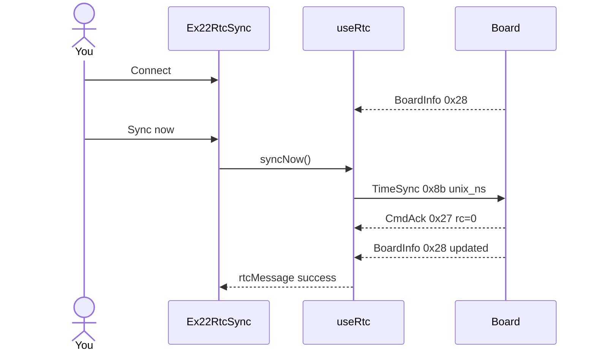

# ex22 — RTC sync

<div class="ebook-run">

**Track:** `react` · **Project:** `demos` · **Port:** `5173`

```text
cd demos
vp install   # first time
vp dev
# enable ex22-rtc-sync in demos/src/App.tsx (import + <Route>)
# match WORKSHOP_BOARD_ID in demos/src/lib/workshop.ts
```

<p class="ebook-source"><strong>Source:</strong> <code>demos/src/pages/ex22-rtc-sync/README.md</code></p>

</div>


**Goal:** send **`TimeSync`** on `MSG_TIME_SYNC` (`0x8b`) with the host’s Unix
time (nanoseconds), wait for **`CmdAck`**, and read **`BoardInfo`** on
`MSG_BOARD_INFO` (`0x28`) for `unix_ns` and **synced** flag. On **ws28p**,
hardware **RTC** persists; on **es3c28p** you get **soft clock** sync only
(no `CAP.RTC`).

**Board:** runs on **both** targets; **persisted RTC** only on **`ws28p`**.

Enable in [`src/App.tsx`](../../../../demos/src/App.tsx): uncomment `Ex22RtcSync` import +
`<Route>`, comment the others.

---

## 1. Learning outcomes

| Idea | In this exercise |
| ---- | ---------------- |
| Host-initiated command | Unlike keys/battery, clock sync is a write |
| TimeSync payload | Protobuf `TimeSync.unix_ns` from `encodeTimeSync()` |
| Ack semantics | `writeAcked` returns `rc`; non-zero means rejected |
| BoardInfo refresh | Identity frames carry clock fields after sync |
| Capability nuance | `rtcSupported` changes success copy, not always blocking |

**Success:** Connect → **Sync now** → ack success message; BoardInfo shows
synced / updated time.

---

## 2. Theory

### Messages involved

| Constant | Value | Direction | Role |
| -------- | ----- | --------- | ---- |
| `MSG_TIME_SYNC` | `0x8b` | Host → board | Set clock from host |
| `MSG_CMD_ACK` | `0x27` | Board → host | Command result |
| `MSG_BOARD_INFO` | `0x28` | Board → host | `unix_ns`, `synced`, caps |

`encodeTimeSync()` defaults to `Date.now() * 1e6` nanoseconds — see
[`lib/wire/time.ts`](../../lib/wire/time.ts).

### Soft vs hardware RTC

```
┌────────────────────────────────────────────┐
│ Sync now sends TimeSync 0x8b               │
├────────────────────────────────────────────┤
│ ws28p:   hardware RTC persists on chip     │
│ es3c28p: soft clock in RAM (no CAP.RTC)    │
└────────────────────────────────────────────┘
```

UI text from `useRtc.syncNow` reflects which case applies.

---

## 3. Before you start

1. Flash board matching `WORKSHOP_BOARD_ID`:
   - **`ws28p`** for full RTC story — `firmware-prebuilt/ws28p/`
   - **`es3c28p`** for soft-sync only — `firmware-prebuilt/es3c28p/`
2. System clock on your PC should be reasonable (Sync copies host time).
3. Know ex03-style **BoardInfo** listening.

---

## 4. What you should see

```
┌─────────────────────────────────────┐
│ ex22 - RTC sync                     │
│ Set board clock from host           │
├─────────────────────────────────────┤
│ Serial port           [ Connected ] │
├─────────────────────────────────────┤
│ Clock                               │
│ Board time     ... (from BoardInfo) │
│ Synced         yes / no             │
│ [ Sync now ]                        │
│ Hint           Ready — press Sync   │
└─────────────────────────────────────┘
```

After sync, hint may say persisted on ws28p or soft sync on es3c28p.

---

## 5. Mental model

```
┌────────────┐  TimeSync 0x8b        ┌──────────────┐   ┌──────────────┐
│  RtcCard   │ ────────────────────► │    useRtc    │ ─►│  BoardInfo   │
└────────────┘                       └──────────────┘   └──────────────┘
```

---

## 6. Sequence — Sync now



---

## 7. Files

| File | Role |
| ---- | ---- |
| `index.tsx` | Serial + RTC card, `onSync` |
| `Ex22Header.tsx` | Title and copy |
| `README.md` | This guide |

| Shared path | Role |
| ----------- | ---- |
| `hooks/useRtc.ts` | TimeSync + BoardInfo subscribe |
| `lib/wire/time.ts` | `MSG_TIME_SYNC`, `encodeTimeSync` |
| `lib/wire/frame.ts` | `MSG_BOARD_INFO` |
| `lib/wire/boardInfo.ts` | Decode clock fields |
| `components/RtcCard.tsx` | Sync button + display |
| `lib/workshop.ts` | `CAP.RTC` |

---

## 8. Checklist

- [ ] Connect → BoardInfo appears
- [ ] Sync now → success hint (not rejected rc)
- [ ] On ws28p, message mentions RTC persist
- [ ] On es3c28p, message mentions soft sync
- [ ] Second sync refreshes time without error

---

## 9. Common pitfalls

| Symptom | Likely cause |
| ------- | ------------ |
| Sync before Ready | Wait for settle — hook blocks with hint |
| `rc != 0` | Firmware rejected payload — check wire encode |
| Time looks wrong | Host timezone vs UTC display — compare delta, not absolute label |
| synced false forever | Old firmware — reflash matching prebuilt |
| No BoardInfo | Same as ex03 — port or decode issue |

---

**Previous:** [ex21 — IMU shake](../../generated/react/ex21-imu-shake/index.md)  
**Next:** [ex23 — Sound-reactive LED](../../generated/react/ex23-sound-led/index.md)
