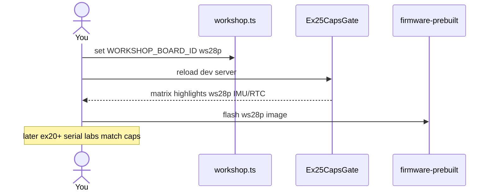

# ex25 — Caps gate

<div class="ebook-run">

**Track:** `react` · **Project:** `demos` · **Port:** `5173`

```text
cd demos
vp install   # first time
vp dev
# enable ex25-caps-gate in demos/src/App.tsx (import + <Route>)
# match WORKSHOP_BOARD_ID in demos/src/lib/workshop.ts
```

<p class="ebook-source"><strong>Source:</strong> <code>demos/src/pages/ex25-caps-gate/README.md</code></p>

</div>


**Goal:** **no USB required** — understand how workshop labs gate UI with
**capability bits** (`CAP.*`) and `boardHas()`. Compare **`es3c28p`** vs
**`ws28p`** for LED, MIC, IMU, RTC, BATT, and BTN, and see which exercise
ranges need which hardware.

Switch target in [`src/lib/workshop.ts`](../../../../demos/src/lib/workshop.ts)
(`WORKSHOP_BOARD_ID`), then flash the matching
**`firmware-prebuilt/<id>/`** before serial labs.

Enable in [`src/App.tsx`](../../../../demos/src/App.tsx): uncomment `Ex25CapsGate` import +
`<Route>`, comment the others.

---

## 1. Learning outcomes

| Idea | In this exercise |
| ---- | ---------------- |
| Capability mask | `BOARDS[id].caps` bitmask matches firmware `BoardInfo` |
| Static gating | Demos use `boardHas(CAP.X)` at compile-time target |
| Two-board curriculum | es3c28p = LED+mic; ws28p = IMU+RTC |
| Flash pairing | Wrong prebuilt + right `WORKSHOP_BOARD_ID` still breaks labs |
| Matrix UX | `CapsGateCard` maps caps → lab numbers |

**Success:** Page shows active `WORKSHOP_BOARD.id`, blurb, and yes/— table vs
the other board; you can explain why ex23 needs es3c28p and ex20 needs ws28p.

---

## 2. Theory

### CAP bits (workshop)

From [`lib/workshop.ts`](../../../../demos/src/lib/workshop.ts):

| Bit | Name | es3c28p (`0x33`) | ws28p (`0x3c`) |
| --- | ---- | ---------------- | -------------- |
| `0x01` | LED | yes | — |
| `0x02` | MIC | yes | — |
| `0x04` | IMU | — | yes |
| `0x08` | RTC | — | yes |
| `0x10` | BATT | yes | yes |
| `0x20` | BTN | yes | yes |

**es3c28p** caps: LED \| MIC \| BATT \| BTN.  
**ws28p** caps: IMU \| RTC \| BATT \| BTN.

Labs in ex16–ex24 call `boardHas()` in hooks — unsupported features show hints
instead of crashing.

### Why a whole lab without serial?

Students often flash ws28p while `WORKSHOP_BOARD_ID` stays `es3c28p`. The
matrix makes mismatches visible **before** debugging empty IMU or missing LED.

```
┌──────────────────┐     ┌─────────────────┐     ┌─────────────────┐
│ WORKSHOP_BOARD   │ ──► │ WORKSHOP_CAPS   │ ──► │ boardHas(CAP.*) │
│ _ID in TS        │     │ bitmask         │     │ hook + UI hints │
└──────────────────┘     └─────────────────┘     └─────────────────┘
  flash firmware-prebuilt/<same id>/ before serial labs
```

---

## 3. Before you start

1. No board required for this page.
2. Open [`src/lib/workshop.ts`](../../../../demos/src/lib/workshop.ts) and note which
   `WORKSHOP_BOARD_ID` line is uncommented.
3. Optional: toggle the comment, reload, watch the matrix flip.

---

## 4. What you should see

```
┌─────────────────────────────────────┐
│ ex25 - Caps gate                    │
│ Know your board                     │
├─────────────────────────────────────┤
│ Current target   es3c28p            │
├─────────────────────────────────────┤
│ Capability gate                     │
│ Cap   es3c28p   ws28p   Labs        │
│ LED   yes       -       ex04-05...  │
│ MIC   yes       -       ex11-15...  │
│ IMU   -         yes     ex20-21     │
│ RTC   -         yes     ex22        │
│ BATT  yes       yes     ex18-19     │
│ BTN   yes       yes     ex16-17...  │
└─────────────────────────────────────┘
```

---

## 5. Mental model

```
┌─────────────────┐
│ workshop.ts     │
│ WORKSHOP_BOARD  │
└────────┬────────┘
         │
         ▼
┌─────────────────┐     no serial
│ CapsGateCard    │ ◄── ex25 index.tsx
│ + Ex25Header    │
└─────────────────┘
```

Serial labs add `useSerialSession` beneath the same cap flags.

---

## 6. Sequence — switch board target (developer flow)



---

## 7. Files

| File | Role |
| ---- | ---- |
| `index.tsx` | Header + target line + `CapsGateCard` |
| `Ex25Header.tsx` | Title and copy |
| `README.md` | This guide |

| Shared path | Role |
| ----------- | ---- |
| `components/CapsGateCard.tsx` | Capability matrix + lab ranges |
| `lib/workshop.ts` | `CAP`, `BOARDS`, `boardHas`, `WORKSHOP_BOARD_ID` |

No hooks in this lab — intentional pause before mic DSP (ex26+).

---

## 8. Checklist

- [ ] Active target id matches your physical board plan
- [ ] You can name one lab that needs es3c28p only (e.g. ex23)
- [ ] You can name one lab that needs ws28p only (e.g. ex20)
- [ ] After changing `WORKSHOP_BOARD_ID`, you know to reflash
- [ ] ex16–ex19 and ex24 run on both (with LED caveats)

---

## 9. Common pitfalls

| Symptom | Likely cause |
| ------- | ------------ |
| All serial labs “broken” after board swap | Flashed old image, only changed TS |
| ex22 “no persist” on ws28p | Still on es3c28p flash |
| ex23 says needs es3c28p on ws28p | Expected — switch board or skip |
| Matrix yes but lab empty | Runtime `BoardInfo.caps` could differ — reflash prebuilt |
| Editing caps in TS without reflash | UI gates change; firmware features do not |

---

**Previous:** [ex24 — Button appliance](../../generated/react/ex24-button-appliance/index.md)  
**Next:** [ex26 — Mic FFT](../../generated/react/ex26-mic-fft/index.md)
