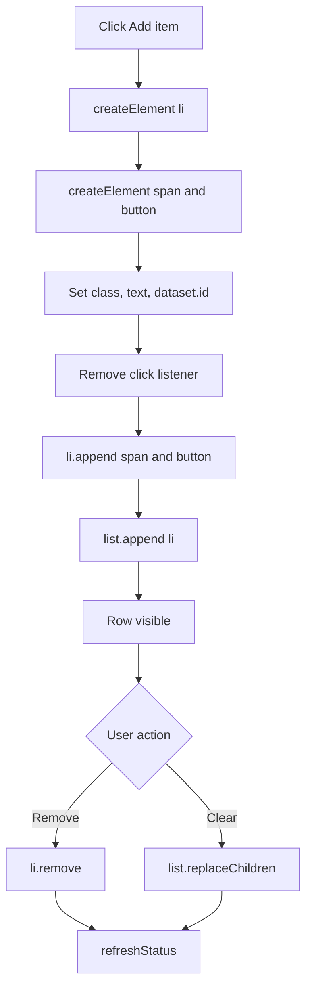

# ex01 — Dynamic elements

<div class="ebook-run">

**Track:** `vanilla` · **Project:** `web-app` · **Port:** `5174`

```text
cd web-app
vp install   # first time
vp dev
# open http://localhost:5174/ex01-dynamic-elements/
```

<p class="ebook-source"><strong>Source:</strong> <code>web-app/ex01-dynamic-elements/README.md</code></p>

</div>


**Goal.** Build UI at runtime with TypeScript DOM APIs —
`createElement`, `append`, `textContent`, `remove` — instead of finding
elements that already exist in the HTML.

ex00 _found_ nodes. This lab _creates_ them, wires listeners, and deletes them
again.

---

## Learning outcomes

After this lab you should be able to:

1. Create an element with `document.createElement` and configure it with
   `textContent`, `className`, `type`, `dataset`, and `setAttribute`.
2. Attach nodes with `append` and detach them with `remove` or
   `replaceChildren`.
3. Explain the difference between a node **in memory** and a node **in the live
   DOM**.
4. Attach a listener to a node you just created and use a **closure** so each
   Remove button knows its row.
5. Keep a status line in sync by reading `list.children.length`.
6. Explain why `textContent` is safer than `innerHTML` for untrusted or plain
   text.

---

## Theory

### The DOM is a tree you can edit

Every element is a **node** with a parent and children. `index.html` is a thin
shell: one empty `<div id="mount" class="card">`. All interactive UI is built in
`main.ts` and attached under `#mount`.

Each list row is a small subtree: `li.item` containing a label `span` and a
Remove `button`. See the **Diagrams** section for the full mount layout.

### Create, configure, attach

| Step         | API                                              | Example from `main.ts`                    |
| ------------ | ------------------------------------------------ | ----------------------------------------- |
| 1. Create    | `document.createElement("tag")`                  | `const li = document.createElement("li")` |
| 2. Configure | `textContent`, `className`, `type`, `dataset`, … | `li.className = "item"`                   |
| 3. Attach    | `parent.append(child, ...)`                      | `list.append(li)`                         |

A node that has been created but not attached exists only in memory — invisible
until a parent contains it.

### Properties, attributes, and dataset

| API                          | Sets                  | Used in this lab for             |
| ---------------------------- | --------------------- | -------------------------------- |
| `el.textContent = "..."`     | Plain text content    | Labels, buttons, status          |
| `el.className = "btn"`       | The `class` attribute | Link to rules in `styles.css`    |
| `button.type = "button"`     | Button type property  | Avoid accidental form submit     |
| `el.setAttribute(name, val)` | Any attribute by name | `aria-live="polite"` on the list |
| `el.dataset.id = "3"`        | `data-id="3"`         | Remember item number on a row    |

`dataset` values are always strings — the code uses `String(id)`.

### Adding and removing

| Operation                | Effect                                     | Where                       |
| ------------------------ | ------------------------------------------ | --------------------------- |
| `parent.append(a, b, c)` | Add children at the end                    | `toolbar.append(addBtn, …)` |
| `li.remove()`            | Remove this node from its parent           | Remove button listener      |
| `list.replaceChildren()` | Remove all children (no args = empty list) | Clear button                |
| `list.children.length`   | Count of child elements                    | `refreshStatus()`           |

`append` on a node already in the document **moves** it. `mount.append(...)` runs
once at the end, after every part is ready.

### Closures: each Remove knows its row

Inside `addItem()`, the Remove button’s click listener calls `li.remove()`. The
arrow function **closes over** the local `li`, so every button removes its own
row after `addItem()` returns — no ids or event delegation required at this
level.

### `textContent` versus `innerHTML`

The hint in `main.ts` mentions `<li>` and `<ul>` as literal text:

```ts
hint.textContent = "Each click builds an <li> in memory, then appends it to the <ul>.";
```

Because `textContent` does not parse HTML, angle brackets appear on screen as
written. With `innerHTML`, the browser would try to interpret markup. Prefer
`textContent` whenever the value is not trusted HTML.

### Small TypeScript details

| Code                                   | Meaning                                       |
| -------------------------------------- | --------------------------------------------- |
| `const LABELS = [...] as const`        | Read-only tuple of literal strings            |
| `LABELS[(id - 1) % LABELS.length]!`    | Cycle labels; `!` asserts index in range      |
| `let nextId = 1; const id = nextId++;` | Post-increment: use current value, then add 1 |
| `aria-live="polite"`                   | Screen readers announce list changes politely |

---

## Diagrams

### Mount tree (after startup)

```
┌─────────────────────────────────────────┐
│ div#mount.card                          │
│ ┌─────────────────────────────────────┐ │
│ │ h2  Live list                       │ │
│ └─────────────────────────────────────┘ │
│ ┌─────────────────────────────────────┐ │
│ │ p.hint                              │ │
│ └─────────────────────────────────────┘ │
│ ┌─────────────────────────────────────┐ │
│ │ div.toolbar  Add item  Clear        │ │
│ └─────────────────────────────────────┘ │
│ ┌─────────────────────────────────────┐ │
│ │ ul.item-list  (li rows go here)     │ │
│ └─────────────────────────────────────┘ │
│ ┌─────────────────────────────────────┐ │
│ │ p.status  items: N                  │ │
│ └─────────────────────────────────────┘ │
└─────────────────────────────────────────┘
```

### One list row

```
┌───────────────────────────────────┐
│ li.item  data-id="3"              │
│ ┌───────────────────────────────┐ │
│ │ span.item-label  #3 - blue    │ │
│ └───────────────────────────────┘ │
│ ┌───────────────────────────────┐ │
│ │ button.item-remove            │ │
│ └───────────────────────────────┘ │
└───────────────────────────────────┘
```

### Sequence: Add item and Remove

```mermaid
sequenceDiagram
  actor User
  participant Add as Add item button
  participant TS as addItem()
  participant DOM as ul.item-list
  participant Status as p.status

  Note over TS: Startup built toolbar, list, status; appended to id=mount
  User->>Add: click
  Add->>TS: click listener
  TS->>TS: id = nextId++, pick label
  TS->>TS: createElement li, span, button
  TS->>TS: Remove listener closes over li
  TS->>DOM: list.append(li)
  TS->>Status: refreshStatus()
  User->>DOM: click Remove on a row
  DOM->>TS: remove listener
  TS->>DOM: li.remove()
  TS->>Status: refreshStatus()
```

### Flow: lifecycle of one row



---

## Files

| File         | Role                                                         |
| ------------ | ------------------------------------------------------------ |
| `index.html` | Thin shell: header, idea card, empty `#mount`                |
| `styles.css` | Classes for nodes created in TS (`.btn`, `.item`, …)         |
| `ui.ts`      | Not used in this lab                                         |
| `main.ts`    | **Read this** — toolbar, list, status, every item at runtime |

---

## Run

```bash
cd hardware-interface-workshop/web-app
vp dev
```

Open [http://localhost:5174/ex01-dynamic-elements/](http://localhost:5174/ex01-dynamic-elements/)

---

## Walkthrough (`main.ts`)

1. **Mount point** — `getElementById("mount")` plus an `instanceof` guard (same
   pattern as ex00).
2. **Constants and state** — `LABELS` and `nextId` at module scope.
3. **Static parts built once** — `title`, `hint`, `toolbar`, `addBtn`,
   `clearBtn`, `list`, `status`. `toolbar.append(addBtn, clearBtn)` groups
   buttons before anything is on screen.
4. **`refreshStatus()`** — reads `list.children.length`; called from add,
   remove, and clear.
5. **`addItem()`** — create `li`, `span`, `button`, attach Remove listener,
   `list.append(li)`.
6. **Toolbar listeners** — Add calls `addItem`; Clear calls
   `list.replaceChildren()`.
7. **Final assembly** — `mount.append(title, hint, toolbar, list, status)` and
   initial `refreshStatus()`.

Ask while reading: _which nodes exist before the first click, and which are
created later?_

---

## Checklist

- [ ] **Add item** appends a new `<li>`
- [ ] **Remove** deletes that row only
- [ ] **Clear** empties the list
- [ ] The status line always matches the number of rows
- [ ] You changed a label string or class in `main.ts` once

---

## Common pitfalls

| Symptom                               | Likely cause                                  | Fix                                 |
| ------------------------------------- | --------------------------------------------- | ----------------------------------- |
| New element never appears             | Created but never attached                    | Call `parent.append(node)`          |
| Element appears once, then disappears | Re-appended the same node (it moves)          | Create a new node per row           |
| Every Remove deletes the last row     | Shared outer variable instead of per-row `li` | Declare `li` inside `addItem()`     |
| Status shows stale count              | Forgot `refreshStatus()` after a change       | Call it from add, remove, and clear |
| Button submits or reloads a form      | Default `type="submit"`                       | Set `button.type = "button"`        |
| `<li>` text renders as an element     | Used `innerHTML` for plain text               | Use `textContent`                   |
| `dataset.id = 3` fails to type-check  | `dataset` values must be strings              | Use `String(id)`                    |

---

## Glossary

| Term              | Meaning                                                    |
| ----------------- | ---------------------------------------------------------- |
| Node              | One object in the DOM tree (element, text, etc.)           |
| Mount point       | Existing element (`#mount`) where dynamic UI is attached   |
| Closure           | Function that remembers variables from its enclosing scope |
| `append`          | Add one or more children to an element                     |
| `replaceChildren` | Replace all children of an element (empty if no args)      |
| `dataset`         | Map of `data-*` attributes on an element                   |
| `aria-live`       | Hint for assistive tech to announce dynamic updates        |

---

## Further reading

- [MDN: Document.createElement](https://developer.mozilla.org/en-US/docs/Web/API/Document/createElement)
- [MDN: Node.append](https://developer.mozilla.org/en-US/docs/Web/API/Element/append)
- [MDN: Element.innerHTML vs textContent](https://developer.mozilla.org/en-US/docs/Web/API/Element/innerHTML#security_considerations)
- [ex00 — Hello, page](../../generated/vanilla/ex00-hello/index.md) — `getElementById` and events
- [Vanilla track hub](../README.md)

---

**Previous:** [ex00 — Hello, page](../../generated/vanilla/ex00-hello/index.md)  
**Next:** [ex02 — Dynamic style](../../generated/vanilla/ex02-dynamic-style/index.md)
