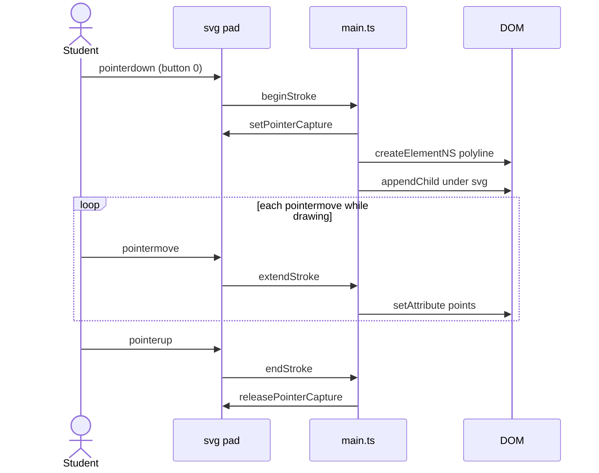
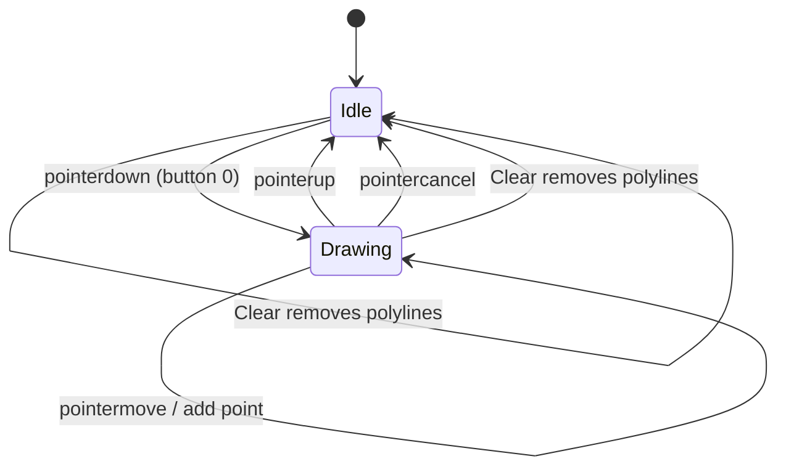
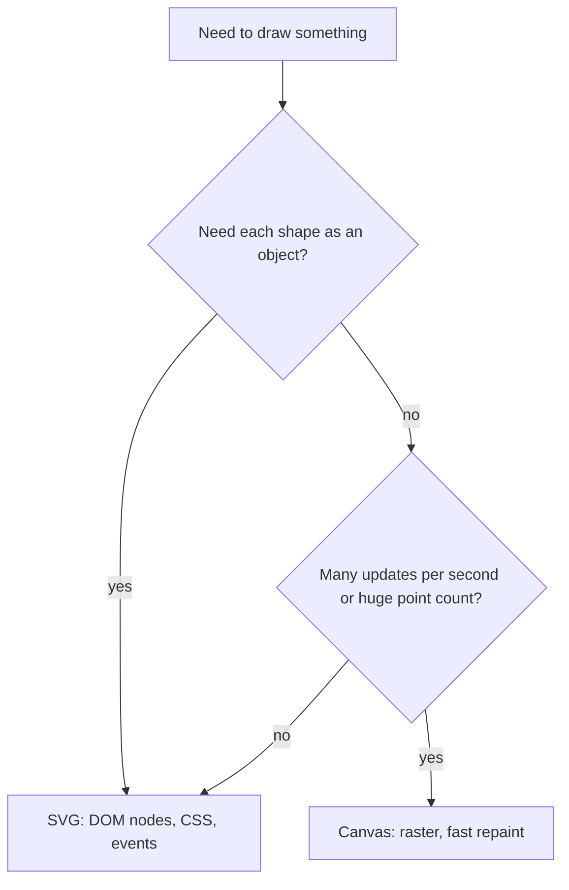

# ex05 — SVG draw

<div class="ebook-run">

**Track:** `vanilla` · **Project:** `web-app` · **Port:** `5174`

```text
cd web-app
vp install   # first time
vp dev
# open http://localhost:5174/ex05-svg-draw/
```

<p class="ebook-source"><strong>Source:</strong> <code>web-app/ex05-svg-draw/README.md</code></p>

</div>


**Goal.** Turn pointer gestures into **vector strokes**: for every drag, build an SVG
`<polyline>` with `createElementNS`, keep growing its `points` attribute, and leave
the result in the DOM where you can inspect, select, and delete it.

This is the first lab where the page **draws** rather than just reacts. The same
gesture is repeated in [ex06 — Canvas draw](../../generated/vanilla/ex06-canvas-draw/index.md) so you can compare
_retained_ (SVG) and _immediate_ (canvas) graphics side by side.

---

## Learning outcomes

After this lab you should be able to:

1. Explain why SVG elements must be created with `createElementNS` and the SVG namespace.
2. Convert a pointer position from screen pixels (`clientX`/`clientY`) into **viewBox** coordinates.
3. Build a `points="x,y x,y …"` string and update it on every `pointermove`.
4. Use pointer capture so a stroke keeps receiving events when the cursor leaves the pad.
5. Describe SVG as **retained-mode** (scene graph) graphics and name trade-offs against canvas.
6. Clear a drawing by removing DOM nodes instead of wiping pixels.

---

## Theory

### Retained mode: the drawing _is_ the DOM

An `<svg>` is part of the document tree. Each shape (`<polyline>`, `<circle>`,
`<path>`) is an element with attributes, can be styled by CSS, receives events,
and shows up in DevTools. The browser keeps the scene description and re-rasterizes
it whenever needed (resize, zoom, print). You describe **what exists**; the browser
decides **how to paint it**.

### Why `createElementNS`

HTML and SVG are different XML vocabularies. `document.createElement("polyline")`
creates an _HTML_ unknown element that the SVG renderer ignores — it never appears.
The SVG namespace tells the DOM which vocabulary the tag belongs to.

| Call                                           | Namespace                    | Result                                          |
| ---------------------------------------------- | ---------------------------- | ----------------------------------------------- |
| `document.createElement("polyline")`           | HTML                         | Inert unknown element, nothing drawn            |
| `document.createElementNS(SVG_NS, "polyline")` | `http://www.w3.org/2000/svg` | Real SVG shape                                  |
| `el.setAttribute("points", "…")`               | —                            | Works on SVG elements (attribute, not property) |

### Coordinate systems

The pad is declared as `viewBox="0 0 640 260"` with `preserveAspectRatio="none"`.
The **viewBox** is the internal coordinate space; the element's on-screen size comes
from CSS and can be anything. `svgPoint()` maps screen pixels into viewBox units
(see the coordinate diagram under **Diagrams**).

Because the stroke is stored in viewBox units, resizing the window **scales the
drawing** with the pad — no redraw code needed. That is a core SVG advantage over
a fixed bitmap (ex06).

### Pointer events and capture

| Event                          | What `main.ts` does                                           |
| ------------------------------ | ------------------------------------------------------------- |
| `pointerdown` (primary button) | Capture pointer, create a new `<polyline>`, append to `<svg>` |
| `pointermove`                  | If drawing, push a point and rewrite `points`                 |
| `pointerup` / `pointercancel`  | Stop drawing, release capture                                 |

`setPointerCapture` routes later events to the pad even if the pointer leaves it.
`touch-action: none` in `styles.css` stops touch screens from scrolling instead of
drawing. The same pointer pattern is reused in ex06 with no API change — only the
_target_ of drawing changes (DOM vs canvas context).

### SVG vs canvas (read before ex06)

Both labs sketch with the same gestures; the **memory model** differs.

| Aspect                 | SVG (this lab)                         | Canvas 2D ([ex06](../../generated/vanilla/ex06-canvas-draw/index.md))                   |
| ---------------------- | -------------------------------------- | ---------------------------------------------------------- |
| Model                  | **Retained:** scene graph of elements  | **Immediate:** pixels painted, no shape list               |
| After drawing          | Each stroke is a DOM node              | One bitmap; strokes exist only as pixels                   |
| Inspect in DevTools    | Yes — select each `<polyline>`         | No — only the `<canvas>` element                           |
| Per-shape CSS / events | Native (hover, click, transitions)     | Manual hit testing                                         |
| Resolution             | Vector — crisp at any zoom             | Fixed bitmap; handle `devicePixelRatio`                    |
| Resize behavior        | Strokes scale with `viewBox`           | Setting bitmap size clears content (ex06 clears on resize) |
| Clear                  | Remove nodes (`clearPolylines`)        | `clearRect`                                                |
| Cost grows with        | Number of DOM elements                 | Pixel area and draw-call rate                              |
| Undo one stroke        | Delete one node                        | Store points yourself and repaint                          |
| Best for               | Diagrams, gauges, pinouts, editable UI | Scopes, particles, video frames, 10k+ points/sec           |

**Workshop rule of thumb:** SVG for board pinouts and dashboards you want to restyle
or click; canvas for high-rate sensor plots and waveforms. ex07–ex09 use neither for
drawing — they use **media APIs** — but the pointer skills from ex04–ex06 still matter
for any custom control you build on top.

---

## Diagrams

### Scene graph (retained mode)

```
┌──────────────────────────────────────┐
│ <svg id="pad" viewBox="0 0 640 260"> │
│   <polyline points="12.0,40.5 ...">  │
│   <polyline points="300.1,80.0 ..."> │
│   <polyline ...>  one per stroke     │
│ </svg>                               │
└──────────────────────────────────────┘
```

### Screen to viewBox

```
┌───────────────────┐       ┌───────────────────┐
│ clientX, clientY  │       │ viewBox x, y      │
│ minus rect.left   │  -->  │ x = u / width*640 │
│ minus rect.top    │       │ y = v / height*260│
└───────────────────┘       └───────────────────┘
  screen pixels               0..640 by 0..260
```

### Stroke lifecycle (sequence)



### Drawing state



### Which technique?



---

## Files

| File         | Role                                                                  |
| ------------ | --------------------------------------------------------------------- |
| `index.html` | Page chrome, color swatches, Clear button, empty `<svg id="pad">`     |
| `styles.css` | Layout, `touch-action: none`, crosshair cursor                        |
| `ui.ts`      | DOM lookups, readout, swatches, `clearPolylines`                      |
| `main.ts`    | **Read this** — pointer handlers, `createElementNS`, `points` builder |

---

## Run

```bash
cd hardware-interface-workshop/web-app
vp dev
```

Open [http://localhost:5174/ex05-svg-draw/](http://localhost:5174/ex05-svg-draw/)

No permissions or special hardware are needed.

---

## Walkthrough (`main.ts`)

1. **Constants and state** — `SVG_NS`, `strokeColor`, `drawing`, `current` (live
   `<polyline>`), `points`, `strokeCount`.
2. **`svgPoint(ev)`** — `getBoundingClientRect()` then scale to 640×260 (viewBox).
3. **`pointsAttr(pts)`** — `"x,y"` pairs joined by spaces, one decimal place.
4. **`beginStroke(ev)`** — capture pointer, `createElementNS`, stroke attributes,
   `fill="none"`, append to `<svg>`.
5. **`extendStroke(ev)`** — push a point, rewrite the whole `points` attribute.
6. **`endStroke(ev)`** — clear state; `releasePointerCapture` in `try/catch`.
7. **Swatches and Clear** — swatch changes color for the _next_ stroke only; Clear
   calls `clearPolylines()` and resets counters.

Try in DevTools: inspect a `<polyline>`, edit `stroke`, watch it update live — then
open [ex06](../../generated/vanilla/ex06-canvas-draw/index.md) where nothing can be inspected per stroke.

---

## Checklist

- [ ] Drag draws a colored stroke
- [ ] Color swatches change the **next** stroke only
- [ ] **Clear** removes all `<polyline>` nodes and resets `strokes=0`
- [ ] DevTools shows each stroke under the `<svg>`
- [ ] Resizing the window scales existing strokes with the pad
- [ ] Dragging out of the pad and back keeps one continuous stroke (pointer capture)

---

## Common pitfalls

| Symptom                            | Likely cause                                                  |
| ---------------------------------- | ------------------------------------------------------------- |
| Nothing appears after drawing      | Used `createElement` instead of `createElementNS`             |
| Stroke filled like a black polygon | Missing `fill="none"` on the polyline                         |
| Strokes offset from the cursor     | Used `clientX/Y` as viewBox units without scaling             |
| Touch screen scrolls the page      | Missing `touch-action: none` on the pad                       |
| Stroke stops at the pad edge       | No `setPointerCapture` on `pointerdown`                       |
| Very slow after many strokes       | Thousands of DOM nodes — simplify or use canvas (ex06)        |
| Strokes look stretched             | `preserveAspectRatio="none"` with a non-matching aspect ratio |

---

## Glossary

| Term                | Meaning                                                                     |
| ------------------- | --------------------------------------------------------------------------- |
| **Retained mode**   | Graphics stored as objects (here, DOM nodes) the engine can re-render later |
| **viewBox**         | Internal coordinate system of an `<svg>` (`0 0 640 260` in this lab)        |
| **Scene graph**     | Tree of drawable elements and their attributes                              |
| **Namespace (SVG)** | XML vocabulary URI required for `createElementNS`                           |
| **Pointer capture** | Events for one pointer ID stay routed to an element until release           |
| **Polyline**        | SVG shape defined by an open sequence of points                             |
| **Immediate mode**  | Draw calls write pixels with no lasting shape objects (canvas — ex06)       |

---

## Further reading

**MDN**

- [SVG element reference](https://developer.mozilla.org/en-US/docs/Web/SVG/Element/svg)
- [`document.createElementNS`](https://developer.mozilla.org/en-US/docs/Web/API/Document/createElementNS)
- [`<polyline>`](https://developer.mozilla.org/en-US/docs/Web/SVG/Element/polyline)
- [Pointer events](https://developer.mozilla.org/en-US/docs/Web/API/Pointer_events)

**Sibling labs**

- [ex04 — Keyboard + pointer](../../generated/vanilla/ex04-keyboard-pointer/index.md) — events before drawing
- [ex06 — Canvas draw](../../generated/vanilla/ex06-canvas-draw/index.md) — same gestures, bitmap output
- [ex07 — Web Audio mic](../../generated/vanilla/ex07-web-audio-mic/index.md) — next step: browser device APIs

---

**Previous:** [ex04 — Keyboard + pointer](../../generated/vanilla/ex04-keyboard-pointer/index.md)  
**Next:** [ex06 — Canvas draw](../../generated/vanilla/ex06-canvas-draw/index.md)
