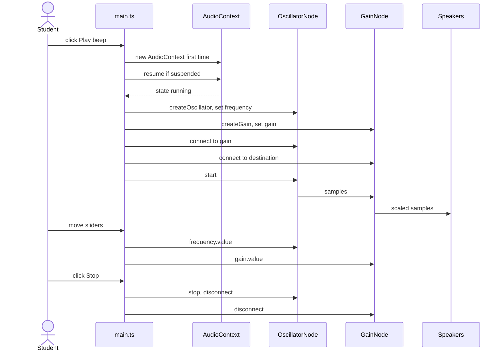
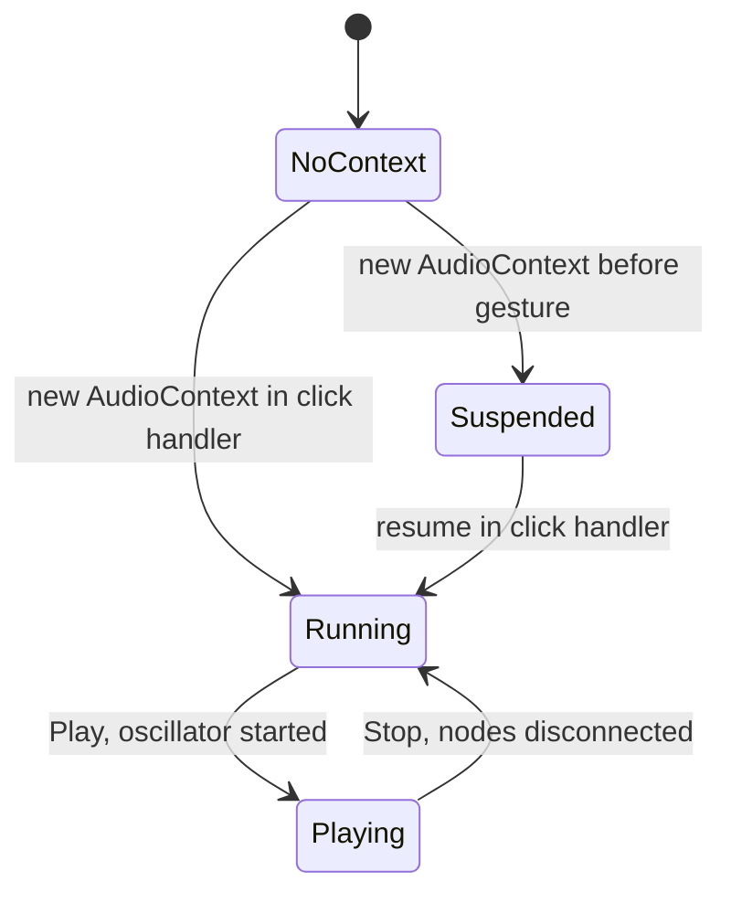
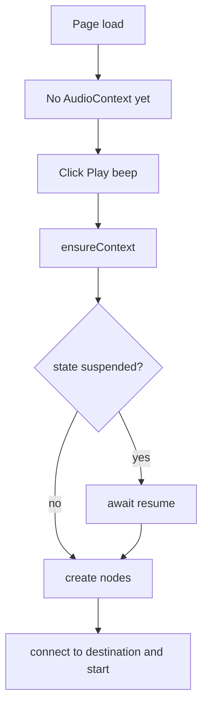

# ex08 — Web Audio speaker

<div class="ebook-run">

**Track:** `vanilla` · **Project:** `web-app` · **Port:** `5174`

```text
cd web-app
vp install   # first time
vp dev
# open http://localhost:5174/ex08-web-audio-speaker/
```

<p class="ebook-source"><strong>Source:</strong> <code>web-app/ex08-web-audio-speaker/README.md</code></p>

</div>


**Goal.** Generate a tone and play it through the default output device with
`OscillatorNode` → `GainNode` → `audioCtx.destination`, while changing frequency and
volume live from sliders.

Where [ex07 — Web Audio mic](../../generated/vanilla/ex07-web-audio-mic/index.md) was **input** (microphone), this
lab is **output** (speaker). No capture permission prompt is needed, but the **autoplay
policy** still requires a **user gesture** before audio runs.

---

## Learning outcomes

After this lab you should be able to:

1. Explain the autoplay policy and why `AudioContext.resume()` must run after a user gesture.
2. Build an output graph: oscillator → gain → `destination`.
3. Describe why an `OscillatorNode` is **one-shot** and create a new one for each Play.
4. Change `frequency` and `gain` while sound is playing, and relate linear gain to dB.
5. Reuse one `AudioContext` for the page and disconnect nodes on Stop.
6. Recognize safety limits (headphones, clipping) when generating tones in the browser.

---

## Theory

### User gesture vs permission (contrast ex07)

| Lab                                | Permission prompt?    | AudioContext unlock?                  |
| ---------------------------------- | --------------------- | ------------------------------------- |
| [ex07](../../generated/vanilla/ex07-web-audio-mic/index.md) mic | Yes — `getUserMedia`  | Yes — `resume()` on Start click       |
| **ex08** speaker                   | No — output only      | Yes — `ensureContext()` on Play click |
| [ex09](../../generated/vanilla/ex09-web-video-camera/index.md)  | Yes — camera          | No context (video only)               |
| [ex10](../../generated/vanilla/ex10-web-serial/index.md)        | Port picker (gesture) | N/A                                   |

Speaker output does not ask for mic/camera access, but Chromium still keeps a new
`AudioContext` in **`suspended`** until the user has clicked (or tapped). Calling
`resume()` inside the **Play beep** handler is the fix — never rely on autoplay from
page load.

### Autoplay policy and `resume()`

| `ctx.state` | Meaning                                     |
| ----------- | ------------------------------------------- |
| `suspended` | No audio clock; no samples reach the device |
| `running`   | Graph processes and output is audible       |
| `closed`    | Context destroyed permanently               |

`ensureContext()` lazily creates the context on first Play, then `await resume()` if
`suspended`. Because that runs in a click handler, the browser allows **`running`**.

### The output graph

Audio nodes connect like patch cables: `osc.connect(gain)`, then
`gain.connect(ctx.destination)`. `destination` is the default speakers or headphones.

### Why a new oscillator each time

An `OscillatorNode` can be `start()`ed **once** and `stop()`ped **once**. After
`stop()` it cannot restart. The lab creates fresh `osc` and `gain` on each Play and
disconnects them on Stop. The **AudioContext** is reused so the next Play stays fast.

### Frequency and gain

| Control   | Range      | Property              | Notes                                    |
| --------- | ---------- | --------------------- | ---------------------------------------- |
| Frequency | 220–880 Hz | `osc.frequency.value` | 440 Hz is concert A                      |
| Gain      | 0.02–0.4   | `gainNode.gain.value` | Linear amplitude, not perceived loudness |

Perceived loudness is roughly logarithmic: \( \text{dB} = 20 \log_{10}(\text{gain}) \).
The lab caps gain at **0.4** as a safety limit — pure tones fatigue quickly in
headphones.

`frequency` and `gain` are `AudioParam` objects. Setting `.value` jumps instantly
(small clicks possible). Production code uses `setTargetAtTime` or ramps; this lab
keeps the simplest form.

### Cleaning up

| Step in `stopTone()`           | Purpose          |
| ------------------------------ | ---------------- |
| `osc.stop()` (in `try/catch`)  | End sound        |
| `disconnect()` on osc and gain | Detach for GC    |
| `playing = false`              | UI matches audio |

The context stays open so the next Play does not need another permission-style unlock.

---

## Diagrams

### Output graph

```
┌────────────────┐   ┌──────────────┐   ┌─────────────────┐
│ OscillatorNode │   │ GainNode     │   │ AudioContext    │
│ sine 220-880 Hz│-->│ gain 0.02-0.4│-->│ .destination    │
│ (pitch)        │   │ (volume)     │   │ (default output)│
└────────────────┘   └──────────────┘   └─────────────────┘
```

### Play, tweak, stop (sequence)



### Audio state



### Gesture gate



---

## Files

| File         | Role                                                             |
| ------------ | ---------------------------------------------------------------- |
| `index.html` | Play / Stop, frequency and gain sliders, readout                 |
| `styles.css` | Slider and button layout                                         |
| `ui.ts`      | `setButtons`, `setSliderLabels`, readout                         |
| `main.ts`    | **Read this** — `ensureContext`, `playTone`, `stopTone`, sliders |

---

## Run

```bash
cd hardware-interface-workshop/web-app
vp dev
```

Open [http://localhost:5174/ex08-web-audio-speaker/](http://localhost:5174/ex08-web-audio-speaker/)

No permission prompt. **Turn system volume down first**, especially with headphones.

---

## Walkthrough (`main.ts`)

1. **State** — `audioCtx`, `osc`, `gainNode`, `playing`; context survives across plays.
2. **`freqHz()` / `gainAmount()`** — parse slider values as numbers.
3. **`refreshReadout()`** — `state`, real `audioCtx.state`, current frequency when playing.
4. **`ensureContext()`** — lazy create + `resume()`; the gesture rule in one function.
5. **`playTone()`** — create nodes, connect chain, `start()`, enable Stop.
6. **`stopTone()`** — `stop`, `disconnect`, clear refs.
7. **Slider listeners** — update live nodes only when `osc` / `gainNode` exist.

Experiment: set `nextOsc.type` to `"square"` or `"triangle"` and compare timbre at low gain.

---

## Checklist

- [ ] **Play beep** starts a sine tone (click unlocks audio)
- [ ] Frequency slider changes pitch while playing
- [ ] Gain slider changes volume while playing
- [ ] **Stop** ends the oscillator and re-enables Play
- [ ] Readout shows `ctx=running` after first Play
- [ ] Play → Stop → Play again works without errors

---

## Common pitfalls

| Symptom                            | Likely cause                                       |
| ---------------------------------- | -------------------------------------------------- |
| No sound, `ctx=suspended`          | Context created or resumed outside a gesture       |
| `InvalidStateError` on second Play | Reused the same oscillator after `stop()`          |
| `InvalidStateError` on Stop        | Double `stop()` — use `try/catch`                  |
| Click when moving gain             | Abrupt `.value` change — use ramps in production   |
| Distorted tone                     | Gain too high or many sources summing above 1.0    |
| Sound after Stop                   | Nodes still connected or oscillator not stopped    |
| High CPU                           | New `AudioContext` every click — reuse one context |
| Silent on mobile                   | Hardware mute or tab in background                 |

---

## Glossary

| Term                | Meaning                                             |
| ------------------- | --------------------------------------------------- |
| **Autoplay policy** | Blocks audio output until user interaction          |
| **AudioContext**    | Host clock and node graph for Web Audio             |
| **OscillatorNode**  | Built-in waveform source (sine, square, …)          |
| **GainNode**        | Multiplies signal amplitude (`gain` AudioParam)     |
| **destination**     | Output node representing system audio device        |
| **AudioParam**      | Automatable parameter (`frequency`, `gain`)         |
| **User gesture**    | Click/tap that allows `resume()` and audible output |

---

## Further reading

**MDN**

- [Web Audio API](https://developer.mozilla.org/en-US/docs/Web/API/Web_Audio_API)
- [`AudioContext`](https://developer.mozilla.org/en-US/docs/Web/API/AudioContext)
- [`OscillatorNode`](https://developer.mozilla.org/en-US/docs/Web/API/OscillatorNode)
- [`GainNode`](https://developer.mozilla.org/en-US/docs/Web/API/GainNode)
- [Autoplay guide](https://developer.mozilla.org/en-US/docs/Web/Media/Autoplay_guide)

**Sibling labs**

- [ex07 — Web Audio mic](../../generated/vanilla/ex07-web-audio-mic/index.md) — input graph + `getUserMedia`
- [ex09 — Web video camera](../../generated/vanilla/ex09-web-video-camera/index.md) — capture permission without Web Audio
- [ex10 — Web Serial](../../generated/vanilla/ex10-web-serial/index.md) — another gesture-gated device API

---

**Previous:** [ex07 — Web Audio mic](../../generated/vanilla/ex07-web-audio-mic/index.md)  
**Next:** [ex09 — Web video camera](../../generated/vanilla/ex09-web-video-camera/index.md)
