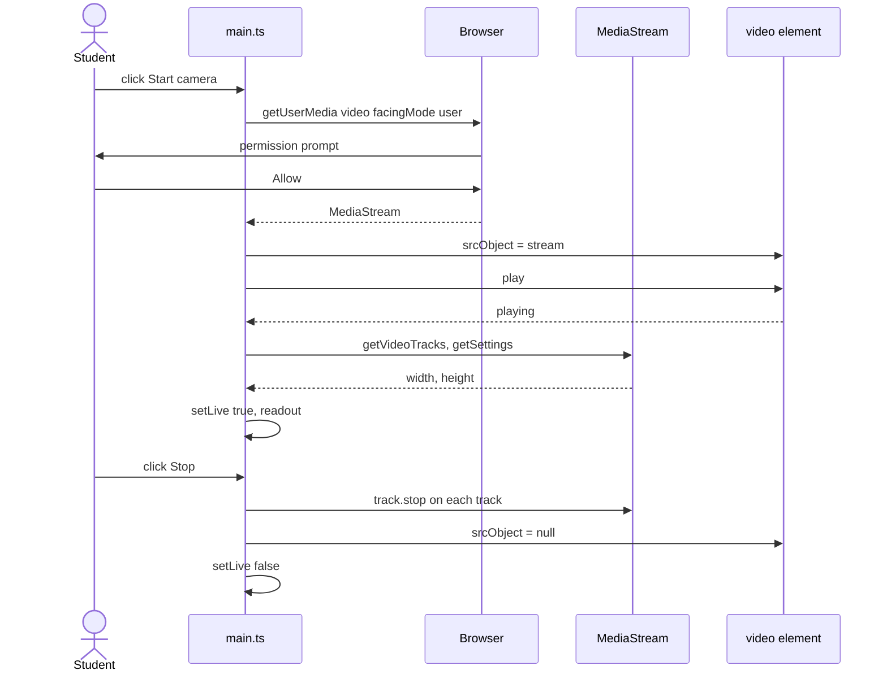
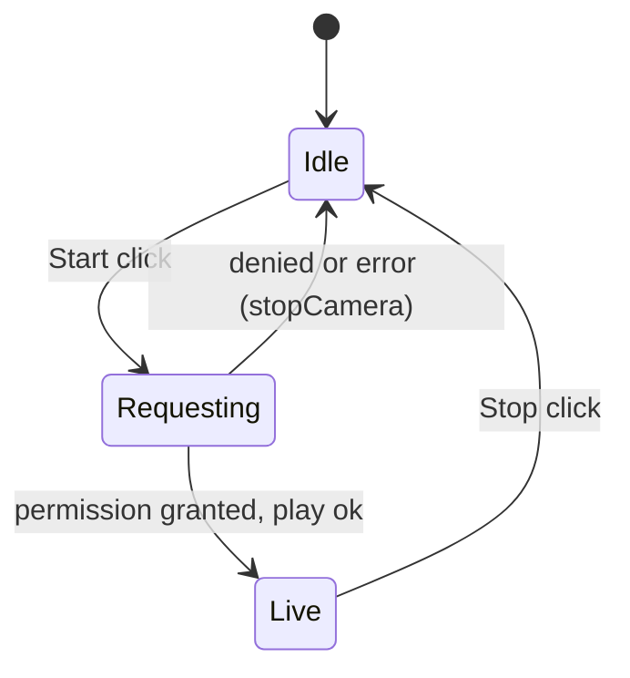
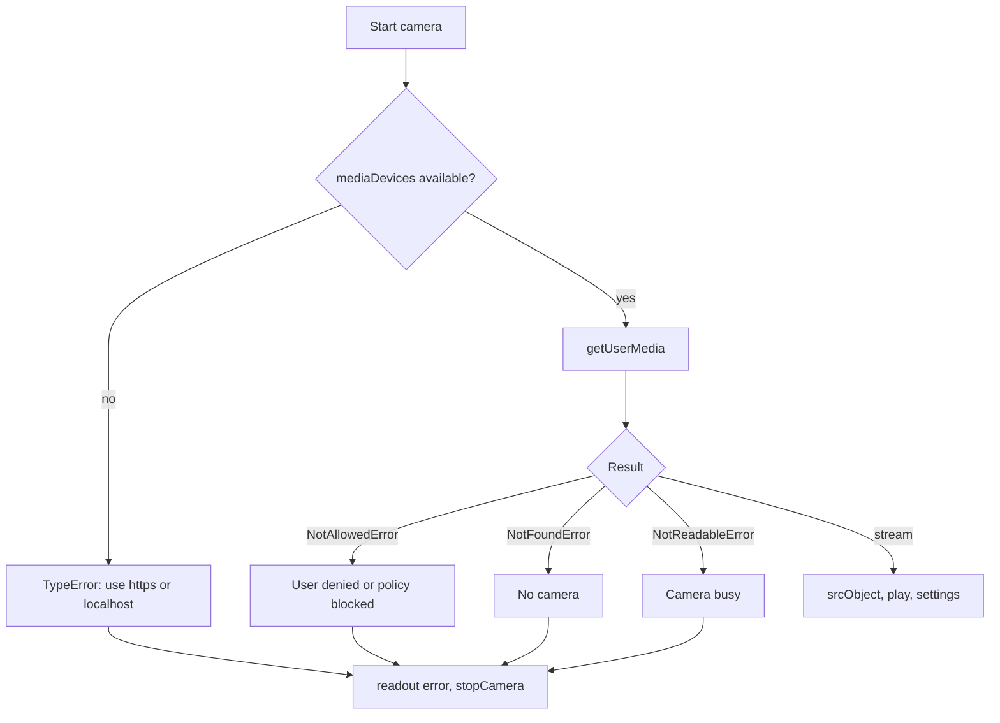

# ex09 — Web video camera

<div class="ebook-run">

**Track:** `vanilla` · **Project:** `web-app` · **Port:** `5174`

```text
cd web-app
vp install   # first time
vp dev
# open http://localhost:5174/ex09-web-video-camera/
```

<p class="ebook-source"><strong>Source:</strong> <code>web-app/ex09-web-video-camera/README.md</code></p>

</div>


**Goal.** Show a live camera preview: request video with `getUserMedia`, attach the
`MediaStream` to a `<video>` element through `srcObject`, read the real resolution from
the track, and release the camera cleanly with `track.stop()`.

This lab reuses the **capture permission pattern** from [ex07 — Web Audio mic](../../generated/vanilla/ex07-web-audio-mic/index.md)
for **video** instead of audio. It needs no `AudioContext`. It is the last browser-media
lab before hardware links starting with [ex10 — Web Serial](../../generated/vanilla/ex10-web-serial/index.md).

---

## Learning outcomes

After this lab you should be able to:

1. Request camera access with `getUserMedia({ video: … })` and handle common rejections.
2. Explain why a **secure context** and **user gesture** are required, parallel to ex07.
3. Attach a stream with `video.srcObject` and explain why `autoplay`, `muted`, and `playsinline` matter.
4. Read capture settings from `MediaStreamTrack.getSettings()`.
5. Distinguish a **constraint** (what you ask for) from a **setting** (what you got).
6. Turn the camera off with `track.stop()` and mirror the preview with CSS only.
7. State when the **AudioContext** gesture rule would apply if you added audio (ex07/ex08).

---

## Theory

### Three browser rules (media track)

When you add mic, speaker, or camera features, three policies often overlap:

| Rule                                    | Applies here?         | Detail                                                              |
| --------------------------------------- | --------------------- | ------------------------------------------------------------------- |
| **Capture permission** (`getUserMedia`) | Yes                   | Secure context; start from **Start camera** click                   |
| **Video autoplay**                      | Yes                   | `<video>` needs `muted` (and usually a gesture) to play inline      |
| **AudioContext autoplay**               | No ( `audio: false` ) | If you add audio, create/`resume()` context in a click (ex07, ex08) |

[ex10](../../generated/vanilla/ex10-web-serial/index.md) adds a fourth pattern for hardware: **Web Serial** port
picker on secure origin + user gesture — no camera involved.

### Permission: same API as the mic

`getUserMedia` backs both microphone and camera. You pass constraints; the browser
prompts; the promise resolves with a `MediaStream` or rejects.

| Requirement                           | Why                                                     |
| ------------------------------------- | ------------------------------------------------------- |
| Secure context (HTTPS or `localhost`) | `navigator.mediaDevices` missing on plain HTTP          |
| User consent                          | Browser shows recording indicator while tracks are live |
| Click-driven start                    | Prompts tied to intent — not on page load               |
| Available camera                      | Otherwise `NotFoundError`                               |

Typical rejections (`err.name`):

| `err.name`             | Meaning                                              |
| ---------------------- | ---------------------------------------------------- |
| `NotAllowedError`      | Denied or permissions policy (iframe without camera) |
| `NotFoundError`        | No camera device                                     |
| `NotReadableError`     | Camera in use elsewhere                              |
| `OverconstrainedError` | An `exact` constraint cannot be met                  |

### Constraints vs settings

`getUserMedia({ video: { facingMode: "user" }, audio: false })` expresses **constraints**.

| Form                         | Meaning             | Failure                |
| ---------------------------- | ------------------- | ---------------------- |
| `video: true`                | Any camera          | Only if none exist     |
| `{ facingMode: "user" }`     | Prefer front camera | Ideal — may fall back  |
| `{ width: { ideal: 1280 } }` | Prefer size         | Closest mode           |
| `{ width: { exact: 1280 } }` | Must match          | `OverconstrainedError` |

After success, `track.getSettings()` reports actual `width`, `height`, `frameRate`,
`deviceId`, etc. The lab falls back to `video.videoWidth` / `videoHeight` when needed.

### `srcObject`, autoplay, and inline playback

- **`srcObject`** accepts a `MediaStream` object. `video.src = "…"` is for URLs, not live capture.
- **`muted`** — required for autoplay without extra user steps in most browsers.
- **`playsinline`** — prevents iOS from forcing fullscreen on play.
- **`await video.play()`** after **Start camera** — runs in the gesture chain started by the click.

If you later set `audio: true`, follow ex07: build the Web Audio graph in the click
handler and `resume()` the context. Do not route mic to speakers without headphones.

### Why `track.stop()` matters

| Action                            | Camera light?                   |
| --------------------------------- | ------------------------------- |
| `video.pause()` or remove element | Often **stays on**              |
| `stream = null` only              | **Stays on** until GC           |
| `track.stop()` on each track      | **Turns off** — releases device |
| `track.enabled = false`           | May stay on (black frames)      |

`stopCamera()` stops every track, clears `srcObject`, and toggles UI off.

### Mirroring is presentation only

CSS `transform: scaleX(-1)` mirrors the preview like a selfie mirror. **Frames in the
stream are not flipped.** Canvas capture or upload needs an explicit flip if you want
non-mirrored text.

---

## Diagrams

### Stream to screen

```
┌──────────────┐   ┌─────────────────┐   ┌───────────────────┐
│ Camera       │   │ MediaStream     │   │ video element     │
│ hardware     │-->│  VideoTrack     │-->│ srcObject = stream│
│ + OS driver  │   │  (live frames)  │   │ autoplay muted    │
└──────────────┘   └─────────────────┘   └───────────────────┘
                                                  |
                                                  v
                                           pixels on screen
                                          (CSS scaleX -1 mirror)
```

### Start, preview, stop (sequence)



### Camera state



### Failure paths



---

## Files

| File         | Role                                                            |
| ------------ | --------------------------------------------------------------- |
| `index.html` | Start / Stop, `<video autoplay muted playsinline>`, placeholder |
| `styles.css` | Preview box, mirror, `is-live` toggling                         |
| `ui.ts`      | `setButtons`, `setLive`, readout                                |
| `main.ts`    | **Read this** — `getUserMedia`, `srcObject`, `stopCamera`       |

---

## Run

```bash
cd hardware-interface-workshop/web-app
vp dev
```

Open [http://localhost:5174/ex09-web-video-camera/](http://localhost:5174/ex09-web-video-camera/)

Needs **HTTPS or localhost**, a camera, and **allow** in the prompt. Close other apps
that hold the camera. Reset site permission if you blocked it earlier.

---

## Walkthrough (`main.ts`)

1. **State** — single `stream: MediaStream | null` (live flag).
2. **`startCamera()`** — guard double start; disable buttons; `getUserMedia` with
   `facingMode: "user"`; assign `srcObject`; `await play()`; read `getSettings()` for
   resolution; `setLive(true)`.
3. **`catch`** — error in readout; `stopCamera()` for clean idle.
4. **`stopCamera()`** — `track.stop()` all tracks; clear `srcObject`; reset UI.
5. **Listeners** — Start only from click (`void startCamera()`).

Experiment: try `{ width: { ideal: 640 }, height: { ideal: 480 } }`, then
`exact: 4000` to see `OverconstrainedError`.

---

## Checklist

- [ ] **Start camera** asks for permission and shows a live image
- [ ] Preview is mirrored (front-camera style)
- [ ] Readout shows resolution when live
- [ ] **Stop** turns camera off (indicator light out), placeholder returns
- [ ] Start → Stop → Start works
- [ ] Denying permission shows `error:` and leaves Start enabled

---

## Common pitfalls

| Symptom                     | Likely cause                                         |
| --------------------------- | ---------------------------------------------------- |
| `getUserMedia` of undefined | Insecure origin                                      |
| Prompt never appears        | Blocked site or iframe without camera permission     |
| Black preview               | Wrong `src`, missing `srcObject`, or `play()` failed |
| `play()` NotAllowedError    | Unmuted video without gesture — keep `muted`         |
| iOS fullscreen              | Missing `playsinline`                                |
| Camera light after Stop     | Tracks not stopped                                   |
| `NotReadableError`          | Another tab or app owns the camera                   |
| Backwards text in captures  | CSS mirror only on preview — flip captures if needed |
| Wrong camera on phone       | `"user"` is front — use `"environment"` for rear     |

---

## Glossary

| Term               | Meaning                                             |
| ------------------ | --------------------------------------------------- |
| **Secure context** | `https:` or `http://localhost` for `mediaDevices`   |
| **User gesture**   | Click that starts `getUserMedia` and `video.play()` |
| **MediaStream**    | Container for live audio/video tracks               |
| **Constraint**     | Desired capture properties passed to `getUserMedia` |
| **getSettings()**  | Actual width/height/device after negotiation        |
| **srcObject**      | Property binding a stream to `<video>` or `<audio>` |
| **track.stop()**   | Releases camera hardware for other apps             |

---

## Further reading

**MDN**

- [`MediaDevices.getUserMedia`](https://developer.mozilla.org/en-US/docs/Web/API/MediaDevices/getUserMedia)
- [Media Capture and Streams API](https://developer.mozilla.org/en-US/docs/Web/API/Media_Capture_and_Streams_API)
- [`HTMLMediaElement.srcObject`](https://developer.mozilla.org/en-US/docs/Web/API/HTMLMediaElement/srcObject)
- [`MediaStreamTrack.getSettings`](https://developer.mozilla.org/en-US/docs/Web/API/MediaStreamTrack/getSettings)
- [Autoplay guide](https://developer.mozilla.org/en-US/docs/Web/Media/Autoplay_guide) (video + audio rules)

**Sibling labs**

- [ex07 — Web Audio mic](../../generated/vanilla/ex07-web-audio-mic/index.md) — same permission API for audio
- [ex08 — Web Audio speaker](../../generated/vanilla/ex08-web-audio-speaker/index.md) — if you add preview audio tones
- [ex10 — Web Serial](../../generated/vanilla/ex10-web-serial/index.md) — next: USB board link (gesture + secure context)
- [ex06 — Canvas draw](../../generated/vanilla/ex06-canvas-draw/index.md) — optional: draw a video frame to canvas

---

**Previous:** [ex08 — Web Audio speaker](../../generated/vanilla/ex08-web-audio-speaker/index.md)  
**Next:** [ex10 — Web Serial](../../generated/vanilla/ex10-web-serial/index.md)
