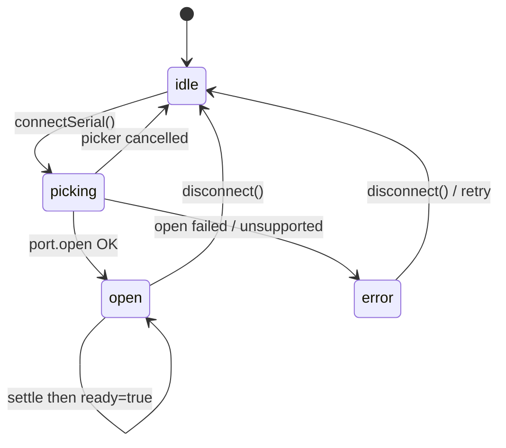
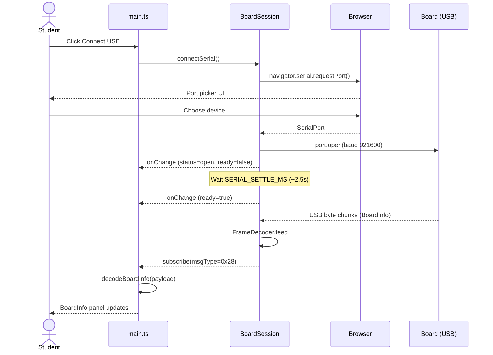

# ex10 — Web Serial

<div class="ebook-run">

**Track:** `vanilla` · **Project:** `web-app` · **Port:** `5174`

```text
cd web-app
vp install   # first time
vp dev
# open http://localhost:5174/ex10-web-serial/
```

<p class="ebook-source"><strong>Source:</strong> <code>web-app/ex10-web-serial/README.md</code></p>

</div>


**Goal.** Open a USB link from the browser to a Cronos board using the
**Web Serial API**, wrapped by `@sdk` `BoardSession`, then display the first
**BoardInfo** identity frame the firmware sends.

This lab is **Serial only** (no Bluetooth). Later labs reuse the same session
for commands (LED) and for BLE.

---

## Learning outcomes

After this lab you should be able to:

1. Explain why Web Serial needs a **secure context** and a **user gesture**.
2. Trace `connectSerial()` from the click through the port picker to the read loop.
3. Describe the on-wire stack: USB CDC → bytes → COBS frames → protobuf payload.
4. Use `onChange` for session state and `subscribe` for decoded frames.
5. Decode `MSG_BOARD_INFO` (`0x28`) into human-readable fields.

---

## Theory

### What Web Serial is

Web Serial is a browser API (`navigator.serial`) that lets a web page talk to
a USB serial device **without** a native app. The page:

1. Asks the user to pick a port (`requestPort()`).
2. Opens it at a baud rate (`open({ baudRate })`).
3. Reads and writes raw `Uint8Array` chunks on streams.

Cronos boards appear as a USB serial (CDC / USB-Serial/JTAG) device. The
firmware speaks a framed binary protocol on that pipe. The browser never sees
“BoardInfo” as text — it sees **bytes**. `@sdk` turns those bytes into typed
frames.

### Why not `file://` or random HTTP?

| Requirement                           | Why                                                 |
| ------------------------------------- | --------------------------------------------------- |
| Secure context (`localhost` or HTTPS) | Browsers restrict powerful device APIs              |
| Chrome / Edge (Chromium)              | Web Serial is not on Firefox/Safari today           |
| User gesture (click)                  | `requestPort()` must run from a trusted interaction |
| Real USB board                        | There is no fake port in this lab                   |

### Session state machine

`BoardSession` exposes a small status machine. UI should follow it, not invent
a second one.



| Field       | Meaning                                          |
| ----------- | ------------------------------------------------ |
| `status`    | `idle` \| `picking` \| `open` \| `error`         |
| `ready`     | `true` after settle; safe to send commands later |
| `transport` | `"serial"` in this lab                           |
| `message`   | Human hint for the status line                   |

**Settle time.** Opening USB can reset the MCU. The SDK waits
`SERIAL_SETTLE_MS` (2500 ms) before setting `ready`. BoardInfo may arrive
during or after that window as the firmware boots and streams identity.

### Bytes on the wire

```
┌────────┐   USB CDC    ┌──────────┐   UART/USB   ┌──────────┐
│ Browser│ ◄──────────► │ USB chip │ ◄──────────► │   MCU    │
│  page  │   bytes      │ (bridge) │              │ firmware │
└────────┘              └──────────┘              └──────────┘
```

The page does not speak USB descriptors itself. It only sees a serial port of
bytes. Framing happens in software:

```
┌──────────────┐     feed(chunk)     ┌──────────────┐
│  USB reader  │ ──────────────────► │ FrameDecoder │
└──────────────┘                     └──────┬───────┘
                                            │ DecodedFrame
                                            ▼
                                     ┌──────────────┐
                                     │  subscribe() │
                                     │   handlers   │
                                     └──────────────┘
```

Frame sketch (conceptual — see `sdk/wire/frame.ts`):

```
  0x00  COBS(msgType | seq | len | payload | crc16)  0x00
   ^                                                  ^
   delimiters                                  delimiters
```

| Layer                    | Job                                   |
| ------------------------ | ------------------------------------- |
| USB serial               | Move opaque bytes                     |
| COBS + `0x00` delimiters | Split a stream into packets           |
| CRC16                    | Reject corruption                     |
| `msgType`                | Which message (e.g. `0x28` BoardInfo) |
| Protobuf payload         | Fields: uuid, mac, fw, caps, …        |

You do **not** hand-parse COBS in this lab. `BoardSession` feeds the read
loop into `FrameDecoder`; your code only handles already-decoded frames.

### `onChange` vs `subscribe`

```
                 ┌─────────────────┐
                 │  BoardSession   │
                 └────────┬────────┘
                          │
           ┌──────────────┼──────────────┐
           │              │              │
           ▼              ▼              ▼
     status/ready    DecodedFrame    writeFrame /
       onChange       subscribe      writeAcked
```

- **`onChange`** — paint the session box (Connect disabled while open, etc.).
- **`subscribe`** — react to protocol messages. Filter on `MSG_BOARD_INFO`.

---

## Sequence: connect and first BoardInfo



Cancel path: if the student closes the picker, the browser throws
`NotFoundError`. The session returns to `idle` with a calm message — not an
error panic.

---

## Files in this lab

| File                                        | Role                                         |
| ------------------------------------------- | -------------------------------------------- |
| `index.html`                                | Page structure (buttons, status, BoardInfo)  |
| `styles.css`                                | Look                                         |
| `ui.ts`                                     | DOM helpers only — ignore on first read      |
| `main.ts`                                   | **Read this** — connect · subscribe · decode |
| [`sdk/session.ts`](../sdk/session.ts)       | `BoardSession` implementation (reference)    |
| [`sdk/wire/frame.ts`](../sdk/wire/frame.ts) | Frame codec + `MSG_BOARD_INFO`               |

---

## Run

```bash
cd hardware-interface-workshop/web-app
vp dev
```

Open [http://localhost:5174/ex10-web-serial/](http://localhost:5174/ex10-web-serial/)

Needs **Chrome or Edge**, `localhost` or HTTPS, and a board on USB with
serial-bridge firmware.

---

## Walkthrough (`main.ts`)

1. **Construct** `new BoardSession()` once for the page lifetime.
2. **Capability banner** — `serialUnsupportedReason()` explains missing API /
   insecure context before the student clicks.
3. **`onChange`** — clear BoardInfo on disconnect/error; call `paint()`.
4. **`subscribe`** — if `frame.msgType === MSG_BOARD_INFO`, decode and paint.
5. **Connect click** — must call `connectSerial()` here (user gesture).
6. **Disconnect click** — `disconnect()` closes the port and resets state.

Key imports from `@sdk`:

```ts
import {
  BoardSession,
  MSG_BOARD_INFO,
  SERIAL_BAUD,
  SERIAL_SETTLE_MS,
  decodeBoardInfo,
  serialUnsupportedReason,
} from "@sdk";
```

---

## Checklist

- [ ] Unsupported browsers show a clear banner
- [ ] **Connect USB** opens the port picker (user gesture)
- [ ] After ~2.5 s settle, `ready=true`
- [ ] BoardInfo fields appear (hw, fw, mac, caps, …)
- [ ] **Disconnect** returns to `status=idle` and clears BoardInfo

---

## Common pitfalls

| Symptom                      | Likely cause                                               |
| ---------------------------- | ---------------------------------------------------------- |
| Banner about secure context  | Opened via `file://` or plain HTTP on a LAN IP             |
| No port picker               | Not Chromium, or click handler never calls `connectSerial` |
| Port opens but never `ready` | Disconnected during settle; or page refreshed mid-open     |
| No BoardInfo                 | Wrong firmware / USB interface; wait longer; check cable   |
| Permission denied            | OS or browser blocked serial; try another cable / port     |

---

## Glossary

| Term           | Meaning                                                      |
| -------------- | ------------------------------------------------------------ |
| Web Serial     | Browser API (`navigator.serial`) for USB serial ports        |
| Secure context | `localhost` or HTTPS — required for Serial / Bluetooth       |
| User gesture   | Trusted interaction (e.g. click) that may call `requestPort` |
| Settle         | Pause after USB open (~2.5 s) while the MCU may reboot       |
| Frame          | COBS-delimited packet with `msgType`, seq, payload, CRC      |
| BoardInfo      | Identity message `0x28` (model, fw, mac, caps, …)            |
| `onChange`     | Session status / ready / message updates                     |
| `subscribe`    | Callback for each decoded protocol frame                     |

---

## Further reading

- [`sdk/README.md`](../../../sdk/index.md) — quick start for Serial + BLE
- [`sdk/browser.ts`](../sdk/browser.ts) — capability checks
- [`sdk/wire/boardInfo.ts`](../sdk/wire/boardInfo.ts) — protobuf field map
- [Web Serial API (MDN)](https://developer.mozilla.org/en-US/docs/Web/API/Web_Serial_API)
- Workshop flash images: [`firmware-prebuilt/`](../../firmware-prebuilt/)

---

**Previous:** [ex09 — Web video camera](../../generated/vanilla/ex09-web-video-camera/index.md)  
**Next:** [ex11 — Web Bluetooth](../../generated/vanilla/ex11-web-bluetooth/index.md) · then [ex12 — LED writeAcked](../../generated/vanilla/ex12-led-writeacked/index.md)
