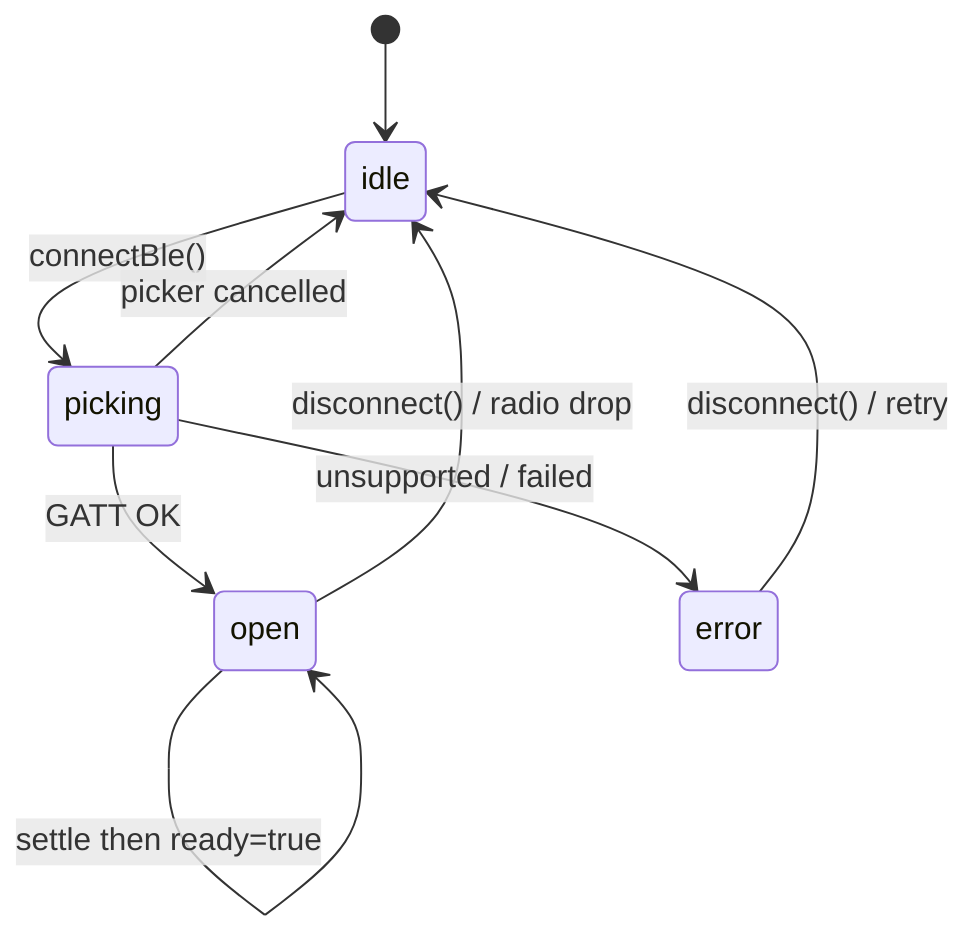
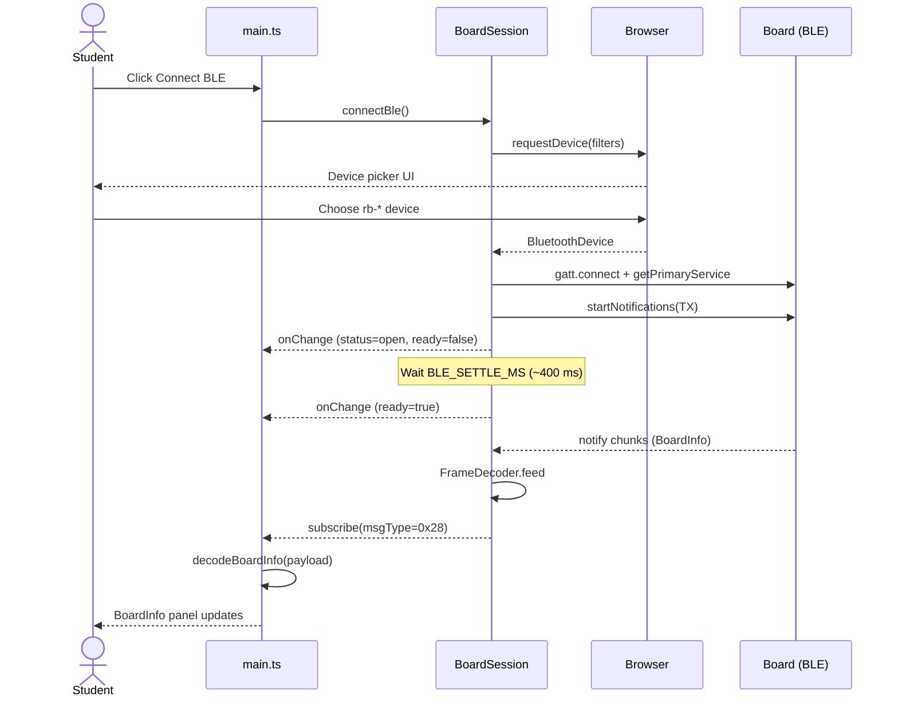

# ex11 — Web Bluetooth

<div class="ebook-run">

**Track:** `vanilla` · **Project:** `web-app` · **Port:** `5174`

```text
cd web-app
vp install   # first time
vp dev
# open http://localhost:5174/ex11-web-bluetooth/
```

<p class="ebook-source"><strong>Source:</strong> <code>web-app/ex11-web-bluetooth/README.md</code></p>

</div>


**Goal.** Open a wireless link from the browser to a Cronos board using the
**Web Bluetooth API**, wrapped by `@sdk` `BoardSession.connectBle()`, then
display the same **BoardInfo** frame (`0x28`) you saw over USB in ex10.

This lab is **BLE only**. The on-wire protocol is identical to Serial — only
the pipe changes (`transport = "ble"`).

---

## Learning outcomes

After this lab you should be able to:

1. Explain why Web Bluetooth needs a **secure context** and a **user gesture**.
2. Trace `connectBle()` from the click → device picker → GATT → notify loop.
3. Name the robotos GATT service and RX/TX characteristics used by the SDK.
4. Contrast Serial settle (~2.5 s) with BLE settle (`BLE_SETTLE_MS`, 400 ms).
5. Reuse `onChange` / `subscribe` / `decodeBoardInfo` unchanged from ex10.

---

## Theory

### What Web Bluetooth is

Web Bluetooth lets a page talk to a BLE GATT peripheral without a native app.
The page:

1. Asks the user to pick a device (`navigator.bluetooth.requestDevice`).
2. Connects GATT and discovers a primary service + characteristics.
3. Writes to one characteristic (host → board) and receives **notifications**
   on another (board → host).

Cronos boards advertise a custom **robotos** service. The SDK writes framed
COBS bytes in 20-byte chunks (`BLE_WRITE_CHUNK`) and reassembles notify chunks
with the same `FrameDecoder` as USB.

### Serial vs Bluetooth (same session API)

| Aspect       | ex10 Web Serial           | ex11 Web Bluetooth    |
| ------------ | ------------------------- | --------------------- |
| Browser API  | `navigator.serial`        | `navigator.bluetooth` |
| Session call | `connectSerial()`         | `connectBle()`        |
| Picker       | USB port                  | BLE device            |
| Settle       | `SERIAL_SETTLE_MS` (2500) | `BLE_SETTLE_MS` (400) |
| `transport`  | `"serial"`                | `"ble"`               |
| Frames       | COBS + CRC + protobuf     | **Same**              |
| BoardInfo    | `MSG_BOARD_INFO` `0x28`   | **Same**              |

### Why not `file://`?

| Requirement       | Why                                                              |
| ----------------- | ---------------------------------------------------------------- |
| Secure context    | BLE is a powerful device API                                     |
| Chrome / Edge     | Web Bluetooth support is Chromium-first                          |
| User gesture      | `requestDevice()` must run from a click                          |
| Board advertising | Firmware must be up and BLE enabled; look for `rb-*` / `robotos` |

### GATT roles in this lab

```
┌──────────────┐  notify TX   ┌──────────────┐
│ BoardSession │ <----------- │    Board     │
│  (browser)   │ -----------> │  (firmware)  │
└──────────────┘  write RX    └──────────────┘
```

| UUID role | Constant  | Direction             |
| --------- | --------- | --------------------- |
| Service   | `BLE_SVC` | Container             |
| RX        | `BLE_RX`  | Host → board writes   |
| TX        | `BLE_TX`  | Board → host notifies |

Exact UUID strings: see [`sdk/ble.ts`](../sdk/ble.ts) and the
[`sdk` API README](../../../sdk/index.md).

### Session state (unchanged shape)



If the GATT link drops, `BoardSession` disconnects and returns to `idle`.

---

## Sequence: connect and first BoardInfo



---

## Files in this lab

| File                                  | Role                                              |
| ------------------------------------- | ------------------------------------------------- |
| `index.html`                          | Page structure (buttons, status, BoardInfo)       |
| `styles.css`                          | Look                                              |
| `ui.ts`                               | DOM helpers only — ignore on first read           |
| `main.ts`                             | **Read this** — `connectBle` · subscribe · decode |
| [`sdk/session.ts`](../sdk/session.ts) | `BoardSession.connectBle`                         |
| [`sdk/ble.ts`](../sdk/ble.ts)         | GATT open / chunked writes                        |

---

## Run

```bash
cd hardware-interface-workshop/web-app
vp dev
```

Open [http://localhost:5174/ex11-web-bluetooth/](http://localhost:5174/ex11-web-bluetooth/)

Needs **Chrome or Edge**, `localhost` or HTTPS, and a board with BLE
advertising (same prebuilt images as USB labs). Prefer finishing
[ex10](../../generated/vanilla/ex10-web-serial/index.md) first so BoardInfo is familiar.

---

## Walkthrough (`main.ts`)

1. **Construct** `new BoardSession()` once.
2. **Banner** — `bleUnsupportedReason()` before the student clicks.
3. **Hint** — shows service prefix + settle time.
4. **`onChange` / `subscribe`** — same pattern as ex10.
5. **Connect click** — `connectBle()` (user gesture).
6. **Disconnect** — `disconnect()`.

```ts
import {
  BLE_SETTLE_MS,
  BLE_SVC,
  BoardSession,
  MSG_BOARD_INFO,
  bleUnsupportedReason,
  decodeBoardInfo,
} from "@sdk";
```

---

## Checklist

- [ ] Unsupported browsers show a clear banner
- [ ] **Connect BLE** opens the device picker (user gesture)
- [ ] After ~400 ms settle, `ready=true` and `transport=ble`
- [ ] BoardInfo fields appear (hw, fw, mac, caps, …)
- [ ] **Disconnect** returns to `status=idle` and clears BoardInfo

---

## Common pitfalls

| Symptom                     | Likely cause                                                      |
| --------------------------- | ----------------------------------------------------------------- |
| Banner about secure context | Opened via `file://` or plain HTTP                                |
| Empty / no device in picker | Board not advertising; wrong firmware; another app holds the link |
| Connect fails after pick    | GATT discover race — retry; close other BLE clients               |
| No BoardInfo                | Wait up to ~10 s (periodic). Newer firmware also pushes `0x28` on BLE subscribe |
| Works on USB, not BLE       | Radio off, distance, or Windows BLE privacy / pairing quirks      |

**Note:** `ready=true` without BoardInfo is OK briefly. Stay connected for the next `0x28`. After flashing firmware that calls `bsp_info_force()` on GATT subscribe, identity should appear almost immediately.

---

## Glossary

| Term          | Meaning                                                              |
| ------------- | -------------------------------------------------------------------- |
| Web Bluetooth | Browser API for BLE GATT (`navigator.bluetooth`)                     |
| GATT          | Generic Attribute Profile — services + characteristics               |
| Notify        | Board pushes bytes on TX; browser fires `characteristicvaluechanged` |
| RX / TX       | Write characteristic / notify characteristic on the robotos service  |
| Chunk         | BLE writes are split into 20-byte pieces                             |
| Settle        | Short pause after notify setup before `ready`                        |

---

## Further reading

- [`sdk/README.md`](../../../sdk/index.md) — full API (Serial + BLE)
- [`sdk/ble.ts`](../sdk/ble.ts) — UUIDs, `openBleLink`, `bleWrite`
- [Web Bluetooth (MDN)](https://developer.mozilla.org/en-US/docs/Web/API/Web_Bluetooth_API)
- Previous lab: [ex10 — Web Serial](../../generated/vanilla/ex10-web-serial/index.md)
- Flash images: [`firmware-prebuilt/`](../../firmware-prebuilt/)

---

**Previous:** [ex10 — Web Serial](../../generated/vanilla/ex10-web-serial/index.md)  
**Next:** [ex12 — LED writeAcked](../../generated/vanilla/ex12-led-writeacked/index.md)
