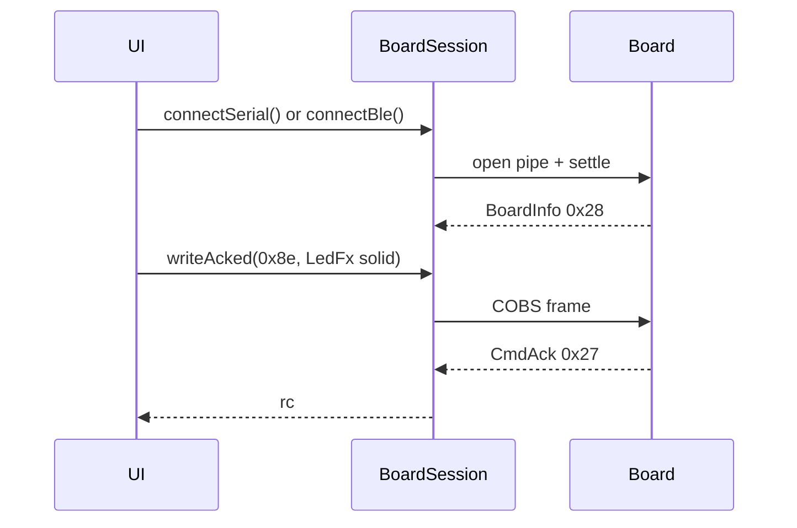

# ex12 — LED · LedFx (Serial or BLE)

<div class="ebook-run">

**Track:** `vanilla` · **Project:** `web-app` · **Port:** `5174`

```text
cd web-app
vp install   # first time
vp dev
# open http://localhost:5174/ex12-led-writeacked/
```

<p class="ebook-source"><strong>Source:</strong> <code>web-app/ex12-led-writeacked/README.md</code></p>

</div>


**Goal.** Drive the board RGB LED with `LedFx` (`MSG_LED_FX` `0x8e`) using
`BoardSession.writeAcked()`, and let the student **choose USB Serial or Web
Bluetooth** — same session object, same frames, only the connect call differs.

Wave oscillators (`WaveCmd` `0x83`) are the next lab:
[ex13 — WaveCmd](../../generated/vanilla/ex13-wave-cmd/index.md).

---

## Learning outcomes

After this lab you should be able to:

1. Offer both transports in one UI (`connectSerial` / `connectBle` / `disconnect`).
2. Explain why LED buttons wait for `ready` **and** `CAP.LED` from BoardInfo.
3. Use all five `LedFx` effects: off / solid / blink / fade / rainbow.
4. Use `writeAcked(MSG_LED_FX, payload)` and read `rc` from `CmdAck`.
5. Say why the wire is identical once `transport` is `"serial"` or `"ble"`.

---

## Theory

### One session, two pipes

| Button         | Call                 | Browser API             |
| -------------- | -------------------- | ----------------------- |
| Connect USB    | `connectSerial()`    | Web Serial port picker  |
| Connect BLE    | `connectBle()`       | Web Bluetooth picker    |
| Disconnect     | `disconnect()`       | Closes whichever is open |

```ts
const board = new BoardSession();
await board.connectSerial(); // or connectBle()
await board.writeAcked(MSG_LED_FX, encodeLedSolid({ r: 220, g: 24, b: 24 }));
```

### `writeAcked` vs `writeFrame`

| API           | Sends frame | Waits for `CmdAck` (`0x27`) |
| ------------- | ----------- | --------------------------- |
| `writeFrame`  | Yes         | No                          |
| `writeAcked`  | Yes         | Yes (timeout if no reply)   |

### Capability gate

| Board    | Typical caps | RGB LED |
| -------- | ------------ | ------- |
| es3c28p  | `0x33`       | Yes     |
| ws28p    | `0x3c`       | No      |

### Message map

| Msg                     | Dir          | Role                                 |
| ----------------------- | ------------ | ------------------------------------ |
| `MSG_BOARD_INFO` `0x28` | board → host | Identity + caps                      |
| `MSG_LED_FX` `0x8e`     | host → board | Off / solid / blink / fade / rainbow |
| `MSG_CMD_ACK` `0x27`    | board → host | Result (`writeAcked`)                |

---

## Sequence



---

## Files

| File         | Role                                      |
| ------------ | ----------------------------------------- |
| `index.html` | Link toolbar + LedFx buttons              |
| `ui.ts`      | DOM handles + paint helpers               |
| `main.ts`    | **Read this** — dual connect + writeAcked |
| `styles.css` | Page look                                 |

---

## Try it

1. Flash [firmware-prebuilt](../../firmware-prebuilt/) (`es3c28p` for LED).
2. `cd hardware-interface-workshop/web-app` → `vp dev` →
   [http://localhost:5174/ex12-led-writeacked/](http://localhost:5174/ex12-led-writeacked/)
3. Click **Connect USB** *or* **Connect BLE**.
4. Wait for BoardInfo with `LED=yes`, then try the LedFx buttons.

### Checklist

- [ ] USB / BLE connect show the right `transport`
- [ ] LedFx buttons stay disabled until `ready` + `CAP.LED`
- [ ] Solid / blink / fade / rainbow / off all respond
- [ ] Last CmdAck shows `rc=0` on success

---

## Further reading

- [`sdk/README.md`](../../../sdk/index.md) — `writeAcked`, LED helpers, caps
- [ex11 — Web Bluetooth](../../generated/vanilla/ex11-web-bluetooth/index.md)
- [ex13 — WaveCmd](../../generated/vanilla/ex13-wave-cmd/index.md)

---

**Previous:** [ex11 — Web Bluetooth](../../generated/vanilla/ex11-web-bluetooth/index.md)  
**Next:** [ex13 — WaveCmd](../../generated/vanilla/ex13-wave-cmd/index.md) · [ex14 — LED sliders](../../generated/vanilla/ex14-led-sliders/index.md)
