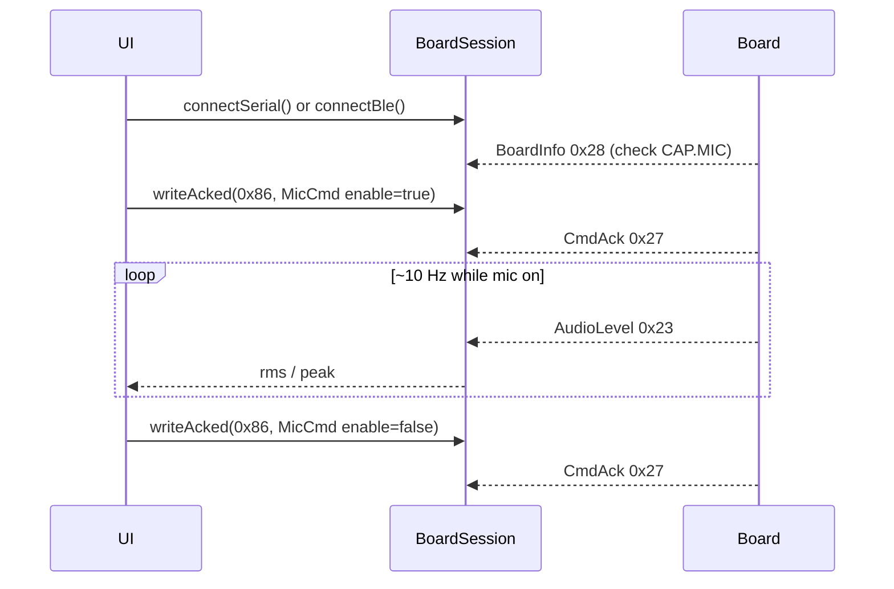

# ex18 — Mic · hello (Serial or BLE)

<div class="ebook-run">

**Track:** `vanilla` · **Project:** `web-app` · **Port:** `5174`

```text
cd web-app
vp install   # first time
vp dev
# open http://localhost:5174/ex18-mic-hello/
```

<p class="ebook-source"><strong>Source:</strong> <code>web-app/ex18-mic-hello/README.md</code></p>

</div>


**Goal.** Turn the board microphone **on and off** with `MicCmd`
(`MSG_MIC_CMD` `0x86`) via `writeAcked()`, and subscribe to **`AudioLevel`**
(`MSG_AUDIO_LEVEL` `0x23`) to print RMS / peak while you speak. Requires
**es3c28p** (`CAP.MIC`); **ws28p** has no mic.

Gain, mute, and a VU bar are [ex19 — Mic VU](../../generated/vanilla/ex19-mic-vu/index.md). USB PCM scope
is [ex20 — Mic wave](../../generated/vanilla/ex20-mic-wave/index.md).

---

## Learning outcomes

After this lab you should be able to:

1. Gate mic controls with `boardHas(CAP.MIC, info.caps)` from `BoardInfo`.
2. Encode enable/disable with `encodeMicCmd({ enable })` and read `CmdAck`.
3. Subscribe to `MSG_AUDIO_LEVEL` and decode with `decodeAudioLevel`.
4. Explain that levels stream on **USB or BLE** (~10 Hz while mic enabled).
5. Contrast mic uplink with SFX downlink (ex15–17) on the same session.

---

## Theory

### Capability gate

| Board    | `CAP.MIC` (`0x02`) | Mic labs |
| -------- | ------------------ | -------- |
| es3c28p  | Yes                | ex18–20  |
| ws28p    | No                 | Banner warns; buttons stay off |

```ts
import { CAP, boardHas } from "@sdk";

const hasMic = info !== null && boardHas(CAP.MIC, info.caps);
```

### `MicCmd` — fields in this lab

From [`sdk/wire/mic.ts`](../sdk/wire/mic.ts):

| Field      | This lab                         |
| ---------- | -------------------------------- |
| `enable`   | `true` / `false` via Mic on/off  |
| `gainPct`  | Not used (defaults on board)     |
| `mute`     | Not used                         |
| `stream`   | Not used (ex20 enables PCM)      |

Omit fields you do not want to change — protobuf optional fields only.

```ts
await board.writeAcked(MSG_MIC_CMD, encodeMicCmd({ enable: true }));
await board.writeAcked(MSG_MIC_CMD, encodeMicCmd({ enable: false }));
```

### `AudioLevel` — board → host

While the mic is enabled, firmware publishes level windows (~10 Hz):

| Field     | Meaning                          |
| --------- | -------------------------------- |
| `rms`     | Window RMS (0..32767 int16 scale)|
| `peak`    | Window peak                      |
| `frames`  | Samples in window                |
| `clipped` | Clip flag                        |

```ts
board.subscribe((frame) => {
  if (frame.msgType !== MSG_AUDIO_LEVEL) return;
  const level = decodeAudioLevel(frame.payload);
});
```

Works over **USB Serial and BLE**. **PCM** (`MSG_MIC_PCM` `0x24`) is USB-only
(ex20).

### Message map

| Msg                     | Dir          | Role                          |
| ----------------------- | ------------ | ----------------------------- |
| `MSG_BOARD_INFO` `0x28` | board → host | Identity + `caps`             |
| `MSG_MIC_CMD` `0x86`    | host → board | Enable / disable capture      |
| `MSG_AUDIO_LEVEL` `0x23`| board → host | RMS / peak while mic on       |
| `MSG_CMD_ACK` `0x27`    | board → host | Result for `writeAcked`       |

---

## Sequence



---

## Files

| File         | Role                                        |
| ------------ | ------------------------------------------- |
| `index.html` | Link toolbar + Mic on/off                   |
| `ui.ts`      | Level text + mic button enablement          |
| `main.ts`    | **Read this** — `CAP.MIC` + AudioLevel sub  |
| `styles.css` | Page look                                   |

---

## Try it

1. Flash [firmware-prebuilt](../../firmware-prebuilt/) for **es3c28p**.
2. [http://localhost:5174/ex18-mic-hello/](http://localhost:5174/ex18-mic-hello/)
3. Connect **USB** or **BLE** → confirm BoardInfo shows `MIC=yes`.
4. **Mic on** → speak or clap → watch `rms` / `peak` update.
5. **Mic off** → levels stop; text says mic off.

### Checklist

- [ ] ws28p (if tried) shows banner and disabled mic buttons
- [ ] es3c28p: Mic on → `rc=0` and live `rms` / `peak`
- [ ] Mic off clears level display
- [ ] Works on both transports (levels only; no PCM yet)

---

## Further reading

- [`sdk/wire/mic.ts`](../sdk/wire/mic.ts) — `encodeMicCmd`, `decodeAudioLevel`
- [`sdk/caps.ts`](../sdk/caps.ts) — `CAP.MIC`
- [ex07 — Web Audio mic](../../generated/vanilla/ex07-web-audio-mic/index.md) — browser mic (not board wire)

---

**Previous:** [ex17 — SFX params](../../generated/vanilla/ex17-sfx-params/index.md)  
**Next:** [ex19 — Mic VU](../../generated/vanilla/ex19-mic-vu/index.md)
