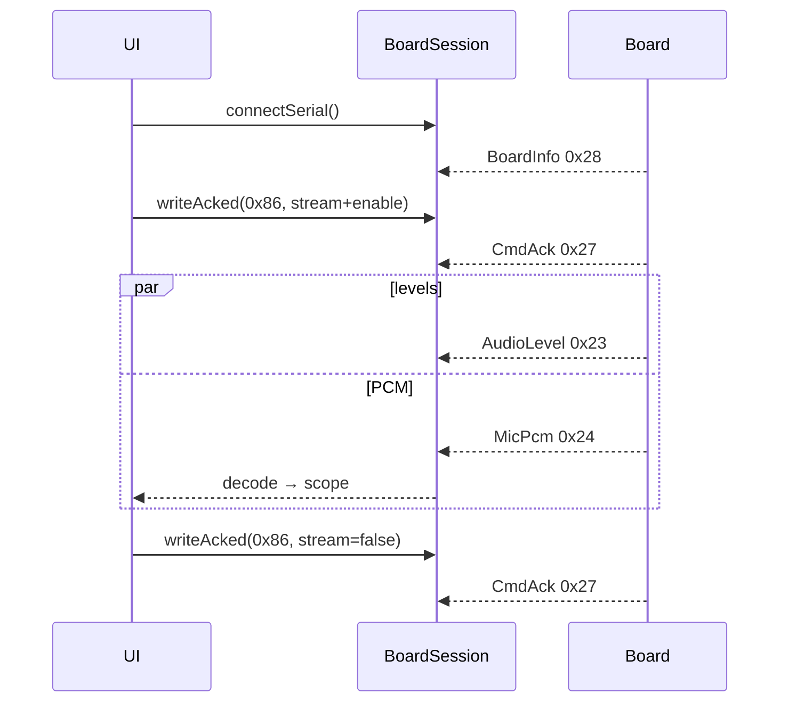

# ex20 — Mic · waveform (USB Serial)

<div class="ebook-run">

**Track:** `vanilla` · **Project:** `web-app` · **Port:** `5174`

```text
cd web-app
vp install   # first time
vp dev
# open http://localhost:5174/ex20-mic-wave/
```

<p class="ebook-source"><strong>Source:</strong> <code>web-app/ex20-mic-wave/README.md</code></p>

</div>


**Goal.** Stream **PCM** from the board with `encodeMicCmd({ stream: true, enable: true })`,
decode **`MicPcm`** (`MSG_MIC_PCM` `0x24`), and draw a scrolling scope on canvas.
**Web Serial only** — PCM bandwidth is too heavy for BLE in this workshop.

Requires **es3c28p** (`CAP.MIC`). You still get **`AudioLevel`** on USB for a
small VU beside the wave.

---

## Learning outcomes

After this lab you should be able to:

1. Explain why this lab hides **Connect BLE** and warns if `transport === "ble"`.
2. Start/stop PCM with `stream` + `enable` on `MicCmd` via `writeAcked`.
3. Decode `MSG_MIC_PCM` with `decodeMicPcm` and downsample into a ring buffer.
4. Normalize int16 samples to ±1 for canvas plotting.
5. Turn **Stream off** (or **Mic off**) before disconnect — good hygiene for firmware.

---

## Theory

### USB vs BLE for mic data

| Data            | Msg    | USB Serial | BLE        |
| --------------- | ------ | ---------- | ---------- |
| Audio levels    | `0x23` | Yes        | Yes        |
| PCM chunks      | `0x24` | Yes        | **No** (this lab) |

ex18–19 work on either transport; ex20 is **USB-only** by design.

### `MicCmd` for streaming

| Button      | Encoded params (this lab)                          |
| ----------- | -------------------------------------------------- |
| Stream on   | `{ stream: true, enable: true, gainPct: 70 }`      |
| Stream off  | `{ stream: false }`                                |
| Mic off     | `{ enable: false, stream: false }`                 |

```ts
await board.writeAcked(
  MSG_MIC_CMD,
  encodeMicCmd({ stream: true, enable: true, gainPct: 70 }),
);
```

### `MicPcm` payload

```ts
const pcm = decodeMicPcm(frame.payload);
// pcm.seq — chunk sequence
// pcm.samples — Int16Array
```

`main.ts` decimates each chunk (~64 points) and shifts a `Float32Array` history
(`PCM_HISTORY = 320`) for a readable scope:

```ts
const v = sample / 32768;
waveHist.copyWithin(0, 1);
waveHist[waveHist.length - 1] = v;
```

### Levels + PCM together

While streaming, the session still receives `MSG_AUDIO_LEVEL` for the compact
VU (`levelToPercent` on RMS). PCM drives the green waveform.

### Message map

| Msg                     | Dir          | Role                         |
| ----------------------- | ------------ | ---------------------------- |
| `MSG_BOARD_INFO` `0x28` | board → host | `CAP.MIC`                    |
| `MSG_MIC_CMD` `0x86`    | host → board | stream / enable / gain       |
| `MSG_AUDIO_LEVEL` `0x23`| board → host | VU while streaming           |
| `MSG_MIC_PCM` `0x24`    | board → host | PCM chunks (USB)             |
| `MSG_CMD_ACK` `0x27`    | board → host | `writeAcked` for MicCmd      |

---

## Sequence



---

## Files

| File         | Role                                            |
| ------------ | ----------------------------------------------- |
| `index.html` | USB connect + stream buttons + canvas           |
| `ui.ts`      | `paintWave`, `paintVu`, link buttons            |
| `main.ts`    | **Read this** — PCM subscribe + ring buffer     |
| `styles.css` | Scope + layout                                  |

---

## Try it

1. Flash **es3c28p** [firmware-prebuilt](../../firmware-prebuilt/).
2. [http://localhost:5174/ex20-mic-wave/](http://localhost:5174/ex20-mic-wave/)
3. **Connect USB** (no BLE button in this lab).
4. **Stream on** → speak — green waveform scrolls; VU twitches.
5. **Stream off** or **Mic off** before **Disconnect**.

### Checklist

- [ ] BoardInfo shows `MIC=yes`
- [ ] Stream on → `rc=0` and waveform moves with voice
- [ ] Stream off clears scope and stops PCM traffic
- [ ] Connecting via BLE elsewhere shows banner to use USB
- [ ] Mic off stops both stream and levels

---

## Further reading

- [`sdk/wire/mic.ts`](../sdk/wire/mic.ts) — `decodeMicPcm`, `encodeMicCmd`
- [ex19 — Mic VU](../../generated/vanilla/ex19-mic-vu/index.md) — levels without PCM
- [`sdk/README.md`](../../../sdk/index.md) — mic USB vs BLE note

---

**Previous:** [ex19 — Mic VU](../../generated/vanilla/ex19-mic-vu/index.md)
