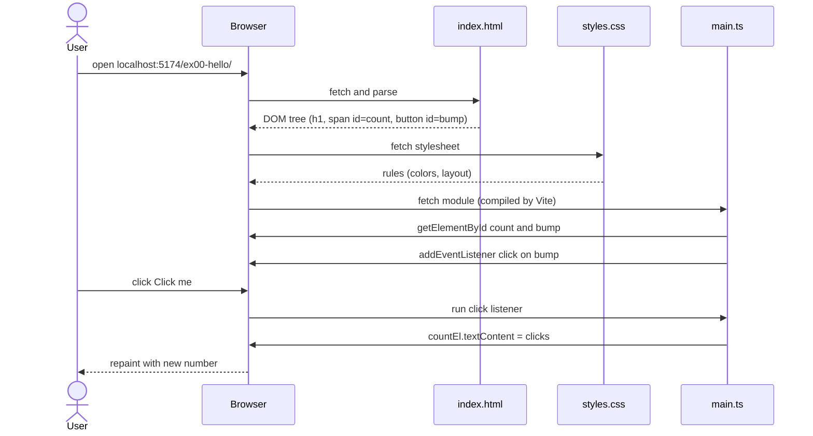
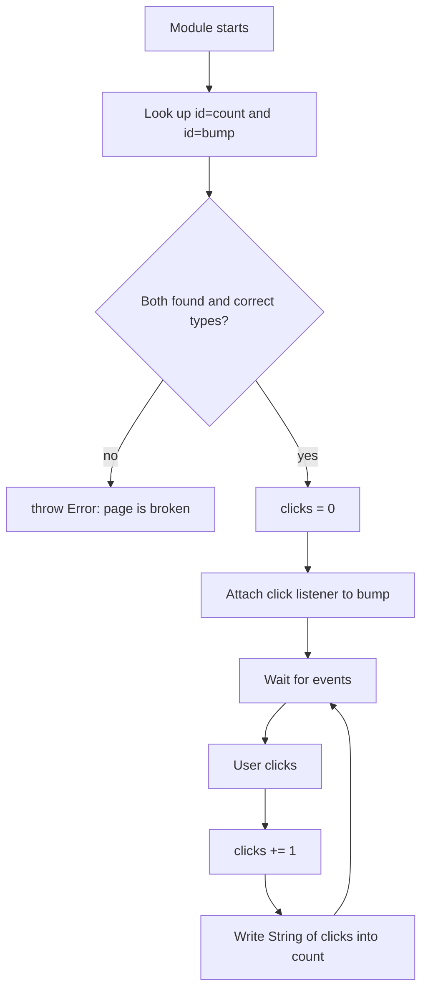

# ex00 — Hello, page

**Goal.** See how a browser page is built from three cooperating files
(HTML, CSS, TypeScript) and make your first interactive change: a button that
updates a counter.

This is the first lab of the vanilla track. There is no React, no Tailwind, and
no board yet — only the browser, the DOM, and one click handler.

---

## Learning outcomes

After this lab you should be able to:

1. Explain the role of **HTML** (structure), **CSS** (look), and **TypeScript**
   (behavior) in one sentence each.
2. Describe what the **DOM** is and why TypeScript talks to it instead of the
   HTML file on disk.
3. Find an element with `document.getElementById` and narrow its type with
   `instanceof`.
4. Register a `click` listener with `addEventListener` and update text with
   `textContent`.
5. Explain why the page must be served over `http://` (via `vp dev`) and not
   opened as a `file://` document.
6. Make three small edits (heading, `--accent`, click step) and see Vite+ hot
   update the page.

---

## Theory

### Three languages, three jobs

| Layer      | File         | Question it answers      | Example in this lab                      |
| ---------- | ------------ | ------------------------ | ---------------------------------------- |
| Structure  | `index.html` | What is on the page?     | `<h1>`, `<button id="bump">`             |
| Appearance | `styles.css` | How does it look?        | `--accent`, card layout                  |
| Behavior   | `main.ts`    | What happens when I act? | Count clicks, write the number into text |

The `id` attribute is the **hook** that lets behavior find structure. You can
change color in CSS without touching logic, or change logic without touching
markup.

### From files to pixels

The browser **parses** HTML into a tree of objects in memory — the **DOM**
(Document Object Model). CSS rules match those nodes to produce computed styles.
JavaScript (compiled from TypeScript) reads and writes the live DOM; the browser
repaints.

TypeScript never edits `index.html` on disk. Reload the tab and the tree is
rebuilt from the file, so the counter returns to 0.

### Why TypeScript?

TypeScript is JavaScript plus **types** checked by the IDE and `tsc`.
`document.getElementById` returns `HTMLElement | null`. Types force you to
handle a missing element before use.

| Expression                             | Type                  | Why it matters                                   |
| -------------------------------------- | --------------------- | ------------------------------------------------ |
| `document.getElementById("count")`     | `HTMLElement \| null` | Misspelled `id` yields null                      |
| `countEl instanceof HTMLElement`       | boolean (type guard)  | After the check, TypeScript knows it is not null |
| `bumpBtn instanceof HTMLButtonElement` | boolean (type guard)  | Button-specific properties                       |
| `let clicks = 0`                       | `number`              | Assigning a string later is a type error         |

Vite+ compiles `.ts` on the fly during `vp dev` — no separate build step while
learning.

### Events and state

The browser raises an **event** when something happens (click, key, pointer).
You attach a **listener** — a function — to an element; the browser calls it
once per event.

| Concept        | In this lab                             |
| -------------- | --------------------------------------- |
| Event target   | `bumpBtn`                               |
| Event type     | `"click"`                               |
| Listener       | Arrow function that increments `clicks` |
| State          | Module variable `let clicks = 0`        |
| Visible output | `countEl.textContent = String(clicks)`  |

`textContent` expects a string and treats the value as **plain text**, never as
HTML — the safe choice for numbers and names.

### Why `type="module"` and why not `file://`

`<script type="module" src="./main.ts">` loads code as an **ES module**. Modules
are deferred (they run after the document is parsed) and are fetched with HTTP
rules. Opening `index.html` by double-click uses `file://`, where the browser
blocks module loading and cannot compile `.ts`. Symptom: the page renders, but
clicking does nothing and the counter stays at 0.

`vp dev` serves files over HTTP (port 5174) and compiles TypeScript for the
browser.

---

## Diagrams

### Architecture: three files, one tab

```
┌────────────┐   ┌────────────┐   ┌────────────┐
│ index.html │   │ styles.css │   │  main.ts   │
│ structure  │   │    look    │   │  behavior  │
└─────┬──────┘   └─────┬──────┘   └─────┬──────┘
      │                │                │
      └────────────────┼────────────────┘
                       ▼
              ┌─────────────────┐
              │ Browser tab:    │
              │ DOM + CSSOM +   │
              │ JavaScript      │
              └─────────────────┘
```

### Sequence: load, then click



### Flow: startup and click loop



---

## Files

| File         | Role                                                           |
| ------------ | -------------------------------------------------------------- |
| `index.html` | Structure: heading, explanation, `#count`, `#bump`             |
| `styles.css` | Look: `--accent`, card layout, button style                    |
| `ui.ts`      | Not used in this lab (helpers appear from ex03 onward)         |
| `main.ts`    | **Read this** — find nodes, listen for `click`, update counter |

---

## Run

```bash
cd hardware-interface-workshop/web-app
vp install   # first time
vp dev
```

Open [http://localhost:5174/ex00-hello/](http://localhost:5174/ex00-hello/)

Hub: [http://localhost:5174/](http://localhost:5174/)

**Do not** double-click `index.html` (`file://`). The counter will stay at 0.

---

## Walkthrough (`main.ts`)

Read top to bottom in four steps:

1. **Find elements** — `document.getElementById("count")` and
   `getElementById("bump")`. Ids match `index.html`.
2. **Guard types** — the `if (!(countEl instanceof HTMLElement) || ...)` check
   throws if HTML and TypeScript disagree. After it, both variables are
   non-null and correctly typed.
3. **Hold state** — `let clicks = 0` lives in module scope so each click adds
   to the previous value.
4. **React** — `bumpBtn.addEventListener("click", ...)` increments `clicks` and
   writes `String(clicks)` to `countEl.textContent`.

Then open `index.html` for matching ids and `styles.css` for `--accent`.

---

## Checklist

- [ ] Page shows the heading and the **Click me** button
- [ ] Each click increases the counter
- [ ] You changed the `<h1>`, `--accent`, and the `+ 1` step once each
- [ ] You can name which of the three files each change belonged to
- [ ] You opened the page through `localhost:5174`, not `file://`

---

## Common pitfalls

| Symptom                                    | Likely cause                                           | Fix                                             |
| ------------------------------------------ | ------------------------------------------------------ | ----------------------------------------------- |
| Counter stays at 0                         | Opened `index.html` with `file://`                     | Run `vp dev` and use the `localhost:5174` URL   |
| Console: `ex00: expected #count and #bump` | `id` in HTML renamed but not in `main.ts` (or reverse) | Make ids match exactly (case-sensitive)         |
| `Cannot read properties of null`           | Skipped the `instanceof` guard                         | Keep the guard before using the element         |
| Number shows `NaN` or `[object Object]`    | Wrong value in `textContent`                           | Use `String(clicks)` and keep `clicks` a number |
| CSS change has no effect                   | Edited the wrong variable or file                      | Edit `--accent` in `styles.css`; hard refresh   |
| Port not 5174                              | Another process holds the port                         | Use the URL printed by `vp dev`                 |

---

## Glossary

| Term           | Meaning                                                                           |
| -------------- | --------------------------------------------------------------------------------- |
| DOM            | In-memory tree of nodes the browser builds from HTML; what scripts read and write |
| CSSOM          | Parsed stylesheet rules matched to DOM nodes for computed style                   |
| Type guard     | Runtime check (e.g. `instanceof`) that narrows a TypeScript type                  |
| Event listener | Function registered with `addEventListener`; called when the event fires          |
| ES module      | JavaScript file loaded with `import`/`export`; requires HTTP in dev               |
| Secure context | Here: `http://localhost` — needed for modules and later device APIs               |
| `textContent`  | DOM property for plain text inside an element (no HTML parsing)                   |

---

## Further reading

- [MDN: Introduction to the DOM](https://developer.mozilla.org/en-US/docs/Web/API/Document_Object_Model/Introduction)
- [MDN: EventTarget.addEventListener](https://developer.mozilla.org/en-US/docs/Web/API/EventTarget/addEventListener)
- [MDN: JavaScript modules](https://developer.mozilla.org/en-US/docs/Web/JavaScript/Guide/Modules)
- [Vite+ vanilla track hub](../README.md) — all lab URLs and `vp dev`

---

**Previous:** none — this is the first lab. Hub: [Vanilla track](http://localhost:5174/)  
**Next:** [ex01 — Dynamic elements](../ex01-dynamic-elements/)
