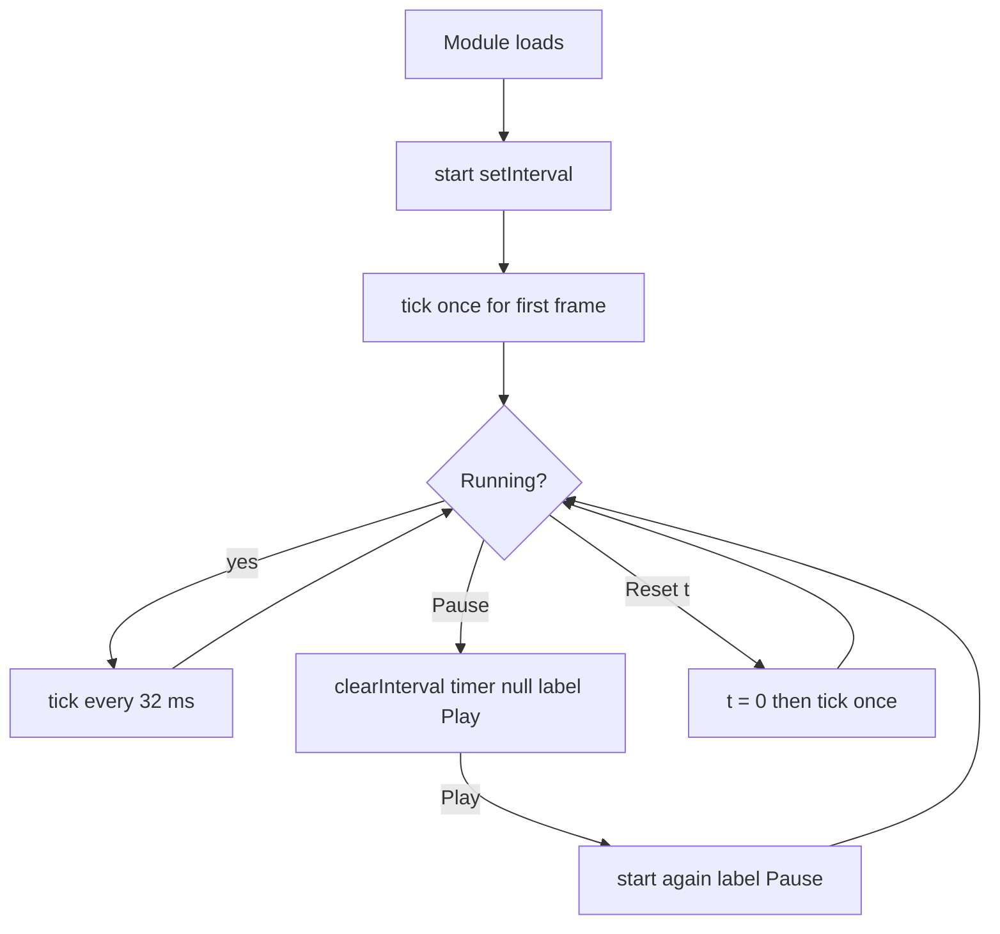

# ex02 — Dynamic style

**Goal.** Drive live CSS from TypeScript — update numbers on a timer
(`setInterval`), then assign `element.style.*` (color, size, position,
rotation, radius, opacity) so a box moves, spins, and changes color.

ex01 created nodes. This lab _restyles_ one node many times per second.

---

## Learning outcomes

After this lab you should be able to:

1. Separate **state** (a plain object of numbers) from **presentation**
   (writing those numbers into `element.style`).
2. Use `setInterval` and `clearInterval` to start and stop a timer safely.
3. Write CSS values from TypeScript with template strings
   (`` `${n}px` ``, `hsla(...)`, `translate(...) rotate(...)`).
4. Explain why `transform` uses `translate(...)` then `rotate(...)` to keep
   the box centered while spinning.
5. Read layout sizes with `clientWidth` / `clientHeight` to scale motion to the
   stage.
6. Edit one formula in `tick()` and predict the visual change.

---

## Theory

### Inline styles override stylesheet defaults

`styles.css` defines the **default** look (`.stage`, `.shape`). Assigning
`el.style.someProperty = value` writes an **inline style**, which wins over
normal stylesheet rules — the simplest way for code to drive visuals.

| CSS property       | JS property              | Value in this lab                        |
| ------------------ | ------------------------ | ---------------------------------------- |
| `width`, `height`  | `style.width`, `.height` | `` `${size}px` ``                        |
| `background-color` | `style.backgroundColor`  | `` `hsla(${hue}, 70%, 55%, ${alpha})` `` |
| `border-radius`    | `style.borderRadius`     | `` `${radius}px` ``                      |
| `left`, `top`      | `style.left`, `.top`     | Pixel position inside the stage          |
| `transform`        | `style.transform`        | `translate(...) rotate(...)`             |

CSS names with hyphens become **camelCase** in JavaScript. Numbers need units —
`"48px"` is valid; bare `48` is not.

### State, then paint

The lab keeps one object, `params`, with all animated numbers:

| Field    | Meaning                       | Typical range in this lab  |
| -------- | ----------------------------- | -------------------------- |
| `t`      | Motion clock (+0.05 per tick) | 0 upward                   |
| `hue`    | Color angle (degrees)         | 0–360 (wraps with `% 360`) |
| `size`   | Square side length (px)       | about 40–68                |
| `x`, `y` | Box center inside the stage   | from `sin` / `cos` of `t`  |
| `rot`    | Rotation (degrees)            | `t * 55`                   |
| `radius` | Corner radius (px)            | about 8–28                 |
| `alpha`  | Opacity (0–1)                 | about 0.55–0.95            |

- `tick()` **updates numbers** from formulas.
- `applyStyle(params)` **writes them** into the DOM.

That split is the seed of every UI framework: _state in, DOM out_. **Reset t**
calls `tick()` once; **Pause** stops the timer without losing `params`.

### Smooth motion from sine and cosine

`Math.sin(t)` swings between -1 and 1. Multiplying by an amplitude and adding a
center gives a back-and-forth path:

```ts
params.x = stage.clientWidth * 0.5 + Math.sin(params.t) * (stage.clientWidth * 0.32);
```

Different speeds for `x` (`t`) and `y` (`t * 0.85`) trace a loop. The pattern
`0.5 + 0.5 * Math.sin(...)` maps sine from `[-1, 1]` to `[0, 1]` for size,
radius, and alpha.

### Positioning and centering

`.stage` is `position: relative`; `.shape` is `position: absolute`, so `left` /
`top` are from the stage corner. The code shifts by half the size in
`transform` so `(x, y)` is the **center** of the box. Order matters: **translate
first, then rotate** so rotation is around the shape center.

### Timers and hot reload

| API                              | Meaning                        | Used here                |
| -------------------------------- | ------------------------------ | ------------------------ |
| `setInterval(fn, ms)`            | Call `fn` about every `ms`     | `setInterval(tick, 32)`  |
| `clearInterval(id)`              | Stop that timer                | In `pause()`             |
| `ReturnType<typeof setInterval>` | Portable type for the timer id | `let timer: ... \| null` |

`TICK_MS = 32` is ~31 fps. Intervals are not exact — tabs in the background get
throttled. Later labs use `requestAnimationFrame` for display-synced drawing.

`start()` and `pause()` guard on `timer` so two overlapping intervals cannot
double the animation speed.

During `vp dev`, saving `main.ts` replaces the module. Without cleanup, the old
interval would keep running:

```ts
if (import.meta.hot) {
  import.meta.hot.dispose(() => {
    pause();
  });
}
```

---

## Diagrams

### Data path: timer to pixels

```
┌──────────────────────────────────────┐
│     setInterval(tick, TICK_MS)       │
└──────────────────┬───────────────────┘
                   ▼
┌──────────────────────────────────────┐
│ tick: params t hue x y rot           │
└──────────────────┬───────────────────┘
                   ▼
┌──────────────────────────────────────┐
│ applyStyle: box.style and readout    │
└──────────────────┬───────────────────┘
                   ▼
┌──────────────────────────────────────┐
│ Browser repaints the stage           │
└──────────────────────────────────────┘
```

### Stage layout (centering)

```
┌──────────────────────────────────────────────┐
│ .stage  position relative                    │
│                                              │
│              ┌────────┐                      │
│              │ .shape │  left top = x y      │
│              └────────┘                      │
│                                              │
│  translate -size/2 then rotate centers spin  │
└──────────────────────────────────────────────┘
```

### Sequence: one timer tick

```mermaid
sequenceDiagram
  participant Timer as setInterval 32ms
  participant Tick as tick()
  participant P as params
  participant Apply as applyStyle()
  participant Box as box.style
  participant Read as readout

  Timer->>Tick: call
  Tick->>P: t += 0.05, formulas for hue size x y rot
  Tick->>Apply: applyStyle(params)
  Apply->>Box: width height backgroundColor transform
  Apply->>Read: rebuild text lines
  Box-->>Timer: repaint, wait for next tick
```

### Flow: Play, Pause, Reset t



---

## Files

| File         | Role                                                 |
| ------------ | ---------------------------------------------------- |
| `index.html` | Shell with empty `#mount` and a small code snippet   |
| `styles.css` | `.stage` (relative) and `.shape` (absolute) defaults |
| `ui.ts`      | Not used in this lab                                 |
| `main.ts`    | **Read this** — stage, timer, `element.style.*`      |

---

## Run

```bash
cd hardware-interface-workshop/web-app
vp dev
```

Open [http://localhost:5174/ex02-dynamic-style/](http://localhost:5174/ex02-dynamic-style/)

---

## Walkthrough (`main.ts`)

1. **`TICK_MS`** — timer interval (~30 fps).
2. **`StyleParams` and `params`** — complete animated state in one object.
3. **DOM construction** — `stage`, `box`, `toolbar`, `readout`; one
   `mount.append(...)`.
4. **`applyStyle(p)`** — only function that writes `box.style.*` and rebuilds
   the readout.
5. **`tick()`** — edit formulas between the `formulas students can edit`
   comments.
6. **`start()` / `pause()`** — `timer` variable and guards.
7. **Buttons** — toggle uses `timer == null`; reset sets `t = 0` and calls
   `tick()`.
8. **`import.meta.hot.dispose`**, then `start()` and initial `tick()`.

Try changing `params.rot = params.t * 55` to `params.t * 10` and watch the spin
slow down.

---

## Checklist

- [ ] Box moves, spins, and changes color while running
- [ ] **Pause** freezes; **Play** resumes
- [ ] **Reset t** restarts the motion clock
- [ ] You edited one formula in `tick()`
- [ ] Readout numbers match what you see on the stage

---

## Common pitfalls

| Symptom                              | Likely cause                                         | Fix                                                 |
| ------------------------------------ | ---------------------------------------------------- | --------------------------------------------------- |
| Style has no effect                  | Missing unit (`"48"` instead of `"48px"`)            | Template string with `px` or `deg`                  |
| Box does not move                    | `.shape` not `position: absolute`                    | Keep absolute positioning for `left` / `top`        |
| Box runs twice as fast after Play    | Second interval started                              | Keep `if (timer != null) return` in `start()`       |
| Pause does nothing                   | Lost timer handle                                    | Store `setInterval` return; pass to `clearInterval` |
| Box rotates around a corner          | Wrong transform order or missing centering translate | Translate by `-size/2` before `rotate`              |
| Motion jumps when switching tabs     | Background timer throttling                          | Expected; use rAF in later labs                     |
| Two animations after saving          | Old interval survived hot reload                     | Keep `import.meta.hot.dispose` cleanup              |
| `style.background-color` fails in TS | CSS names are camelCase in JS                        | Use `style.backgroundColor`                         |

---

## Glossary

| Term              | Meaning                                                       |
| ----------------- | ------------------------------------------------------------- |
| Inline style      | Style set on `element.style`, overrides most stylesheet rules |
| `clientWidth`     | Inner width of an element including padding, excluding border |
| `setInterval`     | Repeated timer callback at roughly fixed ms intervals         |
| `transform`       | CSS property for translate, rotate, scale (order matters)     |
| `hsla`            | Hue-saturation-lightness-alpha color function                 |
| Hot module reload | Vite replaces a module on save; old timers must be cleared    |
| State / paint     | Separate data (`params`) from DOM writes (`applyStyle`)       |

---

## Further reading

- [MDN: CSS inline styles via element.style](https://developer.mozilla.org/en-US/docs/Web/API/HTMLElement/style)
- [MDN: setInterval](https://developer.mozilla.org/en-US/docs/Web/API/setInterval)
- [MDN: transform](https://developer.mozilla.org/en-US/docs/Web/CSS/transform)
- [Vite: HMR API (import.meta.hot)](https://vite.dev/guide/api-hmr.html)
- [ex01 — Dynamic elements](../ex01-dynamic-elements/) — building the stage DOM

---

**Previous:** [ex01 — Dynamic elements](../ex01-dynamic-elements/)  
**Next:** [ex03 — Form events](../ex03-form-events/)
