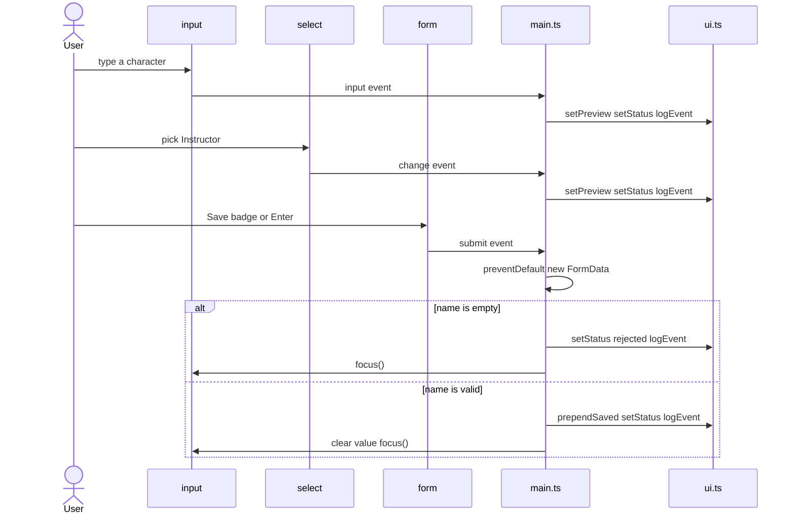
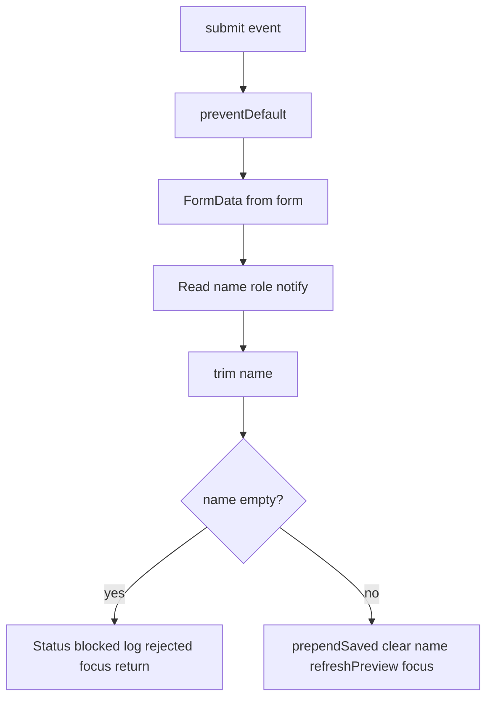

# ex03 — Form events

**Goal.** Handle form events in TypeScript — `input` for live feedback,
`change` for committed values, and `submit` with `preventDefault()` plus
`FormData` so data is processed on the page without a reload.

This lab does not use `keydown` or pointer events yet; those arrive in ex04.

---

## Learning outcomes

After this lab you should be able to:

1. Choose between `input`, `change`, and `submit` for a given interaction and
   explain when each fires.
2. Read control values with `.value`, `.checked`, and `.selectedOptions`.
3. Stop default form navigation with `event.preventDefault()`.
4. Collect a form with `new FormData(form)` and narrow
   `FormDataEntryValue | null` to a `string`.
5. Explain why an unchecked checkbox is **absent** from `FormData` and a checked
   one is `"on"` by default.
6. Validate in TypeScript (`trim`, empty check) and give feedback via status and
   log.
7. Read a lab split into `ui.ts` (DOM helpers) and `main.ts` (events and logic).

---

## Theory

### Three events, three moments

| Event    | Fires when                                        | Typical use       | In this lab                      |
| -------- | ------------------------------------------------- | ----------------- | -------------------------------- |
| `input`  | Value changes (every keystroke, slider move)      | Live preview      | `#name` updates preview each key |
| `change` | Value committed (select, checkbox; text on blur)  | Settings, choices | `#role`, `#notify`               |
| `submit` | Form submitted (button click or Enter in a field) | Save as a whole   | **Save badge** adds a row        |

For a text field, `input` fires many times; `change` fires once when the field
loses focus after a modification. For checkbox and select, `change` fires
immediately on the user’s choice — why this lab uses `change` there but `input`
on the name field.

### Reading control values

| Control                 | Property                     | Type                 | In `main.ts`                                |
| ----------------------- | ---------------------------- | -------------------- | ------------------------------------------- |
| `<input type="text">`   | `.value`                     | `string`             | `ui.name.value.trim()`                      |
| `<select>`              | `.value`, `.selectedOptions` | `string`, collection | `selectedOptions[0]?.textContent` for label |
| `<input type=checkbox>` | `.checked`                   | `boolean`            | `ui.notify.checked` in preview              |
| `<form>`                | `new FormData(form)`         | `FormData`           | Submit handler                              |

`value` is what the program sends (`"ta"`); visible text is what the user reads
(`"TA"`). `roleLabel()` uses visible text for the preview.

### Submit and `preventDefault`

By default, submitting navigates away and destroys in-memory state. A
single-page lab must cancel that:

```ts
ui.form.addEventListener("submit", (ev) => {
  ev.preventDefault();
  // ... read FormData and update the DOM ...
});
```

Listen on the **form’s** `submit`, not only the button’s `click`, so Enter in
the text field uses the same path (implicit submission).

### `FormData` and types

`new FormData(form)` collects every **named** control (`name`, `role`, `notify`
in HTML).

| Call                 | Returns                  | Guard in code                       |
| -------------------- | ------------------------ | ----------------------------------- |
| `data.get("name")`   | `string \| File \| null` | Narrow with `typeof === "string"`   |
| `data.get("role")`   | `string \| File \| null` | Fall back to `""`                   |
| `data.get("notify")` | `"on"` or `null`         | Unchecked checkbox **not included** |

So `notify` is `data.get("notify") === "on"`, not a `"true"` string.

### Validation without browser popups

The form has `novalidate`, which disables built-in validation UI even though
the input may have `required`. The lab validates itself:

1. `trim()` the name so spaces-only is empty.
2. If empty: status message, log rejected submit, `ui.name.focus()`, `return`.
3. If valid: add row, clear field, refresh preview, refocus.

### Split: `ui.ts` vs `main.ts`

| File      | Responsibility                                        | Read it?           |
| --------- | ----------------------------------------------------- | ------------------ |
| `ui.ts`   | Look up elements once (`requireEl`); paint text/lists | Skim               |
| `main.ts` | `addEventListener`, validation, event semantics       | **Read carefully** |

`requireEl(id, HTMLInputElement)` throws if missing or wrong type. Exporting
`ui` lets `main.ts` write `ui.name` instead of repeating lookups. `logEvent`
caps the log at 12 entries by dropping the oldest.

---

## Diagrams

### Event routing

```
┌──────────────┐   input    ┌─────────────────┐
│ input#name   │ ─────────► │ input handler   │
└──────────────┘            └─────────────────┘

┌──────────────┐   change   ┌─────────────────┐
│ select#role  │ ─────────► │ change handler  │
└──────────────┘            └─────────────────┘

┌──────────────┐   change   ┌─────────────────┐
│ input#notify │ ─────────► │ change handler  │
└──────────────┘            └─────────────────┘

┌──────────────┐   submit   ┌─────────────────┐
│ form#badge   │ ─────────► │ submit handler  │
└──────────────┘            └─────────────────┘
```

### Sequence: typing, choosing, submitting



### Flow: submit handler



---

## Files

| File         | Role                                                         |
| ------------ | ------------------------------------------------------------ |
| `index.html` | Form markup: name, role, notify, preview, status, lists      |
| `styles.css` | Fields, buttons, preview, lists                              |
| `ui.ts`      | DOM helpers: `ui` map, `setStatus`, `setPreview`, `logEvent` |
| `main.ts`    | **Read this** — `input` / `change` / `submit` handlers       |

---

## Run

```bash
cd hardware-interface-workshop/web-app
vp dev
```

Open [http://localhost:5174/ex03-form-events/](http://localhost:5174/ex03-form-events/)

---

## Walkthrough (`main.ts`)

1. **Imports** — `ui` and paint helpers from `./ui`. No listeners in `ui.ts`.
2. **`roleLabel()`** — `selectedOptions[0]?.textContent`, fallback to `value`.
3. **`refreshPreview()`** — one function builds preview text; every handler
   calls it.
4. **`ui.name` `input`** — preview, status, log per keystroke.
5. **`ui.role` and `ui.notify` `change`** — same trio, on commit.
6. **`ui.form` `submit`** — `preventDefault`, `FormData`, type narrowing,
   empty-name branch, saved branch, reset and refocus.

Skim `index.html` for `name` attributes (must match `data.get` keys) and `ui.ts`
for `requireEl`.

Experiment: type quickly, then Tab. You should see one `input` log line per
keystroke and no `change` on the name field — only select and checkbox use
`change`.

---

## Checklist

- [ ] Typing updates the preview on every key (`input`)
- [ ] Changing role / checkbox logs `change`
- [ ] **Save badge** adds a row **without** reloading
- [ ] Empty name shows a status message (no navigation)
- [ ] Enter in the name field also saves
- [ ] You can explain why `notify` is missing from `FormData` when unchecked

---

## Common pitfalls

| Symptom                                      | Likely cause                        | Fix                                                |
| -------------------------------------------- | ----------------------------------- | -------------------------------------------------- |
| Page reloads on Save                         | Missing `preventDefault()`          | Call `ev.preventDefault()` first in submit handler |
| Preview only updates after leaving the field | `change` on text instead of `input` | Use `input` for live updates                       |
| `FormData` returns `null`                    | Control has no `name` attribute     | Add `name="..."` in HTML                           |
| Notify always false                          | Compared to `true` not `"on"`       | `data.get("notify") === "on"` or read `.checked`   |
| Handler runs only on button click            | `click` instead of `submit`         | Listen on form so Enter works                      |
| Spaces-only name accepted                    | Skipped `trim()`                    | Trim before emptiness test                         |
| Browser tooltips conflict                    | `required` without `novalidate`     | Keep `novalidate` when validating in TS            |
| `ex03: missing #...`                         | Id renamed in HTML                  | Keep ids in sync with `requireEl` in `ui.ts`       |

---

## Glossary

| Term              | Meaning                                             |
| ----------------- | --------------------------------------------------- |
| `input` event     | Fires as a control’s value changes (live)           |
| `change` event    | Fires when a value is committed                     |
| `preventDefault`  | Cancels the browser’s default action for that event |
| `FormData`        | Name-value collection from form controls            |
| Implicit submit   | Enter in a text field submits the enclosing form    |
| `novalidate`      | Disables native validation UI on a form             |
| `selectedOptions` | Option elements currently selected in a `<select>`  |

---

## Further reading

- [MDN: input event](https://developer.mozilla.org/en-US/docs/Web/API/Element/input_event)
- [MDN: change event](https://developer.mozilla.org/en-US/docs/Web/API/HTMLElement/change_event)
- [MDN: FormData](https://developer.mozilla.org/en-US/docs/Web/API/FormData)
- [MDN: Event.preventDefault](https://developer.mozilla.org/en-US/docs/Web/API/Event/preventDefault)
- [ex02 — Dynamic style](../ex02-dynamic-style/) — DOM updates from code

---

**Previous:** [ex02 — Dynamic style](../ex02-dynamic-style/)  
**Next:** [ex04 — Keyboard + pointer](../ex04-keyboard-pointer/)
