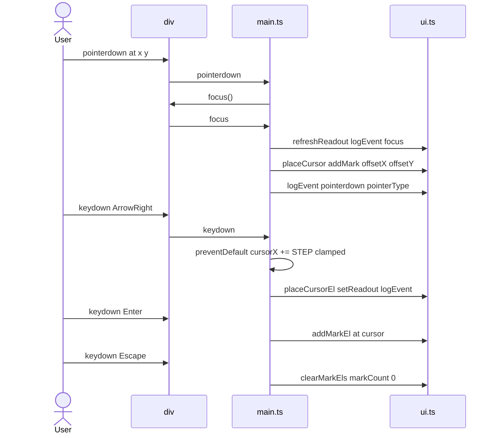
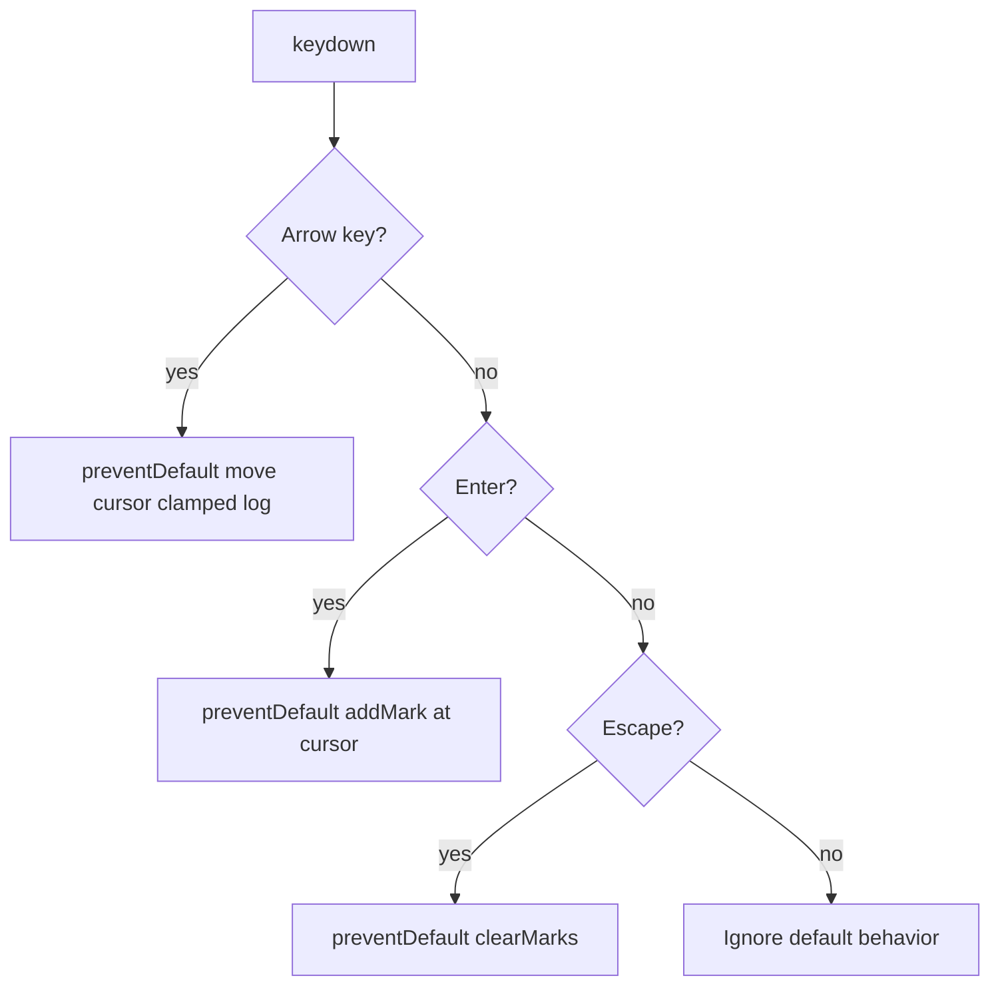

# ex04 — Keyboard + pointer

**Goal.** Handle **pointer** and **keyboard** input on a focusable stage —
click or tap to place marks, use arrow keys to move a cursor, Enter to drop a
mark, and Escape to clear.

This is the last DOM-only lab before drawing (ex05 SVG, ex06 Canvas): it
teaches the input events those labs depend on.

---

## Learning outcomes

After this lab you should be able to:

1. Explain why `pointerdown` covers mouse, touch, and pen with one handler.
2. Use `offsetX` / `offsetY` for coordinates local to the stage.
3. Make a `<div>` keyboard-focusable with `tabindex="0"` and explain why
   `keydown` does nothing without focus.
4. Branch on `ev.key` (`"ArrowLeft"`, `"Enter"`, `"Escape"`).
5. Call `preventDefault()` to stop arrow keys from scrolling the page.
6. Clamp coordinates so the cursor cannot leave the stage.
7. Observe `focus` and `blur` and show focus state in a readout.
8. Read a lab split into `ui.ts` (paint) and `main.ts` (input logic).

---

## Theory

### Pointer events: one model for all pointing devices

**Pointer events** unify mouse, finger, and pen (replacing separate mouse/touch
handlers in older code).

| Event / property         | Meaning                                             | In this lab                 |
| ------------------------ | --------------------------------------------------- | --------------------------- |
| `pointerdown`            | Pointer pressed on the element                      | Place cursor and add a mark |
| `ev.offsetX/Y`           | Position relative to target padding edge            | Stage-local `x`, `y`        |
| `ev.pointerType`         | `"mouse"`, `"touch"`, or `"pen"`                    | Shown in the event log      |
| CSS `touch-action: none` | Browser does not use touch for scroll/zoom on stage | On `.stage` in CSS          |

`offsetX` / `offsetY` are relative to the element that received the event. Here
`.cursor` and `.mark` use `pointer-events: none`, so hits target `#stage`, not
child dots.

### Keyboard events and focus

Keyboard events go to the **focused** element. A plain `<div>` is not
focusable; the stage uses `tabindex="0"` for Tab order.

| Attribute / API          | Role                                              |
| ------------------------ | ------------------------------------------------- |
| `tabindex="0"`           | Stage focusable via Tab and `focus()`             |
| `ui.stage.focus()`       | Called in `pointerdown` so click enables keyboard |
| `focus` / `blur`         | Logged; readout shows focus                       |
| `document.activeElement` | Compared to stage in readout                      |
| `role="application"`     | Interactive region for assistive tech             |
| `:focus` in CSS          | Visible ring when keys will work                  |

### Which key? `ev.key`

| `ev.key`                   | Action in `main.ts`                   |
| -------------------------- | ------------------------------------- |
| `ArrowLeft` / `ArrowRight` | Move cursor by `-STEP` / `+STEP` on x |
| `ArrowUp` / `ArrowDown`    | Move cursor by `-STEP` / `+STEP` on y |
| `Enter`                    | Add mark at current cursor            |
| `Escape`                   | Clear all marks                       |
| anything else              | Ignored (browser default continues)   |

`STEP` is 12 pixels. `ev.key` is layout-aware; `ev.code` is physical key
position.

`preventDefault()` on handled keys stops page scroll (arrows) and other defaults
(Enter/Escape). Unhandled keys are left alone so Tab still moves focus.

### State and clamping

State: `cursorX`, `cursorY`, `markCount`. DOM reflects these variables.

```ts
function clamp(n: number, min: number, max: number): number {
  return Math.max(min, Math.min(max, n));
}
```

`placeCursor` clamps to `0 .. clientWidth` and `0 .. clientHeight`. CSS negative
margin on `.mark` and `.cursor` centers dots on `left` / `top`.

### Initial position and `requestAnimationFrame`

The cursor starts at stage center. Layout size is reliable after paint:

```ts
requestAnimationFrame(() => {
  placeCursor(ui.stage.clientWidth / 2, ui.stage.clientHeight / 2);
});
```

### Logging

Each handler calls `logEvent(...)`; the on-page log keeps the newest 14 lines.

---

## Diagrams

### Stage coordinate system

```
┌─────────────────────────────────────────┐
│ div#stage  tabindex=0  relative         │
│ origin 0,0 top-left                     │
│ offsetX right  offsetY down             │
│ .cursor ring at cursorX cursorY         │
│ .mark dot on pointerdown or Enter       │
└─────────────────────────────────────────┘
```

### Input routing

```
┌─────────────────┐         ┌────────────────────────────┐
│ pointerdown     │ ──────► │ placeCursor + addMark      │
└─────────────────┘         └────────────────────────────┘

┌─────────────────┐         ┌────────────────────────────┐
│ keydown         │ ──────► │ Arrow Enter Escape         │
└─────────────────┘         └────────────────────────────┘

┌─────────────────┐         ┌────────────────────────────┐
│ focus blur      │ ──────► │ refreshReadout + logEvent  │
└─────────────────┘         └────────────────────────────┘
```

### Sequence: click then keyboard



### Flow: keydown handler



---

## Files

| File         | Role                                                                             |
| ------------ | -------------------------------------------------------------------------------- |
| `index.html` | Stage (`#stage`, `#cursor`), readout, log, Clear button                          |
| `styles.css` | Stage, `.mark`, `.cursor`, focus ring, `touch-action: none`                      |
| `ui.ts`      | `ui` map, `placeCursorEl`, `addMarkEl`, `clearMarkEls`, `setReadout`, `logEvent` |
| `main.ts`    | **Read this** — `pointerdown`, `keydown`, `focus`, `blur`                        |

---

## Run

```bash
cd hardware-interface-workshop/web-app
vp dev
```

Open [http://localhost:5174/ex04-keyboard-pointer/](http://localhost:5174/ex04-keyboard-pointer/)

---

## Walkthrough (`main.ts`)

1. **Constants and state** — `STEP = 12`, `cursorX`, `cursorY`, `markCount`.
2. **`clamp`, `placeCursor`, `addMark`, `clearMarks`** — update state, call
   `ui.ts` painters, refresh readout.
3. **`refreshReadout`** — includes `document.activeElement === ui.stage`.
4. **`pointerdown`** — focus, `offsetX/Y`, cursor + mark, log `pointerType`.
5. **`keydown`** — arrows with `preventDefault`, then Enter, then Escape.
6. **`focus` / `blur`** — refresh readout and log.
7. **Clear button** — `click` reuses `clearMarks`.
8. **`requestAnimationFrame`** — initial cursor at center.

Skim `ui.ts` for how marks are created (`div.mark` with `style.left` / `top`) —
ex01 and ex02 patterns reused.

---

## Checklist

- [ ] Click / tap → yellow cursor moves and green mark appears
- [ ] With stage focused, arrows move cursor (page does not scroll)
- [ ] Enter drops a mark; Escape clears marks
- [ ] Event log shows `pointerdown` / `keydown`
- [ ] Readout shows `focused = true` after click, `false` after Tab away
- [ ] You changed `STEP` once and saw speed change

---

## Common pitfalls

| Symptom                            | Likely cause                             | Fix                                         |
| ---------------------------------- | ---------------------------------------- | ------------------------------------------- |
| Arrow keys do nothing              | Stage not focused                        | Click or Tab to stage; keep `tabindex="0"`  |
| Page scrolls on arrows             | Missing `preventDefault` on handled keys | Call it in arrow branch                     |
| Marks in wrong place               | `clientX/Y` (viewport) not `offsetX/Y`   | Use stage-local offsets                     |
| Coordinates jump when clicking dot | Child became event target                | `pointer-events: none` on marks and cursor  |
| Touch scrolls instead of marking   | Missing `touch-action: none`             | Keep on `.stage` CSS                        |
| Cursor starts at 0,0               | Read size before layout                  | `requestAnimationFrame` before first place  |
| `preventDefault` on every key      | Breaks Tab and typing                    | Only prevent keys you handle                |
| Wrong key string                   | `"enter"` vs `"Enter"`                   | Use exact `ev.key` names                    |
| Cursor leaves stage                | No clamping                              | `clamp` with `clientWidth` / `clientHeight` |

---

## Glossary

| Term                    | Meaning                                             |
| ----------------------- | --------------------------------------------------- |
| Pointer event           | Unified mouse/touch/pen input (`pointerdown`, etc.) |
| `offsetX` / `offsetY`   | Coordinates relative to the event target element    |
| Focus                   | Which element receives keyboard events              |
| `tabindex="0"`          | Element in document Tab order                       |
| `preventDefault`        | Cancel browser default for that event               |
| `requestAnimationFrame` | Run callback before next repaint                    |
| `pointer-events: none`  | Element ignored for hit-testing                     |

---

## Further reading

- [MDN: Pointer events](https://developer.mozilla.org/en-US/docs/Web/API/Pointer_events)
- [MDN: KeyboardEvent.key](https://developer.mozilla.org/en-US/docs/Web/API/KeyboardEvent/key)
- [MDN: HTMLElement.focus](https://developer.mozilla.org/en-US/docs/Web/API/HTMLElement/focus)
- [MDN: touch-action](https://developer.mozilla.org/en-US/docs/Web/CSS/touch-action)
- [ex03 — Form events](../ex03-form-events/) — events and `ui.ts` split
- [ex05 — SVG draw](../ex05-svg-draw/) — next: drawing with coordinates

---

**Previous:** [ex03 — Form events](../ex03-form-events/)  
**Next:** [ex05 — SVG draw](../ex05-svg-draw/)
