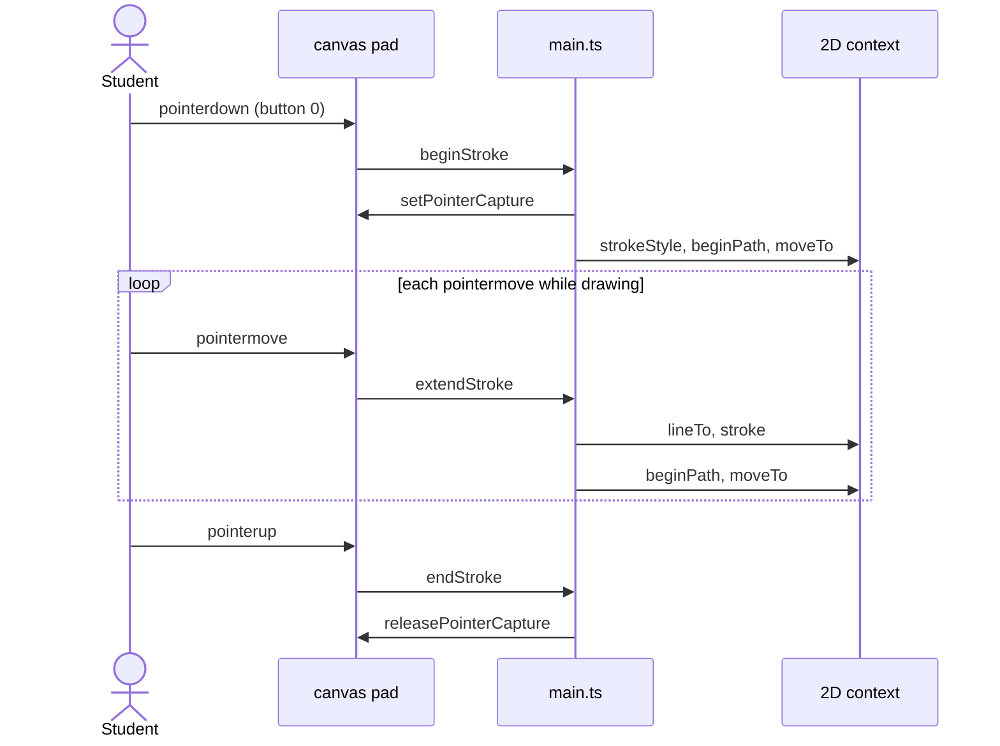
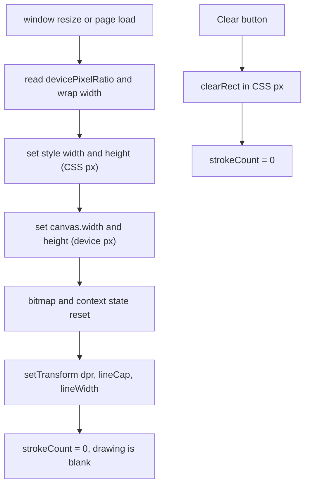
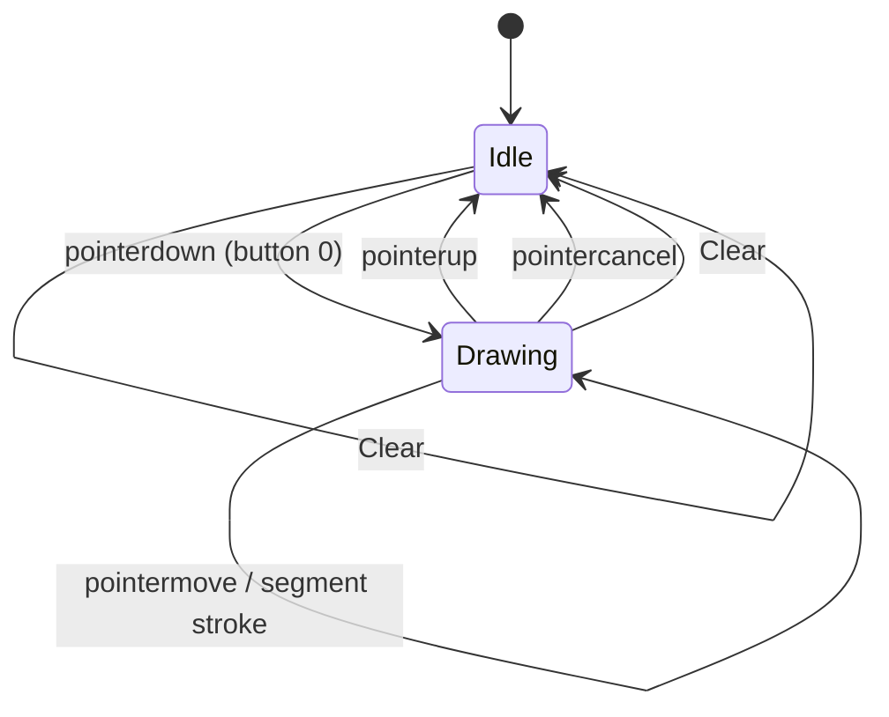

# ex06 — Canvas draw

**Goal.** Draw the same pointer sketch as [ex05 — SVG draw](../ex05-svg-draw/), but into
a `<canvas>` with the 2D context: `beginPath`, `moveTo`, `lineTo`, `stroke`. Learn
what changes when you switch from a **scene graph** to a **bitmap**, and why
`devicePixelRatio` matters on HiDPI displays.

---

## Learning outcomes

After this lab you should be able to:

1. Obtain a `CanvasRenderingContext2D` with `getContext("2d")` and handle a `null` result.
2. Draw line segments incrementally with `beginPath` / `moveTo` / `lineTo` / `stroke`.
3. Explain the difference between canvas **CSS size** and **bitmap size** and size both for HiDPI.
4. Use `setTransform(dpr, 0, 0, dpr, 0, 0)` so drawing code works in CSS pixels.
5. Clear with `clearRect` and explain why assigning `canvas.width` / `height` resets the bitmap.
6. Compare canvas (immediate, raster) with SVG (retained, vector) and choose between them.

---

## Theory

### Immediate mode: paint and forget

A canvas is one rectangle of pixels. Each call such as `stroke()` paints pixels and
returns. The canvas keeps **no list of shapes**; there is nothing to select, restyle,
or delete later except by repainting the area or keeping your own point history.

Contrast [ex05](../ex05-svg-draw/): there every stroke is a `<polyline>` you can
delete individually. Here, **Clear** only erases pixels — the lab does not store
past strokes for undo.

### Two sizes: CSS vs bitmap

| Property                    | Meaning                       | Set in this lab        |
| --------------------------- | ----------------------------- | ---------------------- |
| `canvas.style.width/height` | Size on the page (CSS pixels) | `cssW` × `260`         |
| `canvas.width/height`       | Bitmap pixel dimensions       | `cssW×dpr` × `260×dpr` |
| `devicePixelRatio` (dpr)    | Device pixels per CSS pixel   | Read in `sizeCanvas()` |

If you leave the bitmap at the default 300×150 and stretch it with CSS, the browser
scales the bitmap up and lines look blurry. With dpr = 2, you need twice the pixels
in each direction. `ctx.setTransform(dpr, 0, 0, dpr, 0, 0)` lets drawing code use
CSS-pixel coordinates, so `canvasPoint()` can be plain `clientX - rect.left`.

Setting `canvas.width` or `canvas.height` (even to the same value) **resets the
bitmap and the context state** (`lineWidth`, `lineCap`, transform). That is why
`sizeCanvas()` re-applies style and why this lab clears the drawing on window resize.

### The 2D path API

| Call                        | Effect                                 |
| --------------------------- | -------------------------------------- |
| `ctx.strokeStyle = color`   | Color for the next `stroke()`          |
| `ctx.beginPath()`           | Start a new empty path                 |
| `ctx.moveTo(x, y)`          | Pen up, jump to a point                |
| `ctx.lineTo(x, y)`          | Add a segment from the current point   |
| `ctx.stroke()`              | Paint the path outline into the bitmap |
| `ctx.clearRect(x, y, w, h)` | Set a rectangle to transparent         |

In `extendStroke`, each move draws **one short segment** then starts a fresh path at
the new point so later `stroke()` calls do not re-paint old segments.

### SVG vs canvas (paired with ex05)

| Aspect                   | SVG ([ex05](../ex05-svg-draw/))        | Canvas 2D (this lab)                   |
| ------------------------ | -------------------------------------- | -------------------------------------- |
| Model                    | Retained: elements in the DOM          | Immediate: pixels only                 |
| DevTools                 | Each `<polyline>` visible and editable | One `<canvas>`, no stroke children     |
| Scaling                  | Vector, crisp at any size              | Bitmap; must match dpr for sharp lines |
| Window resize            | Strokes scale via `viewBox`            | Bitmap reset; lab clears drawing       |
| Clear                    | Remove nodes                           | `clearRect`                            |
| Undo / select one stroke | Delete one node                        | Store points and repaint yourself      |
| Throughput               | Slows with thousands of nodes          | Good for dense, animated plots         |
| Events per shape         | Native on SVG elements                 | Manual hit testing                     |
| Typical workshop use     | Pin diagrams, gauges                   | Oscilloscope-style sensor traces       |

A real-time scope for board telemetry belongs on canvas; a clickable pinout belongs on SVG.

---

## Diagrams

### Canvas layout (CSS vs bitmap)

```
┌──────────────────────────────────────────┐
│ <canvas id="pad">                        │
│   CSS size    : cssW x 260 (layout)      │
│   bitmap size : cssW*dpr x 260*dpr       │
│   transform   : scale(dpr) -> CSS units  │
│   content     : pixels only, no children │
└──────────────────────────────────────────┘
```

### Stroke lifecycle (sequence)



### Resize and clear



### Drawing state



---

## Files

| File         | Role                                                              |
| ------------ | ----------------------------------------------------------------- |
| `index.html` | Page chrome, swatches, Clear, `<canvas id="pad">` in `#wrap`      |
| `styles.css` | Layout, `touch-action: none`, crosshair cursor                    |
| `ui.ts`      | DOM lookups (`pad`, `wrap`), readout and swatch helpers           |
| `main.ts`    | **Read this** — `getContext`, `sizeCanvas` (DPR), pointer drawing |

---

## Run

```bash
cd hardware-interface-workshop/web-app
vp dev
```

Open [http://localhost:5174/ex06-canvas-draw/](http://localhost:5174/ex06-canvas-draw/)

No permissions or special hardware are needed.

---

## Walkthrough (`main.ts`)

1. **Context setup** — `getContext("2d")` can return `null`; the lab throws a clear
   error instead of asserting.
2. **`sizeCanvas()`** — dpr, wrap width, CSS size, bitmap size, `setTransform`, line
   style. Runs at startup and on every `resize`; clearing on resize is intentional.
3. **`canvasPoint(ev)`** — `clientX - rect.left` only; the transform handles dpr.
   Compare with `svgPoint` in ex05 (viewBox scaling).
4. **`beginStroke`** — `strokeStyle`, path start at pointer.
5. **`extendStroke`** — `lineTo` + `stroke()`, then new path so old segments are not
   re-stroked.
6. **Clear** — `clearRect(0, 0, clientWidth, clientHeight)` in **CSS-pixel** space.

Experiment: change zoom or move to a HiDPI monitor; readout should show bitmap size
≈ CSS size × dpr (for example `1280×520` when dpr is 2).

---

## Checklist

- [ ] Drag draws a colored stroke
- [ ] Color swatches change the next stroke
- [ ] **Clear** wipes the bitmap and resets `strokes=0`
- [ ] DevTools shows one `<canvas>` with no stroke child nodes (unlike SVG)
- [ ] Readout shows bitmap size equal to CSS size × dpr
- [ ] Lines look sharp on a HiDPI display (not blurry)

---

## Common pitfalls

| Symptom                                  | Likely cause                                               |
| ---------------------------------------- | ---------------------------------------------------------- |
| Blurry lines on Retina / HiDPI           | Bitmap size equals CSS size without dpr scaling            |
| Line lands away from the cursor          | CSS and bitmap size mismatch without transform             |
| Lines vanish after resize                | Setting `canvas.width/height` resets the bitmap            |
| Line width or color reverts after resize | Context state reset — re-apply in `sizeCanvas()`           |
| Whole path repaints on each segment      | Forgot `beginPath()` after `stroke()`                      |
| `getContext` returns `null`              | Unsupported or context already taken                       |
| Page scrolls while drawing on touch      | Missing `touch-action: none`                               |
| Cannot select a stroke in DevTools       | Canvas has no scene graph — use SVG (ex05) or store points |

---

## Glossary

| Term                 | Meaning                                                                  |
| -------------------- | ------------------------------------------------------------------------ |
| **Immediate mode**   | Each draw call updates pixels; no built-in shape list                    |
| **Bitmap**           | The `width`×`height` pixel buffer owned by `<canvas>`                    |
| **CSS pixels**       | Layout units on the page (what `getBoundingClientRect` uses)             |
| **devicePixelRatio** | Ratio of device pixels to CSS pixels on the display                      |
| **Path**             | Sequence of subpaths (`moveTo` / `lineTo`) before `stroke()` or `fill()` |
| **Retained mode**    | Shapes kept as objects (SVG scene graph — ex05)                          |
| **2D context**       | `CanvasRenderingContext2D` API for drawing into the bitmap               |

---

## Further reading

**MDN**

- [Canvas API](https://developer.mozilla.org/en-US/docs/Web/API/Canvas_API)
- [`CanvasRenderingContext2D`](https://developer.mozilla.org/en-US/docs/Web/API/CanvasRenderingContext2D)
- [Optimizing canvas for HiDPI](https://developer.mozilla.org/en-US/docs/Web/API/Canvas_API/Tutorial/Optimizing_canvas)
- [Pointer events](https://developer.mozilla.org/en-US/docs/Web/API/Pointer_events)

**Sibling labs**

- [ex05 — SVG draw](../ex05-svg-draw/) — retained vector drawing
- [ex07 — Web Audio mic](../ex07-web-audio-mic/) — device APIs and user gesture
- [ex09 — Web video camera](../ex09-web-video-camera/) — canvas used later for frame grab (optional extension)

---

**Previous:** [ex05 — SVG draw](../ex05-svg-draw/)  
**Next:** [ex07 — Web Audio mic](../ex07-web-audio-mic/)
