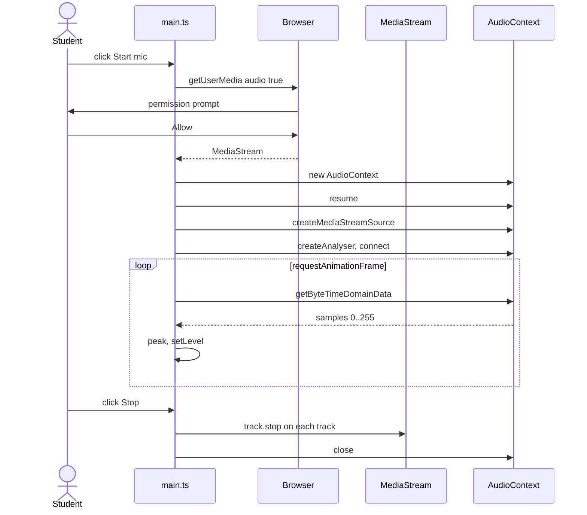
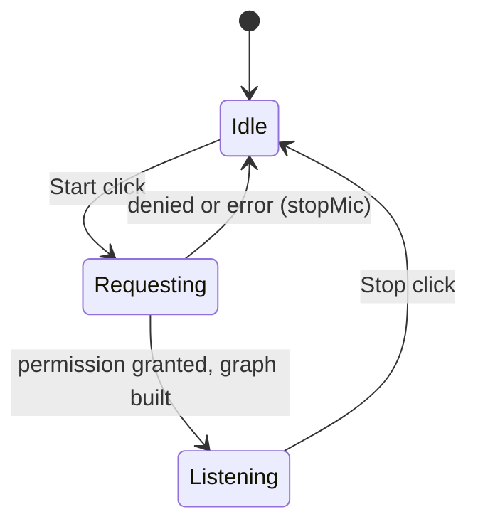
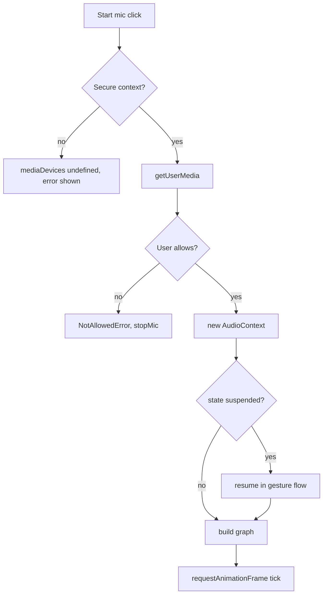

# ex07 — Web Audio mic

**Goal.** Open the microphone with `getUserMedia`, route the `MediaStream` into the
Web Audio graph, and show a live **level meter** using an `AnalyserNode`.

This is the first lab that needs a **permission prompt** and an **AudioContext**
started from a **user gesture**. Both patterns return in [ex08 — Web Audio speaker](../ex08-web-audio-speaker/),
[ex09 — Web video camera](../ex09-web-video-camera/), and [ex10 — Web Serial](../ex10-web-serial/)
(device pickers also require secure context + click).

---

## Learning outcomes

After this lab you should be able to:

1. Request microphone access with `navigator.mediaDevices.getUserMedia({ audio: true })` and handle rejections.
2. Explain why capture APIs need a **secure context** (`localhost` or HTTPS) and why prompts belong on a **user gesture**.
3. Describe the **autoplay policy**: an `AudioContext` may start `suspended` until the page has interacted.
4. Build a small audio graph: `MediaStreamAudioSourceNode` → `AnalyserNode` (not to speakers).
5. Read time-domain samples with `getByteTimeDomainData` and map them to a 0–100 level.
6. Release hardware correctly: `track.stop()` on every track, `audioCtx.close()`, cancel the animation loop.

---

## Theory

### Two gates: permission and audio unlock

Browser media labs hit **two independent rules**:

| Gate                            | What it protects                                    | This lab                                           |
| ------------------------------- | --------------------------------------------------- | -------------------------------------------------- |
| **Capture permission**          | Microphone / camera hardware                        | `getUserMedia` — user must Allow in the prompt     |
| **Autoplay / audio processing** | Surprise sound or silent processing without consent | `AudioContext` — may need `resume()` after a click |

[ex08](../ex08-web-audio-speaker/) needs only the **audio unlock** (no mic prompt).
[ex09](../ex09-web-video-camera/) needs **capture permission** for video but no
`AudioContext`. [ex10](../ex10-web-serial/) needs secure context + gesture for
`navigator.serial.requestPort()`, not `getUserMedia`.

Always start capture and context work from a **button click** handler, not from
`DOMContentLoaded` or a timer — otherwise prompts may be blocked and the context
may stay `suspended`.

### Permission: `getUserMedia`

`getUserMedia` returns a **Promise** that resolves to a `MediaStream` only after the
user allows access.

| Requirement                           | Why                                                           |
| ------------------------------------- | ------------------------------------------------------------- |
| Secure context (HTTPS or `localhost`) | `navigator.mediaDevices` is missing on plain HTTP origins     |
| User choice in a browser prompt       | The browser owns consent; choice can be remembered or revoked |
| User gesture (click)                  | Unprompted capture attempts are blocked or auto-dismissed     |
| A real input device                   | Otherwise `NotFoundError`                                     |

Typical rejections (inspect `err.name`):

| `err.name`                    | Meaning                                           |
| ----------------------------- | ------------------------------------------------- |
| `NotAllowedError`             | User denied, or permissions policy blocks capture |
| `NotFoundError`               | No microphone available                           |
| `NotReadableError`            | Device busy (another app) or OS block             |
| `SecurityError` / `TypeError` | Insecure origin, or `mediaDevices` missing        |

### Autoplay policy: `AudioContext`

Browsers restrict audio processing without user interaction. An `AudioContext` has a
`state`:

| `state`     | Meaning                                            |
| ----------- | -------------------------------------------------- |
| `suspended` | Not allowed to run yet, or paused with `suspend()` |
| `running`   | Clock advances; nodes process samples              |
| `closed`    | Released; cannot be reused                         |

The lab creates the context inside **Start mic** and calls `await audioCtx.resume()`.
If you ever create a context before any click, it begins `suspended` and `resume()`
must run inside a gesture handler — the same pattern as `ensureContext()` in ex08.

### The audio graph

The analyser is **not** connected to `audioCtx.destination`. Routing mic → speakers
creates a **feedback loop** (squeal). This lab is input-only.

### From samples to a level

`getByteTimeDomainData` fills a `Uint8Array` of length `fftSize` (2048). Each byte
maps waveform −1…+1 into 0…255; **128 is silence**.

| Step                   | In `tick()`                          |
| ---------------------- | ------------------------------------ |
| Deviation from silence | `abs(sample - 128) / 128`            |
| Peak over the window   | `max` of deviations                  |
| Meter percent          | `peak * 100` (clamped in `setLevel`) |

At 48 kHz, 2048 samples ≈ 43 ms — a **peak** meter, not loudness (RMS/dB).

### Cleaning up

`track.stop()` releases the microphone (browser recording indicator off). Dropping
the stream reference alone is not enough.

| Resource       | Release in `stopMic()`               |
| -------------- | ------------------------------------ |
| Animation loop | `cancelAnimationFrame(raf)`          |
| Mic hardware   | `track.stop()` for every track       |
| Audio graph    | Clear refs; `await audioCtx.close()` |
| UI             | `setLevel(0)`, re-enable Start       |

---

## Diagrams

### Audio graph (input only)

```
┌───────────────┐   ┌──────────────────────┐   ┌──────────────┐
│ Microphone    │   │ MediaStreamAudio     │   │ AnalyserNode │
│ (MediaStream) │-->│ SourceNode           │-->│ fftSize 2048 │
└───────────────┘   └──────────────────────┘   └──────────────┘
                                                      |
                                                      v
                                              getByteTimeDomainData
                                              (not connected to speakers)
```

### Start, measure, stop (sequence)



### Mic state



### Permission and context decision



---

## Files

| File         | Role                                                         |
| ------------ | ------------------------------------------------------------ |
| `index.html` | Start / Stop buttons, level meter, readout                   |
| `styles.css` | Meter look, disabled-button style                            |
| `ui.ts`      | `setLevel` (width + `aria-valuenow`), `setButtons`, readout  |
| `main.ts`    | **Read this** — `getUserMedia`, graph, `tick()`, `stopMic()` |

---

## Run

```bash
cd hardware-interface-workshop/web-app
vp dev
```

Open [http://localhost:5174/ex07-web-audio-mic/](http://localhost:5174/ex07-web-audio-mic/)

Needs **HTTPS or localhost**, a working microphone, and you must **allow** the browser
prompt. If you blocked the site earlier, reset permission in the address-bar site
settings and reload.

---

## Walkthrough (`main.ts`)

1. **Module state** — `stream`, `audioCtx`, `analyser`, `raf`, `timeData`; `stream`
   doubles as the listening flag.
2. **`tick()`** — `getByteTimeDomainData`, peak deviation, `setLevel`, schedule next frame.
3. **`startMic()`** — disable buttons while waiting, `await getUserMedia`, new
   `AudioContext`, `await resume()`, `source.connect(analyser)` only (no destination),
   start the loop.
4. **`catch`** — readout shows error; `stopMic()` returns to idle.
5. **`stopMic()`** — cancel frame, stop tracks, close context, restore buttons.
6. **Listeners** — nothing runs until **Start mic** is clicked.

---

## Checklist

- [ ] **Start mic** asks for permission
- [ ] Speaking or tapping the table moves the level bar
- [ ] Readout shows `state=listening` and `sampleRate=…`
- [ ] **Stop** ends tracks, mic indicator off, meter at zero
- [ ] No speaker feedback (analyser not connected to `destination`)
- [ ] Denying the prompt shows `error:` and leaves Start enabled

---

## Common pitfalls

| Symptom                           | Likely cause                                                 |
| --------------------------------- | ------------------------------------------------------------ |
| `getUserMedia` of undefined       | Plain HTTP on a non-localhost host                           |
| Prompt never appears              | Previously blocked, or not started from a click              |
| Meter stuck at 0                  | `AudioContext` still `suspended`                             |
| Loud squeal                       | Mic connected to `destination` while using speakers          |
| Mic light stays on after Stop     | Tracks not stopped with `track.stop()`                       |
| Second Start fails                | Old context not closed or buttons not reset                  |
| Works in one browser, not another | Different permission / autoplay rules — always gate on click |

---

## Glossary

| Term                | Meaning                                                      |
| ------------------- | ------------------------------------------------------------ |
| **Secure context**  | `https:` or `http://localhost` — required for `mediaDevices` |
| **User gesture**    | Trusted interaction (click) that unlocks prompts and audio   |
| **MediaStream**     | Live tracks (audio and/or video) from capture devices        |
| **AudioContext**    | Clock and graph host for Web Audio nodes                     |
| **AnalyserNode**    | Exposes time- or frequency-domain data from the graph        |
| **Autoplay policy** | Browser rules blocking audio until user interaction          |
| **track.stop()**    | Releases capture hardware for that track                     |

---

## Further reading

**MDN**

- [`MediaDevices.getUserMedia`](https://developer.mozilla.org/en-US/docs/Web/API/MediaDevices/getUserMedia)
- [Web Audio API](https://developer.mozilla.org/en-US/docs/Web/API/Web_Audio_API)
- [`AnalyserNode`](https://developer.mozilla.org/en-US/docs/Web/API/AnalyserNode)
- [`AudioContext`](https://developer.mozilla.org/en-US/docs/Web/API/AudioContext) and [autoplay guide](https://developer.mozilla.org/en-US/docs/Web/Media/Autoplay_guide)

**Sibling labs**

- [ex06 — Canvas draw](../ex06-canvas-draw/) — no permissions; pointer drawing
- [ex08 — Web Audio speaker](../ex08-web-audio-speaker/) — output graph, same `resume()` pattern
- [ex09 — Web video camera](../ex09-web-video-camera/) — same `getUserMedia` permission flow for video
- [ex10 — Web Serial](../ex10-web-serial/) — secure context + gesture for USB

---

**Previous:** [ex06 — Canvas draw](../ex06-canvas-draw/)  
**Next:** [ex08 — Web Audio speaker](../ex08-web-audio-speaker/)
