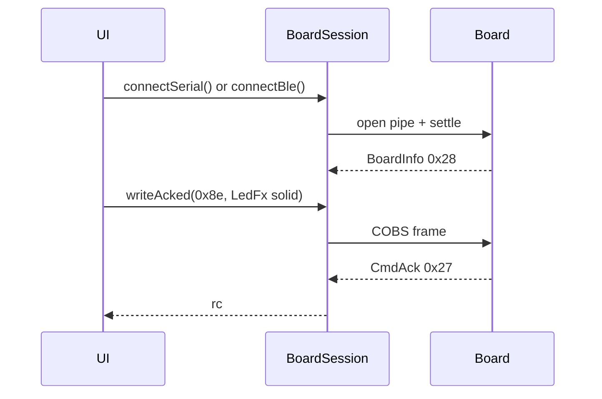

# ex12 — LED · writeAcked (Serial or BLE)

**Goal.** Drive the board RGB LED with `LedFx` (`MSG_LED_FX` `0x8e`) using
`BoardSession.writeAcked()`, and let the student **choose USB Serial or Web
Bluetooth** — same session object, same frames, only the connect call differs.

This lab combines what [ex10](../ex10-web-serial/) and [ex11](../ex11-web-bluetooth/)
taught about the pipe, then adds a **command + CmdAck** round trip.

---

## Learning outcomes

After this lab you should be able to:

1. Offer both transports in one UI (`connectSerial` / `connectBle` / `disconnect`).
2. Explain why LED buttons wait for `ready` **and** `CAP.LED` from BoardInfo.
3. Encode solid / blink / off with `encodeLedSolid` / `encodeLedBlink` / `encodeLedOff`.
4. Use `writeAcked(MSG_LED_FX, payload)` and read the returned `rc` from `CmdAck`.
5. Say why the wire is identical once `transport` is `"serial"` or `"ble"`.

---

## Theory

### One session, two pipes

| Button         | Call                 | Browser API             |
| -------------- | -------------------- | ----------------------- |
| Connect USB    | `connectSerial()`    | Web Serial port picker  |
| Connect BLE    | `connectBle()`       | Web Bluetooth picker    |
| Disconnect     | `disconnect()`       | Closes whichever is open |

```ts
const board = new BoardSession();
await board.connectSerial(); // or connectBle()
await board.writeAcked(MSG_LED_FX, encodeLedSolid({ r: 220, g: 24, b: 24 }));
```

`board.transport` is `"serial"` or `"ble"` after connect — useful in the Session
panel, unused by the LED encode path.

### `writeAcked` vs `writeFrame`

| API           | Sends frame | Waits for `CmdAck` (`0x27`) |
| ------------- | ----------- | --------------------------- |
| `writeFrame`  | Yes         | No                          |
| `writeAcked`  | Yes         | Yes (timeout if no reply)   |

Firmware replies with `CmdAck` matching `msg_type` + `seq`. A timeout usually
means wrong firmware, wrong board, or a dead link.

### Capability gate

BoardInfo `caps` bit `CAP.LED` (`0x01`) means an RGB LED exists.

| Board    | Typical caps | RGB LED |
| -------- | ------------ | ------- |
| es3c28p  | `0x33`       | Yes     |
| ws28p    | `0x3c`       | No      |

This lab disables LED buttons when `CAP.LED` is missing so students see the
caps check instead of a silent no-op.

### Message map

| Msg                | Dir         | Role                                      |
| ------------------ | ----------- | ----------------------------------------- |
| `MSG_BOARD_INFO` `0x28` | board → host | Identity + caps                      |
| `MSG_LED_FX` `0x8e`     | host → board | Solid / blink / off                  |
| `MSG_CMD_ACK` `0x27`    | board → host | Result of the command (`writeAcked`) |

---

## Sequence



---

## Files

| File         | Role                                      |
| ------------ | ----------------------------------------- |
| `index.html` | Link toolbar + LED buttons                |
| `ui.ts`      | DOM handles + paint helpers               |
| `main.ts`    | **Read this** — dual connect + writeAcked |
| `styles.css` | Page look                                 |

---

## Try it

1. Flash [firmware-prebuilt](../../firmware-prebuilt/) (`es3c28p` for LED).
2. `cd hardware-interface-workshop/web-app` → `vp dev` →
   [http://localhost:5174/ex12-led-writeacked/](http://localhost:5174/ex12-led-writeacked/)
3. Click **Connect USB** *or* **Connect BLE** (gesture required).
4. Wait for BoardInfo with `LED=yes`, then try Solid / Blink / Off.
5. Disconnect, reconnect on the **other** transport — LED path stays the same.

### Checklist

- [ ] USB connect shows `transport=serial` and BoardInfo
- [ ] BLE connect shows `transport=ble` and BoardInfo
- [ ] LED buttons stay disabled until `ready` + `CAP.LED`
- [ ] Solid red lights the LED; Off clears it
- [ ] Last CmdAck shows `rc=0` on success
- [ ] Only one pipe open at a time (second Connect disabled while open)

---

## Further reading

- [`sdk/README.md`](../sdk/README.md) — `writeAcked`, LED helpers, caps
- [ex10 — Web Serial](../ex10-web-serial/)
- [ex11 — Web Bluetooth](../ex11-web-bluetooth/)

---

**Previous:** [ex11 — Web Bluetooth](../ex11-web-bluetooth/)  
**Next:** SFX via `writeAcked` — coming soon
