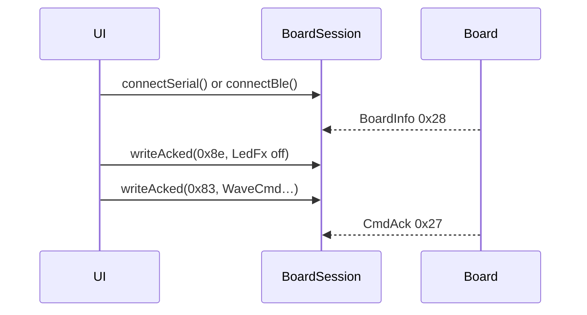

# ex13 — LED · WaveCmd (Serial or BLE)

**Goal.** Drive the board RGB LED with **per-channel oscillators** via
`WaveCmd` (`MSG_CMD_WAVE` `0x83`) and `writeAcked()`, over **USB or BLE**.

Semantic effects (`LedFx` `0x8e`) are covered in
[ex12 — LedFx](../ex12-led-writeacked/). This lab focuses on the wave modules
that feed R / G / B into the same LED.

---

## Learning outcomes

After this lab you should be able to:

1. Reuse the dual-transport `BoardSession` pattern from ex12.
2. Encode `WaveCmd` for shapes sin / square / triangle / sawtooth.
3. Explain channel `0`/`1`/`2` vs `255` (all) and free-run `cycles = 0`.
4. Why the lab sends `LedFx` **off** before starting waves (clear forever-hold).
5. Match the boot-style sin color wheel (`encodeWaveColorWheel`).

---

## Theory

### WaveCmd vs LedFx

| API        | Msg    | Model                                      |
| ---------- | ------ | ------------------------------------------ |
| `LedFx`    | `0x8e` | Semantic pattern engine (ex12)             |
| `WaveCmd`  | `0x83` | Continuous oscillators → LED channels      |

Firmware: each of R/G/B has a `rb_wave` module. `WaveCmd` configures shape,
frequency, amplitude, offset, phase, enable. Values map into 0..255 LED duty.

### Shapes — `WAVE_SHAPE`

| Name       | Value | Notes                         |
| ---------- | ----- | ----------------------------- |
| `SIN`      | `0`   | Smooth (color wheel default)  |
| `SQUARE`   | `1`   | Optional `dutyPct` 1..99      |
| `TRIANGLE` | `2`   | Linear rise / fall            |
| `SAWTOOTH` | `3`   | Linear rise, instant fall     |

### Hold interaction

After a solid/blink `LedFx`, firmware holds the wave sink off forever until
`rb_fx_led_stop` (LedFx **off**). This lab always acks an off first, then
sends the `WaveCmd` frame(s).

### Message map

| Msg                     | Dir          | Role                            |
| ----------------------- | ------------ | ------------------------------- |
| `MSG_BOARD_INFO` `0x28` | board → host | Identity + caps                 |
| `MSG_LED_FX` `0x8e`     | host → board | Off (clear hold) before waves   |
| `MSG_CMD_WAVE` `0x83`   | host → board | Start / stop oscillators        |
| `MSG_CMD_ACK` `0x27`    | board → host | Result (`writeAcked`)           |

---

## Sequence

---

## Files

| File         | Role                                       |
| ------------ | ------------------------------------------ |
| `index.html` | Link toolbar + wave buttons                |
| `ui.ts`      | DOM handles + paint helpers                |
| `main.ts`    | **Read this** — dual connect + WaveCmd     |
| `styles.css` | Page look                                  |

---

## Try it

1. Flash [firmware-prebuilt](../../firmware-prebuilt/) (`es3c28p`).
2. [http://localhost:5174/ex13-wave-cmd/](http://localhost:5174/ex13-wave-cmd/)
3. Connect USB or BLE → **Sin color wheel** → **Stop waves**.

### Checklist

- [ ] Sin color wheel animates RGB smoothly
- [ ] Square / triangle / sawtooth visibly change the motion
- [ ] Stop waves ends motion
- [ ] CmdAck lines show `0x8e` off then `0x83` rc=0

---

## Further reading

- [`sdk/wire/wave.ts`](../sdk/wire/wave.ts) — encoders
- [ex12 — LedFx](../ex12-led-writeacked/)

---

**Previous:** [ex12 — LedFx](../ex12-led-writeacked/)  
**Next:** [ex14 — LED sliders](../ex14-led-sliders/)
