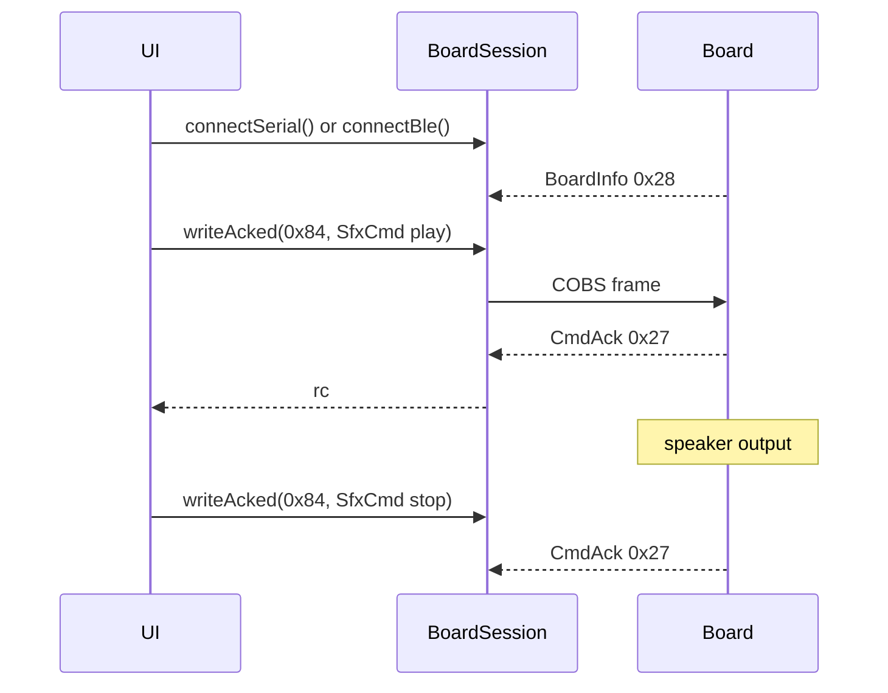

# ex15 — SFX · play / stop (Serial or BLE)

**Goal.** Trigger on-board sound presets with `SfxCmd` (`MSG_SFX_CMD` `0x84`)
via `writeAcked()`, over **USB Serial or Web Bluetooth**. This is the first
**speaker** lab in the vanilla track — same `BoardSession` pattern as the LED
labs, different message type.

Volume and loop count come in [ex16 — SFX volume](../ex16-sfx-volume/).

---

## Learning outcomes

After this lab you should be able to:

1. Reuse dual-transport connect (`connectSerial` / `connectBle`) for a non-LED actuator.
2. Encode play and stop with `encodeSfxPlay` / `encodeSfxStop` and read `rc` from `CmdAck`.
3. Map UI buttons to `SFX_PRESET` IDs and explain preset `STOP` (`255`).
4. Say why some presets (Alarm) may loop until **Stop**, and why desk-safe volume matters.
5. Confirm the speaker works on **both** board SKUs — no `CAP.*` gate in this lab.

---

## Theory

### One session, two pipes (unchanged from ex12)

| Button         | Call                 | Browser API             |
| -------------- | -------------------- | ----------------------- |
| Connect USB    | `connectSerial()`    | Web Serial port picker  |
| Connect BLE    | `connectBle()`       | Web Bluetooth picker    |
| Disconnect     | `disconnect()`       | Closes whichever is open |

Speaker output is available on **es3c28p** and **ws28p**; only the mic path
(later labs) requires `CAP.MIC`.

### `writeAcked` for SFX commands

| API           | Sends frame | Waits for `CmdAck` (`0x27`) |
| ------------- | ----------- | --------------------------- |
| `writeFrame`  | Yes         | No                          |
| `writeAcked`  | Yes         | Yes (timeout if no reply)   |

This lab uses **`writeAcked`** for every play and stop so the UI can show
`rc=0` on success.

### `SfxCmd` payload — `encodeSfxPlay`

Protobuf fields (see [`sdk/wire/sfx.ts`](../sdk/wire/sfx.ts)):

| Field    | Role in this lab                          |
| -------- | ----------------------------------------- |
| `preset` | Which sound to play (`SFX_PRESET.*`)      |
| `volume` | `0..100`; lab default **25** (desk-safe)  |
| `loops`  | Not set here (board default)              |
| `dur_s`  | Not set here                              |

```ts
const rc = await board.writeAcked(
  MSG_SFX_CMD,
  encodeSfxPlay(SFX_PRESET.CHIME, { volume: 25 }),
);
await board.writeAcked(MSG_SFX_CMD, encodeSfxStop());
```

`encodeSfxStop()` is sugar for `encodeSfxPlay(SFX_PRESET.STOP)` — preset
**255** stops the engine.

### Presets used in this lab

| Button | `SFX_PRESET` | Value | Typical behavior        |
| ------ | ------------ | ----- | ----------------------- |
| Chime  | `CHIME`      | `0`   | Short, once             |
| Beep   | `BEEP`       | `2`   | Short, once             |
| Bird   | `BIRD`       | `4`   | Preset effect           |
| Alarm  | `ALARM`      | `1`   | May **loop** until Stop |

Full preset table: [`sdk/README.md`](../sdk/README.md) (SFX section).

### Message map

| Msg                     | Dir          | Role                          |
| ----------------------- | ------------ | ----------------------------- |
| `MSG_BOARD_INFO` `0x28` | board → host | Identity (no SFX cap bit)     |
| `MSG_SFX_CMD` `0x84`    | host → board | Play preset / stop            |
| `MSG_CMD_ACK` `0x27`    | board → host | Result (`writeAcked`)         |

---

## Sequence



---

## Files

| File         | Role                                        |
| ------------ | ------------------------------------------- |
| `index.html` | Link toolbar + preset buttons + Stop        |
| `ui.ts`      | DOM handles + enable/disable SFX buttons    |
| `main.ts`    | **Read this** — dual connect + play/stop    |
| `styles.css` | Page look                                   |

---

## Try it

1. Flash [firmware-prebuilt](../../firmware-prebuilt/) (either board SKU).
2. `cd hardware-interface-workshop/web-app` → `vp dev` →
   [http://localhost:5174/ex15-sfx-play/](http://localhost:5174/ex15-sfx-play/)
3. Click **Connect USB** *or* **Connect BLE**.
4. Wait for `ready=true`, then try **Beep**, **Chime**, **Bird**.
5. Try **Alarm** — use **Stop** if it keeps running.

### Checklist

- [ ] USB / BLE connect show the expected `transport`
- [ ] SFX buttons enable when `ready` (no LED/mic cap gate)
- [ ] Beep / Chime / Bird play at moderate volume (`vol=25`)
- [ ] Alarm stops when **Stop** is pressed
- [ ] Ack line shows `rc=0` on success

---

## Further reading

- [`sdk/wire/sfx.ts`](../sdk/wire/sfx.ts) — `SFX_PRESET`, encoders
- [`sdk/README.md`](../sdk/README.md) — `writeAcked`, message cheat sheet
- [ex14 — LED sliders](../ex14-led-sliders/) — live vs acked contrast

---

**Previous:** [ex14 — LED sliders](../ex14-led-sliders/)  
**Next:** [ex16 — SFX volume](../ex16-sfx-volume/)
