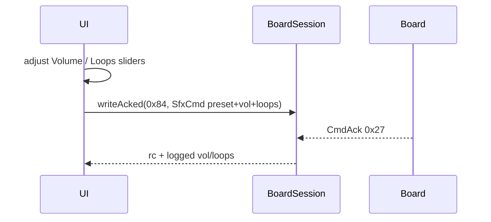

# ex16 — SFX · volume & loops (Serial or BLE)

**Goal.** Send **`volume`** and **`loops`** on each `encodeSfxPlay()` call over
USB or BLE, still using `writeAcked(MSG_SFX_CMD, …)`. Understand that these
fields apply on the **next play command only** — they are not live DSP knobs
(that is [ex17 — SFX params](../ex17-sfx-params/)).

---

## Learning outcomes

After this lab you should be able to:

1. Bind range inputs to `SfxPlayOpts` (`volume`, `loops`) before each play.
2. Explain `volume: 0` means “leave board volume unchanged” (SDK default when omitted).
3. Explain `loops: 0` means board default (sirens may run until **Stop**).
4. Compare play-time options (`SfxCmd`) vs runtime knobs (`SfxParam` `0x85`).
5. Keep using `encodeSfxStop()` to halt looping presets safely.

---

## Theory

### Play options vs live params

| Mechanism        | Msg    | When it applies                          |
| ---------------- | ------ | ---------------------------------------- |
| `encodeSfxPlay`  | `0x84` | On each **play** (this lab)              |
| `encodeSfxParam` | `0x85` | **While** sound runs ([ex17](../ex17-sfx-params/)) |

Changing sliders here does **not** change a sound that is already playing until
you press **Play** again.

### `SfxCmd` fields used in this lab

From [`sdk/wire/sfx.ts`](../sdk/wire/sfx.ts):

```ts
type SfxPlayOpts = {
  volume?: number; // 0..100; 0 = leave unchanged on board
  loops?: number;
  durS?: number;
};
```

| Slider  | Maps to   | Notes                                              |
| ------- | --------- | -------------------------------------------------- |
| Volume  | `volume`  | Sent on every play click                           |
| Loops   | `loops`   | `0` = firmware default; alarm may loop indefinitely |

```ts
const volume = Number(ui.volume.value);
const loops = Number(ui.loops.value);
await board.writeAcked(
  MSG_SFX_CMD,
  encodeSfxPlay(SFX_PRESET.BEEP, { volume, loops }),
);
```

### Presets in the UI

| Button | Preset            | Teaching note                          |
| ------ | ----------------- | -------------------------------------- |
| Beep   | `SFX_PRESET.BEEP` | Good for hearing volume steps          |
| Chime  | `SFX_PRESET.CHIME`| Short; compare low vs high volume      |
| Alarm  | `SFX_PRESET.ALARM`| Try loops `0` vs `1`; always **Stop**  |

### Message map

| Msg                     | Dir          | Role                    |
| ----------------------- | ------------ | ----------------------- |
| `MSG_BOARD_INFO` `0x28` | board → host | Identity                |
| `MSG_SFX_CMD` `0x84`    | host → board | Play with volume/loops  |
| `MSG_CMD_ACK` `0x27`    | board → host | `writeAcked` result     |

Speaker on **both** boards; transport USB or BLE.

---

## Sequence



---

## Files

| File         | Role                                              |
| ------------ | ------------------------------------------------- |
| `index.html` | Link toolbar + sliders + play buttons             |
| `ui.ts`      | Slider labels + control enablement                |
| `main.ts`    | **Read this** — read sliders, then `encodeSfxPlay`|
| `styles.css` | Page look                                         |

---

## Try it

1. Flash [firmware-prebuilt](../../firmware-prebuilt/).
2. [http://localhost:5174/ex16-sfx-volume/](http://localhost:5174/ex16-sfx-volume/)
3. Connect USB or BLE.
4. Set **Volume** low, play **Beep**; raise volume, play again — hear the difference.
5. Set **Loops** to `1`, play **Alarm**; try **Loops** `0` and use **Stop** when needed.

### Checklist

- [ ] Slider values appear in the ack line (`vol=… loops=…`)
- [ ] Lower volume is clearly quieter on the board speaker
- [ ] Alarm respects **Stop** (`encodeSfxStop`)
- [ ] `rc=0` on successful plays and stop

---

## Further reading

- [`sdk/wire/sfx.ts`](../sdk/wire/sfx.ts) — `SfxPlayOpts`, `encodeSfxPlay`
- [ex15 — SFX play](../ex15-sfx-play/) — first `SfxCmd` lab
- [ex17 — SFX params](../ex17-sfx-params/) — live `MSG_SFX_PARAM`

---

**Previous:** [ex15 — SFX play](../ex15-sfx-play/)  
**Next:** [ex17 — SFX params](../ex17-sfx-params/)
