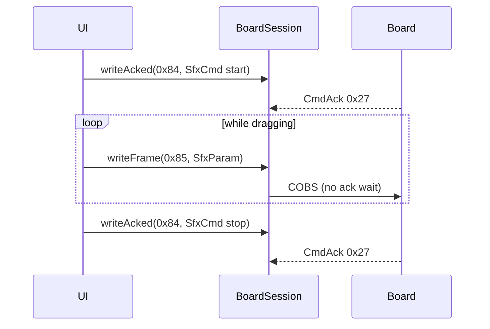

# ex17 — SFX · live params (Serial or BLE)

**Goal.** Start a looping preset with **`writeAcked(MSG_SFX_CMD, …)`**, then
twist **master volume**, **echo mix**, and **release time** using
**`writeFrame(MSG_SFX_PARAM, encodeSfxParam(…))`** while audio runs. This
mirrors [ex14 — LED sliders](../ex14-led-sliders/): acked **start/stop**,
**live** frames for knobs.

---

## Learning outcomes

After this lab you should be able to:

1. Split **command** traffic (`0x84` + `writeAcked`) from **live** traffic (`0x85` + `writeFrame`).
2. Map firmware DSP **stage** / **field** IDs to UI sliders (master, delay mix, ADSR release).
3. Debounce slider `input` (~80 ms) so drag does not flood USB/BLE.
4. Start long-running presets (Alarm, Ambulance) with `loops: 0` and stop cleanly.
5. Relate `encodeSfxParam(0xff, 0, v)` to master volume vs play-time `volume` in ex16.

---

## Theory

### Two message types

| Msg               | Value  | API           | Use in this lab                    |
| ----------------- | ------ | ------------- | ---------------------------------- |
| `MSG_SFX_CMD`     | `0x84` | `writeAcked`  | Start loop, **Stop**               |
| `MSG_SFX_PARAM`   | `0x85` | `writeFrame`  | Master / echo / release while playing |

| API           | Waits for `CmdAck` | Good for              |
| ------------- | ------------------ | --------------------- |
| `writeAcked`  | Yes                | Start, stop           |
| `writeFrame`  | No                 | High-rate knob drag   |

### Stage / field map (firmware)

Comments in `main.ts` match the board DSP graph:

| UI knob   | `stage` | `field` | `value` meaning (this lab)      |
| --------- | ------- | ------- | ------------------------------- |
| Master    | `0xFF`  | `0`     | Master volume 0..100            |
| Echo      | `5`     | `1`     | Delay mix 0..1 (`slider / 100`) |
| Release   | `4`     | `3`     | ADSR release time (ms)          |

```ts
await board.writeAcked(
  MSG_SFX_CMD,
  encodeSfxPlay(SFX_PRESET.ALARM, { volume: master, loops: 0 }),
);

await board.writeFrame(
  MSG_SFX_PARAM,
  encodeSfxParam(0xff, 0, masterVol),
);
await board.writeFrame(
  MSG_SFX_PARAM,
  encodeSfxParam(5, 1, echoMix0to1),
);
await board.writeFrame(
  MSG_SFX_PARAM,
  encodeSfxParam(4, 3, releaseMs),
);
```

Stage `0xFF` = master volume; **field is ignored** (see SDK).

### Live debounce

Slider `input` schedules one send after **`LIVE_MS` (80 ms)** — same idea as
ex14 LED live updates. Only the last drag position in that window is sent.

### Start presets

| Button     | Preset                  | Why                          |
| ---------- | ----------------------- | ---------------------------- |
| Alarm      | `SFX_PRESET.ALARM`      | Long tone; good for echo     |
| Ambulance  | `SFX_PRESET.AMBULANCE`  | Siren; good for release knob |

### Message map

| Msg                     | Dir          | Role                         |
| ----------------------- | ------------ | ---------------------------- |
| `MSG_BOARD_INFO` `0x28` | board → host | Identity                     |
| `MSG_SFX_CMD` `0x84`    | host → board | Start / stop                 |
| `MSG_SFX_PARAM` `0x85`  | host → board | Live DSP knob                |
| `MSG_CMD_ACK` `0x27`    | board → host | Ack for `0x84` only          |

Speaker on **both** boards; USB or BLE.

---

## Sequence



---

## Files

| File         | Role                                           |
| ------------ | ---------------------------------------------- |
| `index.html` | Link toolbar + start/stop + param sliders      |
| `ui.ts`      | Slider paint + enablement                      |
| `main.ts`    | **Read this** — acked start + live `SfxParam`  |
| `styles.css` | Page look                                      |

---

## Try it

1. Flash [firmware-prebuilt](../../firmware-prebuilt/).
2. [http://localhost:5174/ex17-sfx-params/](http://localhost:5174/ex17-sfx-params/)
3. Connect USB or BLE → **Alarm** or **Ambulance**.
4. Drag **Master**, **Echo**, **Release** while sound plays — ack line shows live sends.
5. **Stop** before disconnect.

### Checklist

- [ ] Start shows `writeAcked` with `rc=0`
- [ ] Master slider changes loudness while loop runs
- [ ] Echo / Release audibly change timbre or tail
- [ ] Stop ends playback; no stuck siren

---

## Further reading

- [`sdk/wire/sfx.ts`](../sdk/wire/sfx.ts) — `encodeSfxParam`
- [ex14 — LED sliders](../ex14-led-sliders/) — `writeFrame` vs `writeAcked`
- [ex16 — SFX volume](../ex16-sfx-volume/) — play-time volume only

---

**Previous:** [ex16 — SFX volume](../ex16-sfx-volume/)  
**Next:** [ex18 — Mic hello](../ex18-mic-hello/)
