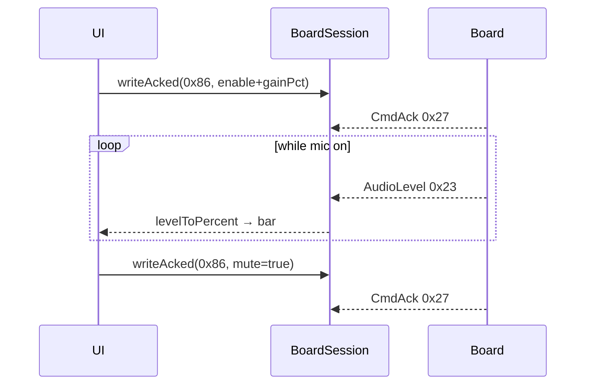

# ex19 — Mic · VU meter (Serial or BLE)

**Goal.** Extend [ex18 — Mic hello](../ex18-mic-hello/) with a **VU bar** driven
by `levelToPercent(rms/peak)`, plus **`gainPct`** and **`mute`** on
`encodeMicCmd`. Still **es3c28p** only; levels on **USB or BLE**.

---

## Learning outcomes

After this lab you should be able to:

1. Map int16 `rms` / `peak` to 0..100% with `levelToPercent` (−48 dBFS floor default).
2. Send `gainPct` on mic enable and via **Apply** (`writeAcked`).
3. Toggle `mute` without disabling capture — uplink levels go quiet.
4. Paint peak vs RMS on one meter (peak marker + RMS fill).
5. Handle `clipped` from `AudioLevel` in the UI.

---

## Theory

### Why not linear `/32767`?

Speech sits low on a linear scale. The SDK maps amplitude to dBFS, then to
percent with a **floor** at −48 dB:

```ts
import { levelToPercent, VU_FLOOR_DB } from "@sdk";

const rmsPct = levelToPercent(level.rms);
const peakPct = levelToPercent(level.peak);
// optional: levelToPercent(level.rms, -40)
```

See `levelToDb` / `VU_FLOOR_DB` in [`sdk/wire/mic.ts`](../sdk/wire/mic.ts).

### `MicCmd` fields used here

| UI action        | `encodeMicCmd` call                                      |
| ---------------- | -------------------------------------------------------- |
| Mic on           | `{ enable: true, gainPct }` from gain slider             |
| Mic off          | `{ enable: false }` — clears mute state in UI            |
| Apply gain       | `{ gainPct }` only (mic already on)                      |
| Mute toggle      | `{ mute: true/false }`                                   |

`gainPct` is clamped 0..100 in the encoder.

```ts
await board.writeAcked(
  MSG_MIC_CMD,
  encodeMicCmd({ enable: true, gainPct: 70 }),
);
await board.writeAcked(MSG_MIC_CMD, encodeMicCmd({ mute: true }));
await board.writeAcked(MSG_MIC_CMD, encodeMicCmd({ gainPct: 50 }));
```

**Mute** silences uplink metering behavior on the board path you are watching;
capture may still be enabled until **Mic off**.

### `AudioLevel` → VU

| Field     | VU use in this lab              |
| --------- | ------------------------------- |
| `rms`     | Bar fill width (`rmsPct`)       |
| `peak`    | Peak tick (`peakPct`)           |
| `clipped` | Warning styling when true       |
| `frames`  | Available in decoder (not shown)|

Subscribe the same way as ex18; paint on every `MSG_AUDIO_LEVEL` frame.

### Message map

| Msg                     | Dir          | Role                    |
| ----------------------- | ------------ | ----------------------- |
| `MSG_BOARD_INFO` `0x28` | board → host | `CAP.MIC` gate          |
| `MSG_MIC_CMD` `0x86`    | host → board | enable / gain / mute    |
| `MSG_AUDIO_LEVEL` `0x23`| board → host | ~10 Hz levels           |
| `MSG_CMD_ACK` `0x27`    | board → host | `writeAcked` result     |

---

## Sequence



---

## Files

| File         | Role                                           |
| ------------ | ---------------------------------------------- |
| `index.html` | Link toolbar + VU + gain + mute                  |
| `ui.ts`      | `paintVu`, gain labels, control enablement     |
| `main.ts`    | **Read this** — gain/mute acked + level sub    |
| `styles.css` | VU bar styling                                 |

---

## Try it

1. Flash **es3c28p** [firmware-prebuilt](../../firmware-prebuilt/).
2. [http://localhost:5174/ex19-mic-vu/](http://localhost:5174/ex19-mic-vu/)
3. Connect USB or BLE → **Mic on** → speak — bar moves.
4. Drag **Gain** → **Apply** (or release slider) — louder/softer response.
5. **Mute** — bar drops; **Mic off** when done.

### Checklist

- [ ] VU responds to voice with reasonable sensitivity (not stuck at 0)
- [ ] Peak marker tracks transients above RMS fill
- [ ] Gain apply shows `rc=0` and changes sensitivity
- [ ] Mute toggles without requiring mic off
- [ ] `MIC=no` board shows banner; controls disabled

---

## Further reading

- [`sdk/wire/mic.ts`](../sdk/wire/mic.ts) — `levelToPercent`, `MicCmdParams`
- [ex18 — Mic hello](../ex18-mic-hello/) — enable + raw levels
- [ex20 — Mic wave](../ex20-mic-wave/) — PCM over USB

---

**Previous:** [ex18 — Mic hello](../ex18-mic-hello/)  
**Next:** [ex20 — Mic wave](../ex20-mic-wave/)
